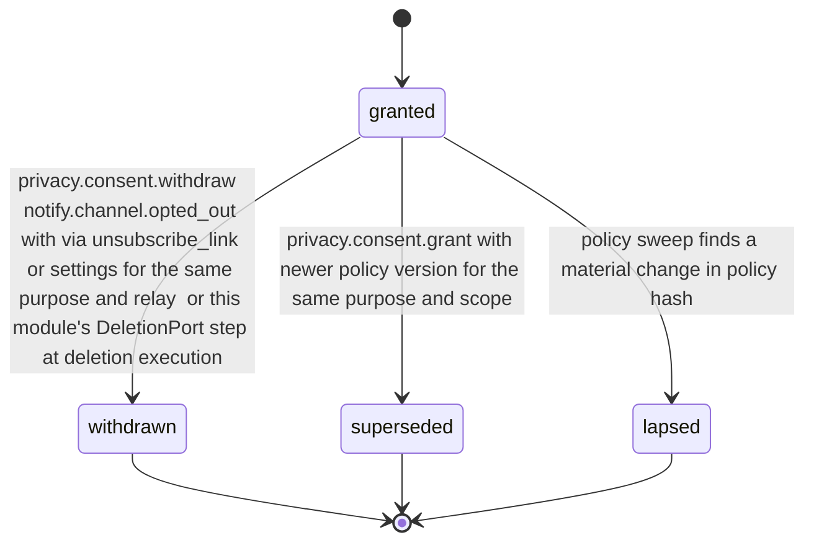

# PS-076-03 — Workflow state machine: Privacy consent

**Status:** SPECIFIED (Stage 3). **Module:** [F10.S01.M01 Privacy consent](SPEC.md) · **Scope:** MVP · **Code:** `packages/privacy/src/data_controls/consent` · **Contracts:** [CTR-PRV-001](../../../planning/contracts/CTR-PRV-001.md), [CTR-ID-001](../../../planning/contracts/CTR-ID-001.md), [CTR-EVT-001](../../../planning/contracts/CTR-EVT-001.md), [CTR-ERR-001](../../../planning/contracts/CTR-ERR-001.md), [CTR-CAP-001](../../../planning/contracts/CTR-CAP-001.md), [CTR-IDM-001](../../../planning/contracts/CTR-IDM-001.md), [CTR-FED-001](../../../planning/contracts/CTR-FED-001.md), [CTR-OBS-001](../../../planning/contracts/CTR-OBS-001.md), [CTR-FLG-001](../../../planning/contracts/CTR-FLG-001.md)

> Generated from `module.spec.yaml` by `tools/specgen`. Edit the YAML, then run `pnpm spec:render`.

## Requirements

- **PS-076-03.R01** A consent is granted until it is withdrawn, superseded by a newer grant or lapsed by a material policy change.
- **PS-076-03.R02** Withdrawal takes effect in the same local transaction and is final for that row; consent again means a new grant.
- **PS-076-03.R03** Lapse is evaluated at unlock and daily against the bundled policy versions, and a lapse of a federation consent queues the same signed withdrawal statement as an explicit withdrawal.

## Specification

### PrivacyConsent lifecycle

Initial **granted**; terminal **withdrawn**, **superseded**, **lapsed**.

| Transition | Trigger | Guard / effect |
|---|---|---|
| granted -> withdrawn | privacy.consent.withdraw; notify.channel.opted_out with via unsubscribe_link or settings for the same purpose and relay; or this module's DeletionPort step at deletion execution | emits privacy.consent.withdrawn; for federation_publish queues classrup.privacy.consent_withdrawal/v1 whose targetCid is the grant cid |
| granted -> superseded | privacy.consent.grant with newer policy version for the same purpose and scope | no event for the superseded row; the new row emits privacy.consent.granted and, for federation_publish, a new statement whose prev is the previous statement |
| granted -> lapsed | policy sweep finds a material change in policy hash | emits privacy.consent.withdrawn with reason policy_changed and, for federation_publish, queues the same signed withdrawal statement as withdraw |

### Timeouts and scheduled transitions

- Policy sweep at vault unlock and every 24 h while open.
- Outgoing withdrawal statements to one relay are coalesced within 5 s into one sync outbox batch.

## Verification

| Test | Level | Covers | Scenario | Expected |
|---|---|---|---|---|
| TEST-PS-076-09.T02 | unit | PS-076-01.R02, PS-076-03.R01 | grant, regrant with new version, withdraw | history keeps three rows with statuses superseded, then withdrawn; none edited |
| TEST-PS-076-09.T05 | property | PS-076-03.R01, PS-076-03.R02 | random grant and withdraw sequences | at most one granted row per purpose and relay; withdrawn rows never return to granted |
| TEST-PS-076-09.T06 | integration | PS-076-03.R03 | change policy hash with materialChange for a federation consent | consent lapses at unlock, privacy.consent.withdrawn emitted with reason policy_changed, check returns false, and a withdrawal statement naming the grant cid is queued for the relay |
| TEST-PS-076-09.T09 | integration | PS-076-04.R03, PS-076-03.R01 | notify.channel.opted_out delivered with via unsubscribe_link, settings, expired, account_deletion, privacy_withdrawal and relay_policy, for a matching and a non-matching relay | withdrawn only for unsubscribe_link (source unsubscribe) and settings (source ui) on the matching purpose and relay; every other case ignored; an already withdrawn consent and a replay are no-ops |

## Dependencies

Module depends on: F07.S01.M01, F11.S01.M01, F15.S01.M01, F15.S02.M01, F16.S02.M02, F12.S03.M03, F10.S02.M02, F10.S01.M02, F10.S01.M03, F10.S01.M04, CTR-PRV-001, CTR-ID-001, CTR-EVT-001, CTR-ERR-001, CTR-CAP-001, CTR-IDM-001, CTR-FED-001, CTR-OBS-001, CTR-FLG-001. Predecessor: [domain_schema.md](domain_schema.md).
