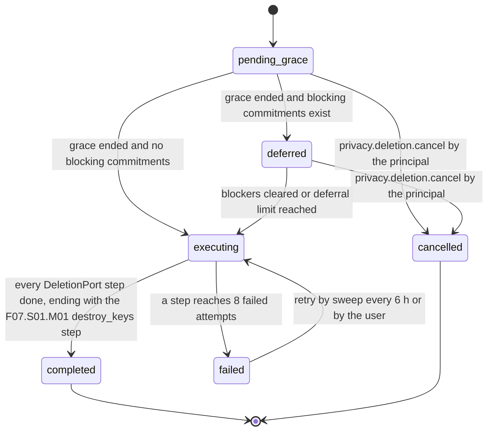

# PS-077-03 — Workflow state machine: Account and data deletion

**Status:** SPECIFIED (Stage 3). **Module:** [F10.S01.M04 Account and data deletion](SPEC.md) · **Scope:** MVP · **Code:** `packages/privacy/src/data_controls/delete` · **Contracts:** [CTR-PRV-001](../../../planning/contracts/CTR-PRV-001.md), [CTR-FED-001](../../../planning/contracts/CTR-FED-001.md), [CTR-ID-001](../../../planning/contracts/CTR-ID-001.md), [CTR-EVT-001](../../../planning/contracts/CTR-EVT-001.md), [CTR-ERR-001](../../../planning/contracts/CTR-ERR-001.md), [CTR-CAP-001](../../../planning/contracts/CTR-CAP-001.md), [CTR-IDM-001](../../../planning/contracts/CTR-IDM-001.md), [CTR-IOX-001](../../../planning/contracts/CTR-IOX-001.md), [CTR-OBS-001](../../../planning/contracts/CTR-OBS-001.md), [CTR-FLG-001](../../../planning/contracts/CTR-FLG-001.md)

> Generated from `module.spec.yaml` by `tools/specgen`. Edit the YAML, then run `pnpm spec:render`.

## Requirements

- **PS-077-03.R01** Deletion requests follow the declared machine; the point of no return is the transition to executing and the UI says so before the request.
- **PS-077-03.R02** Open commitments defer execution for at most 30 days and never silently extend further.
- **PS-077-03.R03** Execution is a resumable sequence of idempotent DeletionPort steps in a fixed order in which every signed statement is produced before any key is revoked or destroyed, and the final step is F07.S01.M01 destroying the device keys.
- **PS-077-03.R04** Cancellation emits privacy.deletion.cancelled; before execution, consumers of privacy.deletion.requested take only reversible actions (hide, pause) and never purge or tombstone, which belong to execution.

## Specification

### DeletionRequest lifecycle

Initial **pending_grace**; terminal **completed**, **cancelled**.

| Transition | Trigger | Guard / effect |
|---|---|---|
| pending_grace -> cancelled | privacy.deletion.cancel by the principal | salt destroyed; emits privacy.deletion.cancelled; nothing was signed or sent |
| pending_grace -> executing | grace ended and no blocking commitments | execution plan loaded |
| pending_grace -> deferred | grace ended and blocking commitments exist | deferredUntil = graceEndsAt + 30 days; blockers listed |
| deferred -> cancelled | privacy.deletion.cancel by the principal | salt destroyed; emits privacy.deletion.cancelled |
| deferred -> executing | blockers cleared or deferral limit reached | counterparties of remaining commitments receive a deletion notice signed in the sign step |
| executing -> completed | every DeletionPort step done, ending with the F07.S01.M01 destroy_keys step | did and salt removed; record and ledger entry kept in the residue store; emits privacy.deletion.completed as a notification only |
| executing -> failed | a step reaches 8 failed attempts | emits nothing; user and diagnostics show the failing module |
| failed -> executing | retry by sweep every 6 h or by the user | steps resume |

### Timeouts and scheduled transitions

- Grace 14 days; deferral at most 30 days; step retry up to 8 attempts with backoff 1 s, 5 s, 30 s, 5 min, then every 6 h.
- Ledger kept 180 days after completion; residue outbox delivers signed statements for 30 days after signing; blockers re-evaluated at unlock and every 6 h while deferred.

## Verification

| Test | Level | Covers | Scenario | Expected |
|---|---|---|---|---|
| TEST-PS-077-09.T02 | unit | PS-077-03.R01, PS-077-03.R04 | cancel at day 13; try to cancel while executing | cancelled with salt destroyed and privacy.deletion.cancelled emitted; executing refuses with CONFLICT_STATE |
| TEST-PS-077-09.T03 | unit | PS-077-02.R02, PS-077-03.R02 | commitments open at day 14, then clear at day 20, then limit reached | deferred then executing; at day 44 execution proceeds with notices sent |
| TEST-PS-077-09.T04 | integration | PS-077-03.R03, PS-077-06.R02, PS-077-06.R03 | kill the app after each step and reopen | execution resumes from persisted state; keys destroyed only after all earlier steps done |
| TEST-PS-077-09.T05 | property | PS-077-03.R01 | random event and time sequences | only declared transitions succeed; completed and cancelled have no exits |
| TEST-PS-077-09.T20 | integration | PS-077-03.R03, PS-077-04.R04 | execution with recording stub ports for F11.S01.M02, F10.S01.M01, F07.S01.M01 and a blob module | every sign step (tombstones, consent withdrawals, deletion statements, notices) runs before revoke_keys, nothing is signed after it, destroy_keys runs last, and F11.S01.M02 issues tombstones only at execution |
| TEST-PS-077-09.T26 | integration | PS-077-04.R06, PS-077-04.R07, PS-077-03.R03 | execution with stub registrants in the kernel port registry for F07.S01.M01, F08.S01.M01, F08.S01.M03, F15.S01.M01 and F15.S04.M03 and recording order | F07 handle releases, identity document tombstone and relay session revocations, F08 message and attachment deletes and mailbox closes all run in sign before revoke_keys and destroy_keys; F15.S01.M01 moves pending signed entries to the residue outbox; F15.S04.M03 local settings are purged; no registrant needs a depends_on edge to this module |

## Dependencies

Module depends on: F10.S01.M02, F10.S01.M03, F07.S01.M01, F16.S02.M02, F11.S01.M01, F15.S01.M01, F15.S02.M02, F10.S02.M02, CTR-PRV-001, CTR-FED-001, CTR-ID-001, CTR-EVT-001, CTR-ERR-001, CTR-CAP-001, CTR-IDM-001, CTR-IOX-001, CTR-OBS-001, CTR-FLG-001. Predecessor: [domain_schema.md](domain_schema.md).
