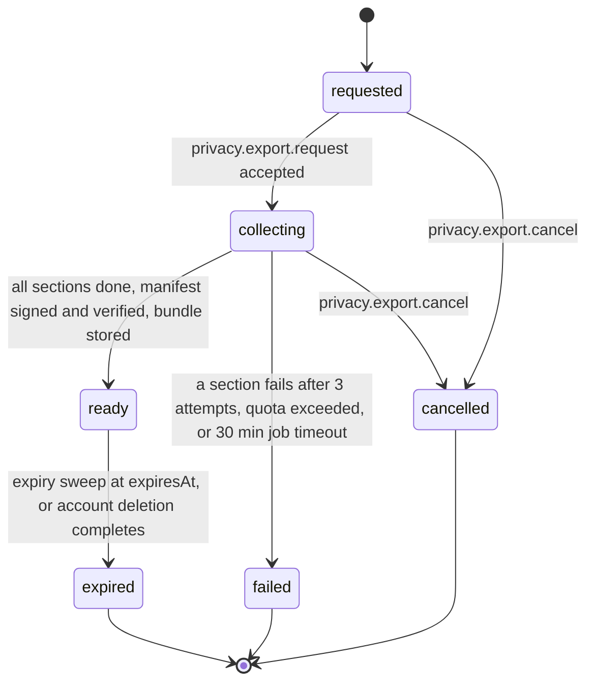

# PS-078-03 — Workflow state machine: Data export

**Status:** SPECIFIED (Stage 3). **Module:** [F10.S01.M03 Data export](SPEC.md) · **Scope:** MVP · **Code:** `packages/privacy/src/data_controls/export` · **Contracts:** [CTR-IOX-001](../../../planning/contracts/CTR-IOX-001.md), [CTR-PRV-001](../../../planning/contracts/CTR-PRV-001.md), [CTR-ID-001](../../../planning/contracts/CTR-ID-001.md), [CTR-EVT-001](../../../planning/contracts/CTR-EVT-001.md), [CTR-ERR-001](../../../planning/contracts/CTR-ERR-001.md), [CTR-CAP-001](../../../planning/contracts/CTR-CAP-001.md), [CTR-IDM-001](../../../planning/contracts/CTR-IDM-001.md), [CTR-FED-001](../../../planning/contracts/CTR-FED-001.md), [CTR-OBS-001](../../../planning/contracts/CTR-OBS-001.md)

> Generated from `module.spec.yaml` by `tools/specgen`. Edit the YAML, then run `pnpm spec:render`.

## Requirements

- **PS-078-03.R01** Export jobs follow the declared machine; any transition not listed is refused with CONFLICT_STATE.
- **PS-078-03.R02** A job is ready only after all sections are done, the manifest is signed and verified, and the bundle is stored.
- **PS-078-03.R03** Expiry after 7 days deletes the bundle and shreds its key; failure and cancel delete partial files immediately.

## Specification

### ExportJob lifecycle

Initial **requested**; terminal **failed**, **expired**, **cancelled**.

| Transition | Trigger | Guard / effect |
|---|---|---|
| requested -> collecting | privacy.export.request accepted | sections discovered; first section started |
| collecting -> ready | all sections done, manifest signed and verified, bundle stored | sets expiresAt = readyAt + 7 days; emits privacy.export.ready |
| collecting -> failed | a section fails after 3 attempts, quota exceeded, or 30 min job timeout | partial files deleted; emits privacy.export.failed |
| requested -> cancelled | privacy.export.cancel | no files yet |
| collecting -> cancelled | privacy.export.cancel | partial files deleted |
| ready -> expired | expiry sweep at expiresAt, or account deletion completes | bundle deleted and key shredded; emits privacy.export.expired |

### Timeouts and scheduled transitions

- Section timeout 5 min with 3 attempts; job timeout 30 min; resume window after PWA close 24 h.
- Bundle expiry 7 days after readyAt; expiry sweep every 5 min while open and at unlock.

## Verification

| Test | Level | Covers | Scenario | Expected |
|---|---|---|---|---|
| TEST-PS-078-09.T02 | integration | PS-078-01.R02, PS-078-03.R02 | complete an export and inspect storage | bundle is an encrypted file, job holds only hashes and sizes, no content or key |
| TEST-PS-078-09.T04 | integration | PS-078-02.R02, PS-078-03.R01 | module section throws after 3 attempts | job failed naming the module; no partial bundle; PRIVACY_EXPORT_SECTION_FAILED |
| TEST-PS-078-09.T05 | property | PS-078-03.R01 | random command and time sequences | only declared transitions succeed; terminal states have no exits |
| TEST-PS-078-09.T06 | integration | PS-078-03.R03, PS-078-04.R03 | clock advanced 7 days and account deletion completes | bundle deleted, key shredded, privacy.export.expired emitted with the right reason |

## Dependencies

Module depends on: F07.S01.M01, F10.S01.M01, CTR-IOX-001, CTR-PRV-001, CTR-ID-001, CTR-EVT-001, CTR-ERR-001, CTR-CAP-001, CTR-IDM-001, CTR-FED-001, CTR-OBS-001. Predecessor: [domain_schema.md](domain_schema.md).
