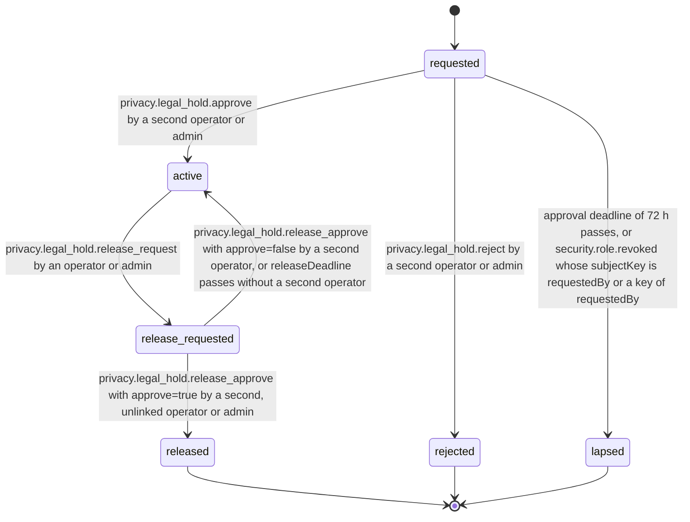

# PS-079-03 — Workflow state machine: Retention and legal hold

**Status:** SPECIFIED (Stage 3). **Module:** [F10.S01.M02 Retention and legal hold](SPEC.md) · **Scope:** MVP · **Code:** `packages/privacy/src/data_controls/retention` · **Contracts:** [CTR-PRV-001](../../../planning/contracts/CTR-PRV-001.md), [CTR-ID-001](../../../planning/contracts/CTR-ID-001.md), [CTR-EVT-001](../../../planning/contracts/CTR-EVT-001.md), [CTR-ERR-001](../../../planning/contracts/CTR-ERR-001.md), [CTR-CAP-001](../../../planning/contracts/CTR-CAP-001.md), [CTR-IDM-001](../../../planning/contracts/CTR-IDM-001.md), [CTR-IOX-001](../../../planning/contracts/CTR-IOX-001.md), [CTR-OBS-001](../../../planning/contracts/CTR-OBS-001.md), [CTR-FLG-001](../../../planning/contracts/CTR-FLG-001.md)

> Generated from `module.spec.yaml` by `tools/specgen`. Edit the YAML, then run `pnpm spec:render`.

## Requirements

- **PS-079-03.R01** Legal holds follow the declared machine and every activation and release needs two different, unlinked operators of whom at least one is a relay admin.
- **PS-079-03.R02** An active hold excludes its subject from every sweep and relay purge until released.
- **PS-079-03.R03** Retention policy rows have no lifecycle; a change creates a new revision effective from the next sweep.

## Specification

### LegalHold lifecycle

Initial **requested**; terminal **released**, **rejected**, **lapsed**.

| Transition | Trigger | Guard / effect |
|---|---|---|
| requested -> active | privacy.legal_hold.approve by a second operator or admin | approver differs from and is not linked to the requester and at least one of them is admin; emits privacy.legal_hold.placed |
| requested -> rejected | privacy.legal_hold.reject by a second operator or admin | no data is held |
| requested -> lapsed | approval deadline of 72 h passes, or security.role.revoked whose subjectKey is requestedBy or a key of requestedBy | no data is held |
| active -> release_requested | privacy.legal_hold.release_request by an operator or admin | audited; releaseDeadline = now + 72 h |
| release_requested -> released | privacy.legal_hold.release_approve with approve=true by a second, unlinked operator or admin | at least one of the pair is admin; emits privacy.legal_hold.released |
| release_requested -> active | privacy.legal_hold.release_approve with approve=false by a second operator, or releaseDeadline passes without a second operator | hold continues; audited and operators reminded |

### Timeouts and scheduled transitions

- Approval deadline 72 h from request; release deadline 72 h from release request; review reminder to operators at activeSince + 180 days, repeated every 30 days until a review is recorded.
- Sweep schedule: relay daily at 02:30 relay time; vault at the first unlock after 24 h; run timeout 20 min.

## Verification

| Test | Level | Covers | Scenario | Expected |
|---|---|---|---|---|
| TEST-PS-079-09.T03 | unit | PS-079-02.R02, PS-079-03.R01, PS-079-07.R03 | A requests and A approves; B approves A's request; C approves A's request; C requests release and C approves it; B approves C's release; D approves A's request | self and linked approvals refused with PRIVACY_HOLD_SELF_APPROVAL; operator-only pair refused with FORBIDDEN; admin-plus-operator pairs succeed |
| TEST-PS-079-09.T04 | integration | PS-079-03.R01, PS-079-03.R03 | 72 h without approval; requester role revoked; release request unanswered for 72 h; release declined with approve=false; policy change | hold lapses; release returns to active in both release cases; policy revision effective at next sweep |
| TEST-PS-079-09.T05 | integration | PS-079-03.R02 | sweep with records at each age and one under active hold; tombstone and relay_apply purge of a held subject | expired records purged, held record untouched by every path |
| TEST-PS-079-09.T06 | property | PS-079-03.R01 | random hold command sequences | only declared transitions succeed; terminal states have no exits |

## Dependencies

Module depends on: F18.S01.M01, F16.S01.M01, F15.S02.M02, F10.S02.M02, CTR-PRV-001, CTR-ID-001, CTR-EVT-001, CTR-ERR-001, CTR-CAP-001, CTR-IDM-001, CTR-IOX-001, CTR-OBS-001, CTR-FLG-001. Predecessor: [domain_schema.md](domain_schema.md).
