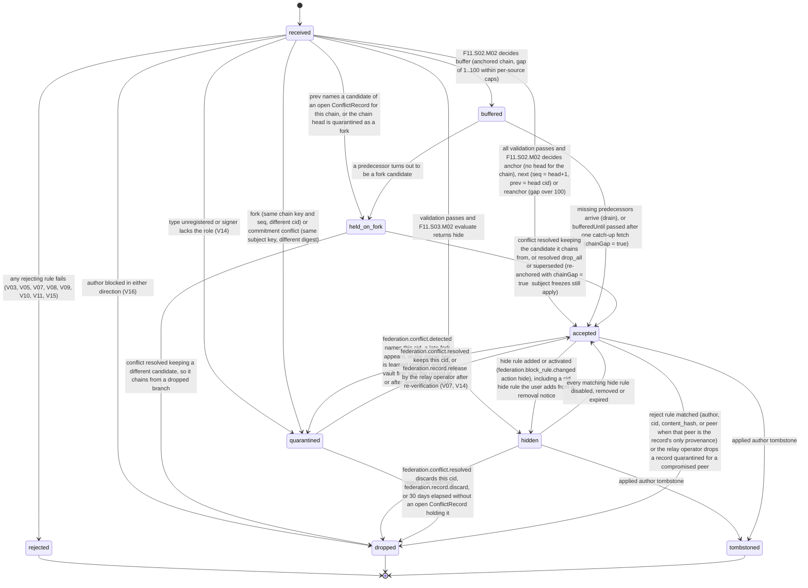
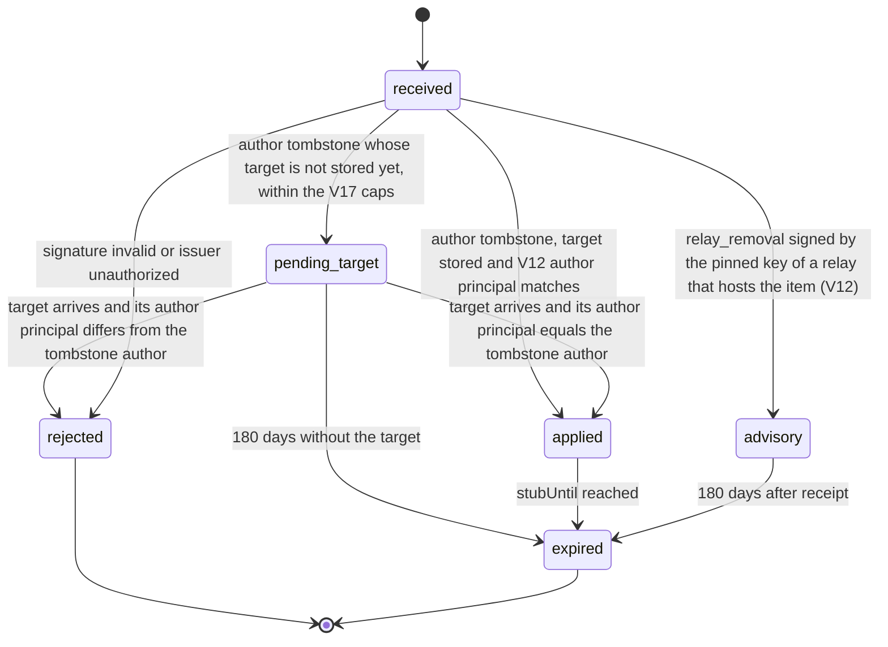

# PS-084-03 — Workflow state machine: Federated records

**Status:** SPECIFIED (Stage 3). **Module:** [F11.S01.M02 Federated records](SPEC.md) · **Scope:** MVP · **Code:** `packages/federation/src/protocol/records` · **Contracts:** [CTR-FED-001](../../../planning/contracts/CTR-FED-001.md), [CTR-ID-001](../../../planning/contracts/CTR-ID-001.md), [CTR-EVT-001](../../../planning/contracts/CTR-EVT-001.md), [CTR-ERR-001](../../../planning/contracts/CTR-ERR-001.md), [CTR-CAP-001](../../../planning/contracts/CTR-CAP-001.md), [CTR-PRV-001](../../../planning/contracts/CTR-PRV-001.md), [CTR-IDM-001](../../../planning/contracts/CTR-IDM-001.md), [CTR-FLG-001](../../../planning/contracts/CTR-FLG-001.md), [CTR-OBS-001](../../../planning/contracts/CTR-OBS-001.md), [CTR-IOX-001](../../../planning/contracts/CTR-IOX-001.md)

> Generated from `module.spec.yaml` by `tools/specgen`. Edit the YAML, then run `pnpm spec:render`.

## Requirements

- **PS-084-03.R01** Envelopes move only along the declared FederatedRecord and Tombstone transitions; any other transition is refused with CONFLICT_STATE.
- **PS-084-03.R02** A record becomes visible to readers only in status accepted; buffered, held_on_fork, hidden and quarantined records are never served.
- **PS-084-03.R03** Tombstoned, rejected and dropped are terminal, so a rejected envelope can only be reconsidered by a new submission and purged content cannot be restored; hidden is reversible and never purges.
- **PS-084-03.R04** Every non-terminal state has an exit; buffered records are released (with chainGap when predecessors never arrive), held_on_fork records follow the conflict resolution, and quarantined records are discarded, released, resolved or dropped after 30 days unless an open conflict holds them.
- **PS-084-03.R05** A pending tombstone is never applied without checking its issuer against the arriving target; a tombstone whose issuer does not match is rejected and the target accepted.

## Specification

### FederatedRecord lifecycle

Initial **received**; terminal **rejected**, **dropped**, **tombstoned**.

| Transition | Trigger | Guard / effect |
|---|---|---|
| received -> accepted | all validation passes and F11.S02.M02 decides anchor (no head for the chain), next (seq = head+1, prev = head cid) or reanchor (gap over 100) | stores row with signerRole; emits federation.record.accepted; vault: signs an ack when audience participants and the principal is in recipients |
| received -> hidden | validation passes and F11.S03.M02 evaluate returns hide | stored with hiddenByRuleIds, not served, no record.accepted until unhidden |
| received -> buffered | F11.S02.M02 decides buffer (anchored chain, gap of 1..100 within per-source caps) | bufferedUntil = receivedAt + 24 h |
| received -> held_on_fork | prev names a candidate of an open ConflictRecord for this chain, or the chain head is quarantined as a fork | held without the 24 h drop until the conflict is resolved |
| received -> quarantined | type unregistered or signer lacks the role (V14) | statusReason signer_role_invalid, not acted on; principal or operator may discard |
| received -> quarantined | fork (same chain key and seq, different cid) or commitment conflict (same subject key, different digest) | federation.conflict.detect in the same transaction; every candidate quarantined in that transaction; dependent coordination frozen |
| received -> rejected | any rejecting rule fails (V03, V05, V07, V08, V09, V10, V11, V15) | cid stub only; emits federation.record.rejected |
| received -> dropped | author blocked in either direction (V16) | silent: no ack, no event, generic outcome; statusReason blocked_party |
| buffered -> accepted | missing predecessors arrive (drain), or bufferedUntil passed after one catch-up fetch (chainGap = true) | emits federation.record.accepted for each released record in seq order |
| buffered -> held_on_fork | a predecessor turns out to be a fork candidate | waits for the conflict resolution |
| held_on_fork -> accepted | conflict resolved keeping the candidate it chains from, or resolved drop_all or superseded (re-anchored with chainGap = true; subject freezes still apply) | emits federation.record.accepted |
| held_on_fork -> dropped | conflict resolved keeping a different candidate, so it chains from a dropped branch | purges content; statusReason superseded |
| accepted -> quarantined | federation.conflict.detected names this cid, a late fork appears, or the signer key is learned revoked and this vault first saw the record at or after revokesEffectiveAt | hides from readers; statusReason fork, commitment_conflict or signer_key_revoked |
| accepted -> hidden | hide rule added or activated (federation.block_rule.changed action hide), including a cid hide rule the user adds from a removal notice | reversible; no purge |
| hidden -> accepted | every matching hide rule disabled, removed or expired | emits federation.record.accepted |
| hidden -> tombstoned | applied author tombstone | purge within 1 h; emits federation.tombstone.applied |
| hidden -> dropped | reject rule matched | purge; statusReason blocked |
| quarantined -> accepted | federation.conflict.resolved keeps this cid, or federation.record.release by the relay operator after re-verification (V07, V14) | emits federation.record.accepted |
| quarantined -> dropped | federation.conflict.resolved discards this cid, federation.record.discard, or 30 days elapsed without an open ConflictRecord holding it | purges content; emits federation.record.rejected with reason discarded, superseded or quarantine_expired |
| accepted -> tombstoned | applied author tombstone | content purged within 1 h of trigger (deadline 24 h); stub kept; emits federation.tombstone.applied |
| accepted -> dropped | reject rule matched (author, cid, content_hash, or peer when that peer is the record's only provenance) or the relay operator drops a record quarantined for a compromised peer | purge; stub {cid, statusReason}; a re-delivery after the rule is removed is processed from scratch |

### Tombstone lifecycle

Initial **received**; terminal **rejected**, **expired**.

| Transition | Trigger | Guard / effect |
|---|---|---|
| received -> applied | author tombstone, target stored and V12 author principal matches | purges target content, sets stubUntil = now + max(180 days, target maxAge), emits federation.tombstone.applied |
| received -> pending_target | author tombstone whose target is not stored yet, within the V17 caps | kept up to 180 days; never applied before its target arrives |
| pending_target -> applied | target arrives and its author principal equals the tombstone author | the target is rejected FEDERATION_TOMBSTONED; emits federation.tombstone.applied |
| pending_target -> rejected | target arrives and its author principal differs from the tombstone author | target accepted normally; emits federation.record.rejected for the tombstone |
| pending_target -> expired | 180 days without the target | row deleted |
| received -> advisory | relay_removal signed by the pinned key of a relay that hosts the item (V12) | issuing relay: item removed from its own index; other relays: queued for operator review only; vault: notice on the record, optional local hide rule, ignored in the author's own vault; emits federation.tombstone.applied with issuerKind origin_relay and advisory true |
| received -> rejected | signature invalid or issuer unauthorized | emits federation.record.rejected |
| applied -> expired | stubUntil reached | stub deleted by retention sweep |
| advisory -> expired | 180 days after receipt | deleted by retention sweep |

### Timeouts and scheduled transitions

- Gap-buffer sweep every 5 min: buffered records with bufferedUntil ≤ now get one catch-up fetch from the relays in the author's portable document and are then accepted with chainGap = true; nothing is dropped for a gap.
- Pending tombstone sweep daily: pending_target tombstones with pendingUntil ≤ now become expired.
- Quarantine sweep daily: quarantined records older than 30 days that no open ConflictRecord holds move to dropped (quarantine_expired).
- Purge sweep every 5 min removes content for records whose author tombstone, reject rule or operator drop is older than 1 h; any item older than 24 h raises alert classrup_federation_purge_overdue_total.
- Tombstone retention sweep daily deletes stubs with stubUntil ≤ now and advisories older than 180 days.

## Verification

| Test | Level | Covers | Scenario | Expected |
|---|---|---|---|---|
| TEST-PS-084-09.T04 | property | PS-084-03.R01, PS-084-03.R03 | random sequences of arrivals, gaps, forks, tombstones, hide and reject rules, discards and releases | only declared transitions occur; terminal states never change; only accepted records are readable; hidden records return to accepted with their envelope when rules are removed |
| TEST-PS-084-09.T05 | integration | PS-084-01.R05, PS-084-03.R02 | anchored public chain: seq 7 before seq 6, then seq 6 | seq 7 buffered and not served, then both accepted in order; events emitted in seq order |
| TEST-PS-084-09.T06 | integration | PS-084-03.R04 | seq 7 buffered and 24 h pass without seq 6 | one catch-up fetch attempted, then seq 7 accepted with chainGap true and never dropped |
| TEST-PS-084-09.T07 | integration | PS-084-01.R02, PS-084-03.R03, PS-084-07.R03 | valid owner tombstone for an accepted record | content purged within 1 h, tombstone applied with stubUntil ≥ appliedAt + max(180 days, target maxAge), event emitted |
| TEST-PS-084-09.T09 | integration | PS-084-03.R05, PS-084-01.R02 | author tombstone arrives before its target, 25 h pass, then the target signed by the same author arrives | tombstone still pending_target after 24 h (never applied unchecked); on arrival the target is rejected FEDERATION_TOMBSTONED and the tombstone becomes applied |
| TEST-PS-084-09.T10 | abuse | PS-084-03.R05, PS-084-02.R01 | third party signs a pre-emptive tombstone for X's record not yet seen; X's record arrives 2 days later; one issuer sends 51 tombstones for unseen targets | tombstone rejected on arrival and X's record accepted; the 51st refused with RATE_LIMITED |
| TEST-PS-084-09.T13 | integration | PS-084-03.R04, PS-084-07.R01 | two envelopes with the same chain key and seq and different cids, then seq + 1 chaining from one of them, then the conflict resolved keeping that one | both quarantined and hidden; the successor held_on_fork beyond 24 h; after resolution the successor accepted and the other candidate dropped |
| TEST-PS-084-09.T25 | integration | PS-084-03.R04, PS-084-05.R01 | vault receives an accept-offer statement signed by a key that is not the listing author; the user discards it; a second one is left untouched for 30 days | quarantined signer_role_invalid with no domain event; discard moves it to dropped; the second is dropped by the quarantine sweep |
| TEST-PS-084-09.T22 | integration | PS-084-08.R04, PS-084-03.R03 | 10 000 tombstoned mirrors and delayed purge | sweep ≤ 10 s; purge_lag alert fires when lag exceeds 1 h |
| TEST-PS-084-09.T29 | abuse | PS-084-07.R03, PS-084-03.R03 | relay R1's operator issues relay_removal (moderation_removed) with a statement of reasons for X's listing that R2 and vault V1 also hold | R1's index drops it; R2's mirror stays accepted and only enters R2's review queue; V1 keeps it with a removal notice; X's own vault ignores it and X republishes on another relay without FEDERATION_TOMBSTONED |
| TEST-PS-084-09.T35 | integration | PS-084-03.R02, PS-084-03.R03 | personal hide rule on author Z then undo; reject rule on author Z; peer reject rule on relay B for records whose only provenance is B | hidden then accepted with envelope intact; reject purges to dropped; only B-only records dropped |

## Dependencies

Module depends on: F11.S01.M01, F11.S01.M03, F11.S02.M02, F11.S02.M03, F11.S03.M01, F11.S03.M02, F07.S02.M01, F07.S02.M02, F15.S04.M02, F12.S03.M03, F10.S01.M01, F10.S01.M02, F10.S01.M03, F10.S01.M04, F10.S02.M02, CTR-FED-001, CTR-ID-001, CTR-EVT-001, CTR-ERR-001, CTR-CAP-001, CTR-PRV-001, CTR-IDM-001, CTR-FLG-001, CTR-OBS-001, CTR-IOX-001. Predecessor: [domain_schema.md](domain_schema.md).
