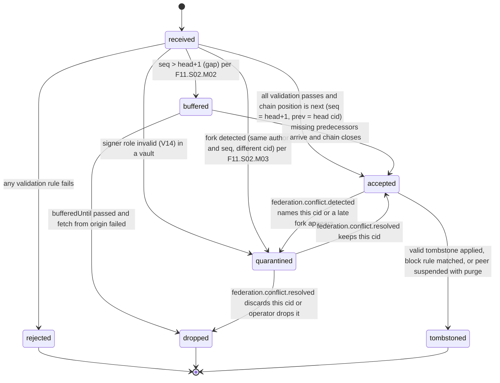
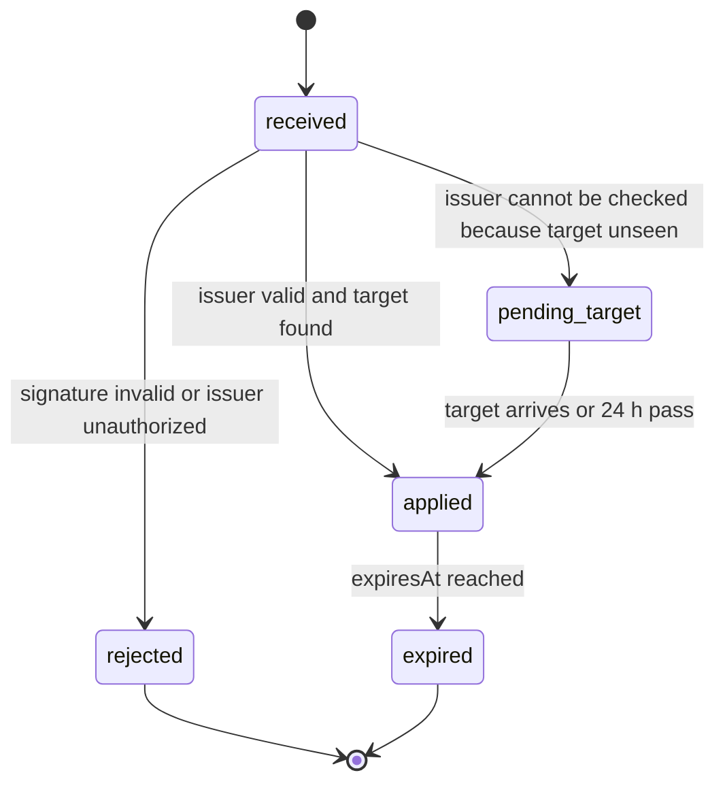

# PS-084-03 — Workflow state machine: Federated records

**Status:** SPECIFIED (Stage 3). **Module:** [F11.S01.M02 Federated records](SPEC.md) · **Scope:** MVP · **Code:** `packages/federation/src/protocol/records` · **Contracts:** [CTR-FED-001](../../../planning/contracts/CTR-FED-001.md), [CTR-ID-001](../../../planning/contracts/CTR-ID-001.md), [CTR-EVT-001](../../../planning/contracts/CTR-EVT-001.md), [CTR-ERR-001](../../../planning/contracts/CTR-ERR-001.md), [CTR-CAP-001](../../../planning/contracts/CTR-CAP-001.md), [CTR-PRV-001](../../../planning/contracts/CTR-PRV-001.md), [CTR-IDM-001](../../../planning/contracts/CTR-IDM-001.md), [CTR-FLG-001](../../../planning/contracts/CTR-FLG-001.md), [CTR-OBS-001](../../../planning/contracts/CTR-OBS-001.md), [CTR-IOX-001](../../../planning/contracts/CTR-IOX-001.md)

> Generated from `module.spec.yaml` by `tools/specgen`. Edit the YAML, then run `pnpm spec:render`.

## Requirements

- **PS-084-03.R01** Envelopes move only along the declared FederatedRecord and Tombstone transitions; any other transition is refused with CONFLICT_STATE.
- **PS-084-03.R02** A record becomes visible to readers only in status accepted; buffered and quarantined records are never served.
- **PS-084-03.R03** Tombstoned and rejected are terminal, so a rejected envelope can only be reconsidered by a new submission and a purged record cannot be restored.

## Specification

### FederatedRecord lifecycle

Initial **received**; terminal **rejected**, **dropped**, **tombstoned**.

| Transition | Trigger | Guard / effect |
|---|---|---|
| received -> accepted | all validation passes and chain position is next (seq = head+1, prev = head cid) | stores row, emits federation.record.accepted |
| received -> buffered | seq > head+1 (gap) per F11.S02.M02 | sets bufferedUntil = receivedAt + 24 h |
| received -> quarantined | signer role invalid (V14) in a vault | stored with statusReason signer_role_invalid, not acted on, user may discard |
| received -> quarantined | fork detected (same author and seq, different cid) per F11.S02.M03 | both candidates quarantined and dependent coordination frozen for explicit renegotiation (no last-writer-wins); emits via federation.conflict.detected |
| received -> rejected | any validation rule fails | no row content stored beyond cid stub; emits federation.record.rejected |
| buffered -> accepted | missing predecessors arrive and chain closes | emits federation.record.accepted for each released record in seq order |
| buffered -> dropped | bufferedUntil passed and fetch from origin failed | emits federation.record.rejected reason gap_timeout |
| accepted -> quarantined | federation.conflict.detected names this cid or a late fork appears | hides from readers |
| quarantined -> accepted | federation.conflict.resolved keeps this cid | emits federation.record.accepted |
| quarantined -> dropped | federation.conflict.resolved discards this cid or operator drops it | purges content |
| accepted -> tombstoned | valid tombstone applied, block rule matched, or peer suspended with purge | content purged within 1 h of trigger (deadline 24 h); emits federation.tombstone.applied for tombstones |

### Tombstone lifecycle

Initial **received**; terminal **rejected**, **expired**.

| Transition | Trigger | Guard / effect |
|---|---|---|
| received -> applied | issuer valid and target found | purges target content, sets expiresAt = now + 180 days, emits federation.tombstone.applied |
| received -> pending_target | issuer cannot be checked because target unseen | waits up to 24 h for the target or its author binding |
| pending_target -> applied | target arrives or 24 h pass | stored as applied so a later arrival of the target is rejected as FEDERATION_TOMBSTONED; emits federation.tombstone.applied |
| received -> rejected | signature invalid or issuer unauthorized | emits federation.record.rejected |
| applied -> expired | expiresAt reached | tombstone row deleted by retention sweep |

### Timeouts and scheduled transitions

- Gap-buffer sweep every 5 min moves buffered records with bufferedUntil ≤ now to dropped (reason gap_timeout) after one fetch attempt from the origin.
- Pending tombstone sweep every 5 min applies pending_target tombstones older than 24 h.
- Purge sweep every 5 min removes content for records whose tombstone, block rule or suspension is older than 1 h; any item older than 24 h raises alert classrup_federation_purge_overdue_total.
- Tombstone retention sweep daily deletes tombstones with expiresAt ≤ now.

## Verification

| Test | Level | Covers | Scenario | Expected |
|---|---|---|---|---|
| TEST-PS-084-09.T04 | property | PS-084-03.R01, PS-084-03.R03 | random sequences of arrivals, gaps, tombstones and conflicts | only declared transitions occur; terminal states never change; only accepted records are readable |
| TEST-PS-084-09.T05 | integration | PS-084-03.R02, PS-084-01.R02 | seq 7 before seq 6, then seq 6 | seq 7 buffered then both accepted in order; events emitted in seq order |
| TEST-PS-084-09.T06 | integration | PS-084-03.R01, PS-084-07.R01 | seq 7 buffered and 24 h pass | record dropped with reason gap_timeout and one origin fetch attempted |
| TEST-PS-084-09.T07 | integration | PS-084-01.R02, PS-084-03.R03, PS-084-07.R02 | valid owner tombstone for accepted record | content purged within 1 h, tombstone applied with expiresAt = appliedAt + 180 days, event emitted |
| TEST-PS-084-09.T08 | abuse | PS-084-03.R03, PS-084-07.R01 | resend the tombstoned envelope, and an envelope dated 181 days ago | FEDERATION_TOMBSTONED and FEDERATION_RECORD_TIME_INVALID; no resurrection |
| TEST-PS-084-09.T09 | integration | PS-084-03.R01, PS-084-07.R02 | tombstone arrives before target | pending_target then applied after 24 h; later target rejected FEDERATION_TOMBSTONED |
| TEST-PS-084-09.T13 | integration | PS-084-03.R01, PS-084-07.R01, PS-084-08.R02 | two envelopes same author and seq with different cids | both quarantined, hidden from reads, federation.conflict.detected consumed |
| TEST-PS-084-09.T25 | integration | PS-084-01.R04, PS-084-02.R01, PS-084-03.R01 | vault receives accept-offer statement signed by a key that is not the listing author | quarantined with statusReason signer_role_invalid, no domain event, user can discard |
| TEST-PS-084-09.T22 | integration | PS-084-08.R03, PS-084-08.R04, PS-084-03.R03 | 10 000 tombstoned mirrors and delayed purge | sweep ≤ 10 s; purge_lag alert fires when lag exceeds 1 h |

## Dependencies

Module depends on: F11.S01.M01, F11.S01.M03, F11.S02.M02, F11.S02.M03, F11.S03.M01, F11.S03.M02, F07.S02.M01, F15.S04.M02, F10.S02.M02, CTR-FED-001, CTR-ID-001, CTR-EVT-001, CTR-ERR-001, CTR-CAP-001, CTR-PRV-001, CTR-IDM-001, CTR-FLG-001, CTR-OBS-001, CTR-IOX-001. Predecessor: [domain_schema.md](domain_schema.md).
