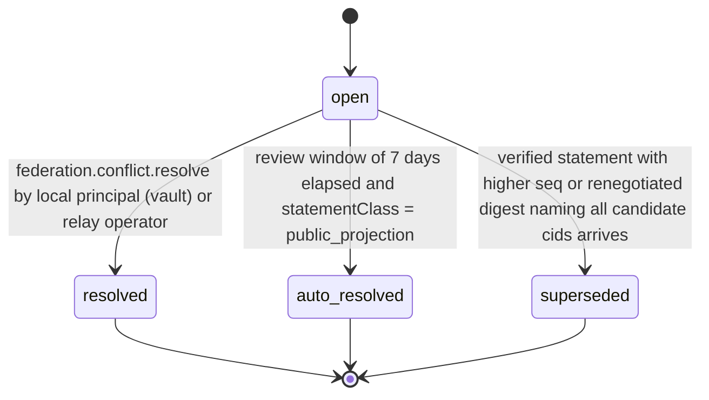

# PS-086-03 — Workflow state machine: Federated conflicts

**Status:** SPECIFIED (Stage 3). **Module:** [F11.S02.M03 Federated conflicts](SPEC.md) · **Scope:** MVP · **Code:** `packages/federation/src/relay_sync/conflicts` · **Contracts:** [CTR-FED-001](../../../planning/contracts/CTR-FED-001.md), [CTR-ID-001](../../../planning/contracts/CTR-ID-001.md), [CTR-EVT-001](../../../planning/contracts/CTR-EVT-001.md), [CTR-ERR-001](../../../planning/contracts/CTR-ERR-001.md), [CTR-CAP-001](../../../planning/contracts/CTR-CAP-001.md), [CTR-IDM-001](../../../planning/contracts/CTR-IDM-001.md), [CTR-OBS-001](../../../planning/contracts/CTR-OBS-001.md), [CTR-IOX-001](../../../planning/contracts/CTR-IOX-001.md), [CTR-PRV-001](../../../planning/contracts/CTR-PRV-001.md)

> Generated from `module.spec.yaml` by `tools/specgen`. Edit the YAML, then run `pnpm spec:render`.

## Requirements

- **PS-086-03.R01** Conflicts move only along the declared transitions and any other transition is refused with CONFLICT_STATE.
- **PS-086-03.R02** Public projections may auto-resolve by origin-wins after 7 days; commitments may only be resolved by a person or superseded by a renegotiated signed statement.
- **PS-086-03.R03** Resolution is recorded permanently and never rewrites the signed candidates.

## Specification

### ConflictRecord lifecycle

Initial **open**; terminal **resolved**, **auto_resolved**, **superseded**.

| Transition | Trigger | Guard / effect |
|---|---|---|
| open -> resolved | federation.conflict.resolve by local principal (vault) or relay operator | records decision keep or drop_all, emits federation.conflict.resolved |
| open -> auto_resolved | review window of 7 days elapsed and statementClass = public_projection | keeps the candidate first received from the relay bound to the author (origin_wins), emits federation.conflict.resolved |
| open -> superseded | verified statement with higher seq or renegotiated digest naming all candidate cids arrives | records supersededByCid, emits federation.conflict.resolved |

### Timeouts and scheduled transitions

- Auto-resolution sweep every 15 min applies origin-wins to public_projection conflicts open longer than 7 days.
- Reminder after 24 h and again after 7 days for open commitment conflicts; no automatic resolution at any age.

## Verification

| Test | Level | Covers | Scenario | Expected |
|---|---|---|---|---|
| TEST-PS-086-09.T03 | property | PS-086-03.R01, PS-086-03.R03 | random command sequences on one conflict | only declared transitions succeed; terminal states never change; candidates never altered |
| TEST-PS-086-09.T04 | integration | PS-086-03.R02, PS-086-04.R03, PS-086-07.R02 | public conflict untouched for 7 days with a bound origin | auto_resolved origin_wins keeps the first-received-from-origin cid; event emitted |
| TEST-PS-086-09.T05 | integration | PS-086-03.R02, PS-086-01.R03 | commitment conflict C1 vs C2 for 30 days | still open; freezeScope contains the proposal; resolve with origin_wins returns FEDERATION_CONFLICT_NOT_AUTO_RESOLVABLE |
| TEST-PS-086-09.T06 | integration | PS-086-03.R03, PS-086-04.R01 | author publishes E8 with ext.supersedes naming both cids | conflict superseded with supersededByCid; resolved event emitted |
| TEST-PS-086-09.T13 | integration | PS-086-07.R02, PS-086-03.R03 | relay with ciphertext commitment statements | relay stores no plaintext and refuses to resolve commitment conflicts |
| TEST-PS-086-09.T15 | e2e | PS-086-01.R03, PS-086-03.R02 | two vaults receive conflicting acceptances; user opens review screen | trade paused banner visible, labels claim vs evidence, axe zero serious issues |

## Dependencies

Module depends on: F11.S02.M02, F11.S01.M03, F11.S01.M01, CTR-FED-001, CTR-ID-001, CTR-EVT-001, CTR-ERR-001, CTR-CAP-001, CTR-IDM-001, CTR-OBS-001, CTR-IOX-001, CTR-PRV-001. Predecessor: [domain_schema.md](domain_schema.md).
