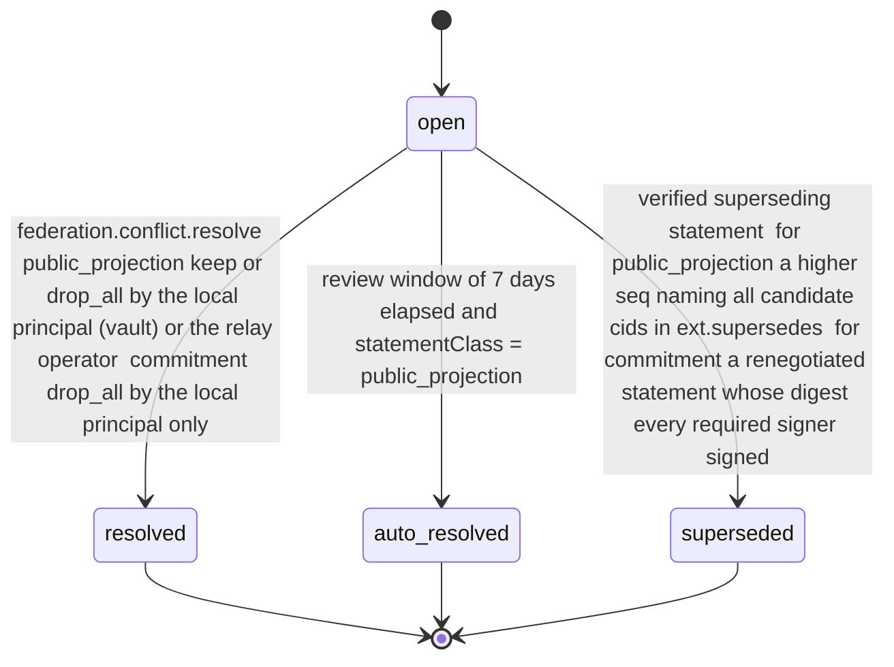

# PS-086-03 — Workflow state machine: Federated conflicts

**Status:** SPECIFIED (Stage 3). **Module:** [F11.S02.M03 Federated conflicts](SPEC.md) · **Scope:** MVP · **Code:** `packages/federation/src/relay_sync/conflicts` · **Contracts:** [CTR-FED-001](../../../planning/contracts/CTR-FED-001.md), [CTR-ID-001](../../../planning/contracts/CTR-ID-001.md), [CTR-EVT-001](../../../planning/contracts/CTR-EVT-001.md), [CTR-ERR-001](../../../planning/contracts/CTR-ERR-001.md), [CTR-CAP-001](../../../planning/contracts/CTR-CAP-001.md), [CTR-IDM-001](../../../planning/contracts/CTR-IDM-001.md), [CTR-OBS-001](../../../planning/contracts/CTR-OBS-001.md), [CTR-IOX-001](../../../planning/contracts/CTR-IOX-001.md), [CTR-PRV-001](../../../planning/contracts/CTR-PRV-001.md)

> Generated from `module.spec.yaml` by `tools/specgen`. Edit the YAML, then run `pnpm spec:render`.

## Requirements

- **PS-086-03.R01** Conflicts move only along the declared transitions and any other transition is refused with CONFLICT_STATE.
- **PS-086-03.R02** Public projections may auto-resolve after 7 days by the origin-wins policy based on the author's portable identity document; commitments may only be released locally by drop_all or superseded by a statement every required signer signed.
- **PS-086-03.R03** Resolution is recorded permanently and never rewrites the signed candidates.
- **PS-086-03.R04** The freeze takes effect in the receive transaction that detects the conflict, and domain modules check is_frozen synchronously before acting, so the freeze never fails open while events are in transit.

## Specification

### ConflictRecord lifecycle

Initial **open**; terminal **resolved**, **auto_resolved**, **superseded**.

| Transition | Trigger | Guard / effect |
|---|---|---|
| open -> resolved | federation.conflict.resolve: public_projection keep or drop_all by the local principal (vault) or the relay operator; commitment drop_all by the local principal only | records decision, emits federation.conflict.resolved with candidateCids, statementClass and freezeScope |
| open -> auto_resolved | review window of 7 days elapsed and statementClass = public_projection | origin_wins: keeps the candidate first received (local clock) from a relay listed in the author's latest verified portable document, or drop_all when no candidate came from a listed relay; emits federation.conflict.resolved |
| open -> superseded | verified superseding statement: for public_projection a higher seq naming all candidate cids in ext.supersedes; for commitment a renegotiated statement whose digest every required signer signed | records supersededByCid, emits federation.conflict.resolved |

### Timeouts and scheduled transitions

- Auto-resolution sweep every 15 min applies origin-wins to public_projection conflicts open longer than 7 days.
- Reminder after 24 h and again after 7 days for open commitment conflicts; no automatic resolution and no automatic freeze release at any age.

## Verification

| Test | Level | Covers | Scenario | Expected |
|---|---|---|---|---|
| TEST-PS-086-09.T03 | property | PS-086-03.R01, PS-086-03.R03 | random command sequences on one conflict | only declared transitions succeed; terminal states never change; candidates never altered |
| TEST-PS-086-09.T04 | integration | PS-086-03.R02, PS-086-04.R03 | public conflict untouched for 7 days with E7a from listed relay R and E7b from unlisted U; second case with neither from a listed relay | auto_resolved origin_wins keeps E7a; second case resolves drop_all; events emitted |
| TEST-PS-086-09.T05 | integration | PS-086-03.R02, PS-086-02.R04 | commitment conflict C1 vs C2 for 30 days, then resolve keep C1 | still open after 30 days; freezeScope contains the proposal; keep returns FEDERATION_CONFLICT_NOT_AUTO_RESOLVABLE |
| TEST-PS-086-09.T06 | integration | PS-086-03.R03, PS-086-04.R01 | author publishes E8 with ext.supersedes naming both cids | conflict superseded with supersededByCid; resolved event emitted |
| TEST-PS-086-09.T15 | e2e | PS-086-01.R02, PS-086-03.R02 | two vaults receive conflicting acceptances; user opens review screen | trade paused banner visible, labels claim vs evidence, only the owner sees the record, axe zero serious issues |
| TEST-PS-086-09.T20 | integration | PS-086-03.R04 | a domain module calls is_frozen while the conflict store is unavailable | DEPENDENCY_UNAVAILABLE and the domain action is refused (fail closed) |

## Dependencies

Module depends on: F11.S02.M02, F11.S01.M03, F11.S01.M01, F07.S02.M01, F10.S01.M02, F10.S01.M03, F10.S01.M04, F10.S02.M02, CTR-FED-001, CTR-ID-001, CTR-EVT-001, CTR-ERR-001, CTR-CAP-001, CTR-IDM-001, CTR-OBS-001, CTR-IOX-001, CTR-PRV-001. Predecessor: [domain_schema.md](domain_schema.md).
