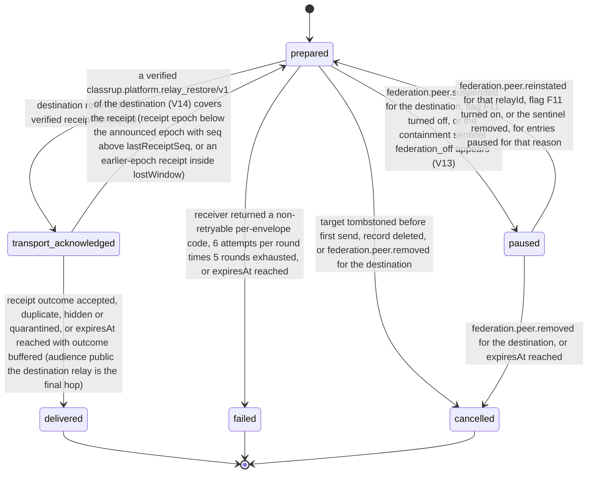

# PS-088-03 — Workflow state machine: Relay delivery

**Status:** SPECIFIED (Stage 3). **Module:** [F11.S02.M01 Relay delivery](SPEC.md) · **Scope:** MVP · **Code:** `packages/federation/src/relay_sync/delivery` · **Contracts:** [CTR-FED-001](../../../planning/contracts/CTR-FED-001.md), [CTR-IDM-001](../../../planning/contracts/CTR-IDM-001.md), [CTR-EVT-001](../../../planning/contracts/CTR-EVT-001.md), [CTR-ERR-001](../../../planning/contracts/CTR-ERR-001.md), [CTR-CAP-001](../../../planning/contracts/CTR-CAP-001.md), [CTR-OBS-001](../../../planning/contracts/CTR-OBS-001.md), [CTR-PRV-001](../../../planning/contracts/CTR-PRV-001.md), [CTR-IOX-001](../../../planning/contracts/CTR-IOX-001.md)

> Generated from `module.spec.yaml` by `tools/specgen`. Edit the YAML, then run `pnpm spec:render`.

## Requirements

- **PS-088-03.R01** PeerOutbox entries advance only along prepared, transport_acknowledged and delivered, and never move backward or skip a state they did not reach.
- **PS-088-03.R02** Delivered, failed and cancelled are terminal and every entry is terminal by its expiresAt; failed entries can be re-queued only by creating a new entry through an operator retry.
- **PS-088-03.R03** The UI maps each state to wording that claims no more than the state proves; a relay receipt reads 'Relay received' and only a verified recipient acknowledgement reads 'Recipient confirmed'.
- **PS-088-03.R04** Paused entries resume on federation.peer.reinstated or when flag F11 turns on, and are cancelled on federation.peer.removed or at expiry.
- **PS-088-03.R05** A verified relay restore announcement of the destination peer that covers an entry's receipt returns a transport_acknowledged entry to prepared and re-queues a delivered entry as a new prepared entry, both resent under the same cid.

## Specification

### PeerOutbox lifecycle

Initial **prepared**; terminal **delivered**, **failed**, **cancelled**.

| Transition | Trigger | Guard / effect |
|---|---|---|
| prepared -> transport_acknowledged | destination returned a verified receipt for the cid | stores transportReceipt |
| transport_acknowledged -> delivered | receipt outcome accepted, duplicate, hidden or quarantined, or expiresAt reached with outcome buffered (audience public: the destination relay is the final hop) | UI 'Relay received'; RET-SHORT starts |
| prepared -> failed | receiver returned a non-retryable per-envelope code, 6 attempts per round times 5 rounds exhausted, or expiresAt reached | emits federation.delivery.failed |
| prepared -> paused | federation.peer.suspended for the destination, flag F11 turned off, or the containment sentinel federation_off appears (V13) | pausedReason peer_suspended, flag_off or federation_killed; no attempts while paused |
| paused -> prepared | federation.peer.reinstated for that relayId, flag F11 turned on, or the sentinel removed, for entries paused for that reason | nextAttemptAt = now |
| prepared -> cancelled | target tombstoned before first send, record deleted, or federation.peer.removed for the destination | no event |
| paused -> cancelled | federation.peer.removed for the destination, or expiresAt reached | no event when removed; at expiresAt emits federation.delivery.failed with reason expired |
| transport_acknowledged -> prepared | a verified classrup.platform.relay_restore/v1 of the destination (V14) covers the receipt (receipt epoch below the announced epoch with seq above lastReceiptSeq, or an earlier-epoch receipt inside lostWindow) | receipt moved to receiptHistory, attempts reset to 0, resent under the same cid; expiresAt unchanged |

### Timeouts and scheduled transitions

- Per-round retry uses IDM-4 backoff (base 500 ms, cap 30 s, full jitter, 6 attempts); rounds are scheduled at 1 min, 15 min, 1 h, 6 h and 24 h after the previous round.
- PeerOutbox entries expire 7 days after creation: prepared becomes failed, transport_acknowledged becomes delivered and paused becomes cancelled, so no entry stays active past expiresAt.
- Pull catch-up runs every 5 min while the app is open and on relay reconnect; the user's own mailboxes are pulled through MailboxPort.fetch every 60 s while the app is open and acknowledged through MailboxPort.ack only after F11.S01.M02 receive committed each envelope.
- Relay: each peer's published key history and restore announcements (F15.S02.M01 /.well-known/classrup-relay.json) are re-read at most every 6 h and immediately after a receipt fails V05; a covered delivered entry is re-queued as a new prepared entry with the same cid.
- Relay: the containment sentinel is read before every dispatch batch and at least every 1 s while entries are paused for federation_killed; paused entries still expire at expiresAt (7 days).
- Vault: a delivery-outcome sweep on every F15.S01.M01 delivery tick reads platform.outbox.list for federation entries and emits federation.delivery.failed once per entry that reached failed or expired, remembered by entryId.
- Vault-side expiry (7 days unsent, 30 days waiting for an acknowledgement) is F15.S01.M01's; this module only supplies the wording for its outcomes.

## Verification

| Test | Level | Covers | Scenario | Expected |
|---|---|---|---|---|
| TEST-PS-088-09.T04 | property | PS-088-03.R01, PS-088-03.R02 | random event sequences (receipt, outcome, failure, pause, reinstate, remove, cancel) with the clock advanced to expiresAt | states only advance along declared transitions; terminal states fixed; every entry is terminal by expiresAt |
| TEST-PS-088-09.T05 | e2e | PS-088-03.R03, PS-088-01.R03, PS-088-01.R04 | vault publishes a listing offline, reconnects, gets a receipt; sends an offer that the recipient acknowledges; sends another offer never acknowledged for 30 days | chips read Saved on this device, Queued, Relay received for the listing (never Recipient confirmed); Recipient confirmed only after the ack; Relay received, recipient not confirmed after the F15 expiry; receipt times labelled relay time |
| TEST-PS-088-09.T11 | integration | PS-088-03.R01, PS-088-09.R02 | batch of 100 with 3 rejected and 2 buffered | 95 delivered, 3 failed with receiver codes, 2 transport_acknowledged and delivered at expiry |
| TEST-PS-088-09.T12 | integration | PS-088-03.R02 | 6 attempts x 5 rounds exhausted | entry failed and federation.delivery.failed emitted once |
| TEST-PS-088-09.T18 | integration | PS-088-03.R04 | peer suspended with 500 entries, then reinstated; another peer removed; flag F11 off then on | paused entries return to prepared on reinstate; removed peer's entries cancelled; flag on resumes flag_off entries |
| TEST-PS-088-09.T26 | integration | PS-088-03.R05 | peer publishes a verified relay_restore whose lost window covers one transport_acknowledged and one delivered entry; a restore signed by an unknown key | the first returns to prepared with its receipt in receiptHistory and is resent with the same cid; the delivered one is re-queued as a new prepared entry; the forged restore FEDERATION_RECEIPT_INVALID and ignored |

## Dependencies

Module depends on: F11.S01.M01, F11.S01.M02, F11.S01.M03, F11.S03.M01, F11.S03.M02, F07.S02.M01, F15.S01.M01, F15.S02.M01, F15.S04.M02, F10.S01.M01, F10.S01.M02, F10.S01.M03, F10.S01.M04, F10.S02.M02, CTR-FED-001, CTR-IDM-001, CTR-EVT-001, CTR-ERR-001, CTR-CAP-001, CTR-OBS-001, CTR-PRV-001, CTR-IOX-001. Predecessor: [domain_schema.md](domain_schema.md).
