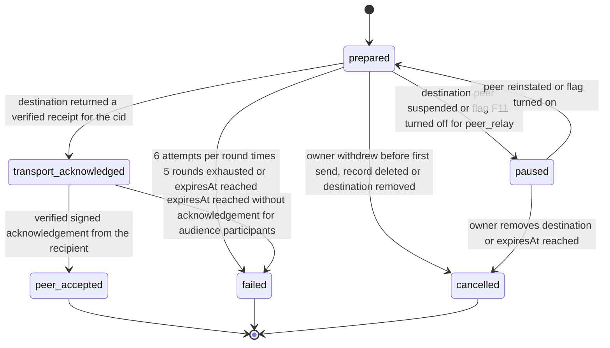

# PS-088-03 — Workflow state machine: Relay delivery

**Status:** SPECIFIED (Stage 3). **Module:** [F11.S02.M01 Relay delivery](SPEC.md) · **Scope:** MVP · **Code:** `packages/federation/src/relay_sync/delivery` · **Contracts:** [CTR-FED-001](../../../planning/contracts/CTR-FED-001.md), [CTR-IDM-001](../../../planning/contracts/CTR-IDM-001.md), [CTR-EVT-001](../../../planning/contracts/CTR-EVT-001.md), [CTR-ERR-001](../../../planning/contracts/CTR-ERR-001.md), [CTR-CAP-001](../../../planning/contracts/CTR-CAP-001.md), [CTR-OBS-001](../../../planning/contracts/CTR-OBS-001.md), [CTR-PRV-001](../../../planning/contracts/CTR-PRV-001.md), [CTR-IOX-001](../../../planning/contracts/CTR-IOX-001.md)

> Generated from `module.spec.yaml` by `tools/specgen`. Edit the YAML, then run `pnpm spec:render`.

## Requirements

- **PS-088-03.R01** Entries advance only along prepared, transport_acknowledged and peer_accepted, and never move backward or skip a state they did not reach.
- **PS-088-03.R02** Failed, cancelled and peer_accepted are terminal; failed entries can be re-queued only by creating a new entry through a user retry.
- **PS-088-03.R03** The UI maps each state to wording that claims no more than the state proves.

## Specification

### PeerOutbox lifecycle

Initial **prepared**; terminal **peer_accepted**, **failed**, **cancelled**.

| Transition | Trigger | Guard / effect |
|---|---|---|
| prepared -> transport_acknowledged | destination returned a verified receipt for the cid | stores transportReceipt |
| prepared -> paused | destination peer suspended or flag F11 turned off for peer_relay | no attempts while paused |
| paused -> prepared | peer reinstated or flag turned on | nextAttemptAt = now |
| prepared -> failed | 6 attempts per round times 5 rounds exhausted or expiresAt reached | emits federation.delivery.failed |
| prepared -> cancelled | owner withdrew before first send, record deleted or destination removed | no event |
| transport_acknowledged -> peer_accepted | verified signed acknowledgement from the recipient | stores peerAck |
| transport_acknowledged -> failed | expiresAt reached without acknowledgement for audience participants | emits federation.delivery.failed with reason no_peer_ack |
| paused -> cancelled | owner removes destination or expiresAt reached | no event |

### Timeouts and scheduled transitions

- Per-round retry uses IDM-4 backoff (base 500 ms, cap 30 s, full jitter, 6 attempts); rounds are scheduled at 1 min, 15 min, 1 h, 6 h and 24 h after the previous round.
- Entries expire 7 days after creation; public entries in transport_acknowledged are treated as complete at expiry and move to peer_accepted only with a signed acknowledgement.
- Pull catch-up runs every 5 min while the app is open and on relay reconnect.

## Verification

| Test | Level | Covers | Scenario | Expected |
|---|---|---|---|---|
| TEST-PS-088-09.T03 | abuse | PS-088-02.R02, PS-088-03.R01, PS-088-07.R01 | relay returns a forged receipt and a forged peer ack | FEDERATION_RECEIPT_INVALID; state does not advance |
| TEST-PS-088-09.T04 | property | PS-088-03.R01, PS-088-03.R02 | random event sequences (receipt, ack, failure, pause, cancel) | states only advance along declared transitions; terminal states fixed; peer_accepted always has peerAck |
| TEST-PS-088-09.T05 | e2e | PS-088-03.R03, PS-088-01.R03 | publish offline, reconnect, receipt, recipient ack | UI wording progresses Saved on this device, Queued, Relay received, Recipient confirmed and never skips ahead |
| TEST-PS-088-09.T11 | integration | PS-088-06.R03, PS-088-03.R01 | batch of 100 with 3 rejected and 2 buffered | 95 advance, 3 failed with receiver codes, 2 stay prepared with 30 min recheck |
| TEST-PS-088-09.T12 | integration | PS-088-03.R01, PS-088-06.R03 | 6 attempts x 5 rounds exhausted | entry failed and federation.delivery.failed emitted once |

## Dependencies

Module depends on: F11.S01.M02, F11.S01.M03, F11.S03.M01, F11.S03.M02, F07.S02.M01, F15.S01.M01, F15.S04.M02, CTR-FED-001, CTR-IDM-001, CTR-EVT-001, CTR-ERR-001, CTR-CAP-001, CTR-OBS-001, CTR-PRV-001, CTR-IOX-001. Predecessor: [domain_schema.md](domain_schema.md).
