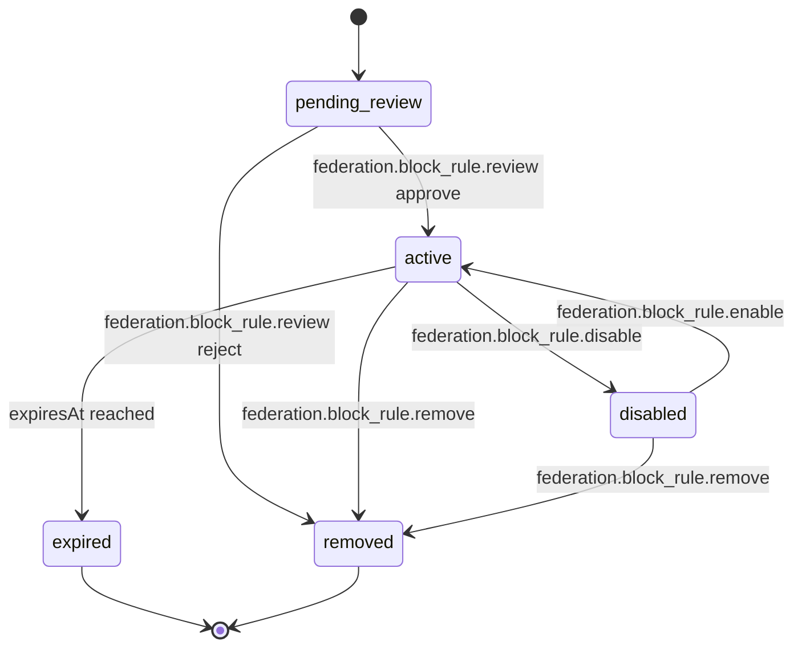

# PS-089-03 — Workflow state machine: Federation blocklists

**Status:** SPECIFIED (Stage 3). **Module:** [F11.S03.M02 Federation blocklists](SPEC.md) · **Scope:** MVP · **Code:** `packages/federation/src/interop/blocklists` · **Contracts:** [CTR-FED-001](../../../planning/contracts/CTR-FED-001.md), [CTR-ID-001](../../../planning/contracts/CTR-ID-001.md), [CTR-EVT-001](../../../planning/contracts/CTR-EVT-001.md), [CTR-ERR-001](../../../planning/contracts/CTR-ERR-001.md), [CTR-CAP-001](../../../planning/contracts/CTR-CAP-001.md), [CTR-IDM-001](../../../planning/contracts/CTR-IDM-001.md), [CTR-OBS-001](../../../planning/contracts/CTR-OBS-001.md), [CTR-IOX-001](../../../planning/contracts/CTR-IOX-001.md), [CTR-PRV-001](../../../planning/contracts/CTR-PRV-001.md)

> Generated from `module.spec.yaml` by `tools/specgen`. Edit the YAML, then run `pnpm spec:render`.

## Requirements

- **PS-089-03.R01** Rules follow the declared lifecycle and any transition not listed is refused with CONFLICT_STATE.
- **PS-089-03.R02** Imported rules cannot reach active without an explicit review decision by the owner or operator.
- **PS-089-03.R03** Expired and removed are terminal so history of what was blocked remains auditable.

## Specification

### BlockRule lifecycle

Initial **pending_review**; terminal **expired**, **removed**.

| Transition | Trigger | Guard / effect |
|---|---|---|
| pending_review -> active | federation.block_rule.review approve | emits federation.block_rule.changed change activated |
| pending_review -> removed | federation.block_rule.review reject | emits federation.block_rule.changed change removed |
| active -> disabled | federation.block_rule.disable | emits federation.block_rule.changed change disabled |
| disabled -> active | federation.block_rule.enable | emits federation.block_rule.changed change activated |
| active -> expired | expiresAt reached | emits federation.block_rule.changed change expired |
| active -> removed | federation.block_rule.remove | emits federation.block_rule.changed change removed |
| disabled -> removed | federation.block_rule.remove | emits federation.block_rule.changed change removed |

### Timeouts and scheduled transitions

- Expiry sweep every 15 min moves active rules with expiresAt ≤ now to expired.
- Pending imported rules not reviewed within 30 days are removed with a notice.

## Verification

| Test | Level | Covers | Scenario | Expected |
|---|---|---|---|---|
| TEST-PS-089-09.T03 | integration | PS-089-03.R01, PS-089-03.R02 | import list L then approve one of 3 entries | 3 pending, 1 active, 2 stay pending then removed by reject; none active before review |
| TEST-PS-089-09.T04 | property | PS-089-03.R01, PS-089-03.R03 | random command sequences on one rule | only declared transitions succeed; expired and removed never change |
| TEST-PS-089-09.T14 | a11y | PS-089-03.R01, PS-089-04.R01 | operate import review by keyboard and screen reader | all rows labelled, targets ≥ 44 px, announcements present |

## Dependencies

Module depends on: F11.S01.M03, F07.S02.M02, CTR-FED-001, CTR-ID-001, CTR-EVT-001, CTR-ERR-001, CTR-CAP-001, CTR-IDM-001, CTR-OBS-001, CTR-IOX-001, CTR-PRV-001. Predecessor: [domain_schema.md](domain_schema.md).
