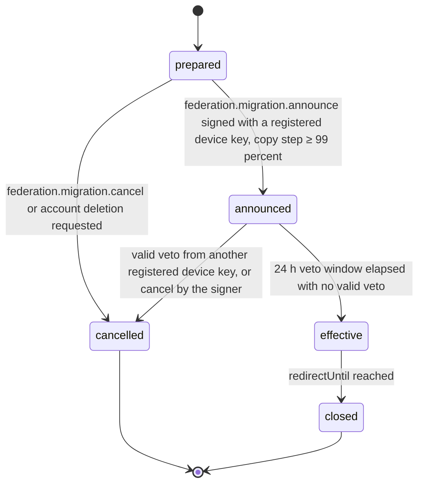

# PS-090-03 — Workflow state machine: Account and relay migration

**Status:** SPECIFIED (Stage 3). **Module:** [F11.S03.M03 Account and relay migration](SPEC.md) · **Scope:** MVP · **Code:** `packages/federation/src/interop/migration` · **Contracts:** [CTR-FED-001](../../../planning/contracts/CTR-FED-001.md), [CTR-ID-001](../../../planning/contracts/CTR-ID-001.md), [CTR-EVT-001](../../../planning/contracts/CTR-EVT-001.md), [CTR-ERR-001](../../../planning/contracts/CTR-ERR-001.md), [CTR-CAP-001](../../../planning/contracts/CTR-CAP-001.md), [CTR-IDM-001](../../../planning/contracts/CTR-IDM-001.md), [CTR-OBS-001](../../../planning/contracts/CTR-OBS-001.md), [CTR-IOX-001](../../../planning/contracts/CTR-IOX-001.md), [CTR-PRV-001](../../../planning/contracts/CTR-PRV-001.md)

> Generated from `module.spec.yaml` by `tools/specgen`. Edit the YAML, then run `pnpm spec:render`.

## Requirements

- **PS-090-03.R01** A move advances prepared, announced and effective and may be cancelled only before it becomes effective.
- **PS-090-03.R02** The redirect and the rebinding of the author's origin relay start only at effective, never at announce.
- **PS-090-03.R03** Closed and cancelled are terminal; a later move creates a new record.

## Specification

### MigrationRecord lifecycle

Initial **prepared**; terminal **cancelled**, **closed**.

| Transition | Trigger | Guard / effect |
|---|---|---|
| prepared -> announced | federation.migration.announce signed with a registered device key, copy step ≥ 99 percent | produces classrup.federation.move/v1 and queues it to old relay, new relay and peers |
| prepared -> cancelled | federation.migration.cancel or account deletion requested | no statement |
| announced -> effective | 24 h veto window elapsed with no valid veto | emits federation.account.moved; old relay starts redirect for 180 days |
| announced -> cancelled | valid veto from another registered device key, or cancel by the signer | produces classrup.federation.move_cancel/v1 |
| effective -> closed | redirectUntil reached | old relay removes redirect |

### Timeouts and scheduled transitions

- Veto window 24 h from announcedAt; sweep every 5 min promotes announced records whose effectiveAt ≤ now.
- Redirect expiry sweep daily closes effective records with redirectUntil ≤ now.
- Prepared records idle for 14 days are cancelled.

## Verification

| Test | Level | Covers | Scenario | Expected |
|---|---|---|---|---|
| TEST-PS-090-09.T04 | integration | PS-090-03.R01, PS-090-03.R02, PS-090-02.R02 | veto from K2 at 23 h 59 min and at 24 h 01 min | first cancels the move; second ignored; redirect inactive after cancel |
| TEST-PS-090-09.T05 | property | PS-090-03.R01, PS-090-03.R03 | random command sequences on one record | only declared transitions succeed; cancelled and closed never change |
| TEST-PS-090-09.T06 | integration | PS-090-03.R02, PS-090-04.R03 | observer R3 receives move before and after effectiveAt | rebinding of origin relay only after effective; F11.S01.M02 accepts records from R2 afterward |
| TEST-PS-090-09.T13 | abuse | PS-090-07.R01, PS-090-03.R01 | replay of old move statement after a newer move | rejected by cid dedup and chain position; no move back |
| TEST-PS-090-09.T17 | a11y | PS-090-03.R03, PS-090-01.R01 | operate wizard, countdown and veto prompt by keyboard and screen reader | steps announced, countdown text milestones announced, targets ≥ 44 px |

## Dependencies

Module depends on: F11.S01.M02, F11.S01.M03, F11.S02.M01, F11.S03.M01, F07.S02.M01, F10.S01.M04, CTR-FED-001, CTR-ID-001, CTR-EVT-001, CTR-ERR-001, CTR-CAP-001, CTR-IDM-001, CTR-OBS-001, CTR-IOX-001, CTR-PRV-001. Predecessor: [domain_schema.md](domain_schema.md).
