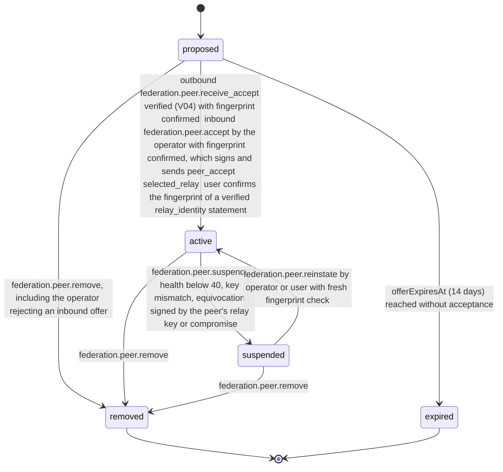

# PS-091-03 — Workflow state machine: Peer trust

**Status:** SPECIFIED (Stage 3). **Module:** [F11.S03.M01 Peer trust](SPEC.md) · **Scope:** MVP · **Code:** `packages/federation/src/interop/trust` · **Contracts:** [CTR-FED-001](../../../planning/contracts/CTR-FED-001.md), [CTR-ID-001](../../../planning/contracts/CTR-ID-001.md), [CTR-EVT-001](../../../planning/contracts/CTR-EVT-001.md), [CTR-ERR-001](../../../planning/contracts/CTR-ERR-001.md), [CTR-CAP-001](../../../planning/contracts/CTR-CAP-001.md), [CTR-IDM-001](../../../planning/contracts/CTR-IDM-001.md), [CTR-FLG-001](../../../planning/contracts/CTR-FLG-001.md), [CTR-OBS-001](../../../planning/contracts/CTR-OBS-001.md), [CTR-IOX-001](../../../planning/contracts/CTR-IOX-001.md), [CTR-PRV-001](../../../planning/contracts/CTR-PRV-001.md)

> Generated from `module.spec.yaml` by `tools/specgen`. Edit the YAML, then run `pnpm spec:render`.

## Requirements

- **PS-091-03.R01** A peer activates only when both sides opted in, and suspension or removal takes effect on the next request.
- **PS-091-03.R02** Suspended peers keep their pinned key and history and can be reinstated by an explicit action, never automatically.
- **PS-091-03.R03** Removed and expired are terminal; peering again creates a new Peer record.
- **PS-091-03.R04** The handshake has an inbound path on both sides; a verified peer_offer creates or merges an inbound proposed Peer that needs operator action, and a verified peer_accept matching the offer cid activates the proposer once its fingerprint is confirmed.

## Specification

### Peer lifecycle

Initial **proposed**; terminal **removed**, **expired**.

| Transition | Trigger | Guard / effect |
|---|---|---|
| proposed -> active | outbound: federation.peer.receive_accept verified (V04) with fingerprint confirmed; inbound: federation.peer.accept by the operator with fingerprint confirmed, which signs and sends peer_accept; selected_relay: user confirms the fingerprint of a verified relay_identity statement | both opt-in flags true; emits federation.peer.added |
| proposed -> expired | offerExpiresAt (14 days) reached without acceptance | no event |
| proposed -> removed | federation.peer.remove, including the operator rejecting an inbound offer | no event |
| active -> suspended | federation.peer.suspend, health below 40, key mismatch, equivocation signed by the peer's relay key or compromise | emits federation.peer.suspended |
| suspended -> active | federation.peer.reinstate by operator or user with fresh fingerprint check | emits federation.peer.reinstated |
| active -> removed | federation.peer.remove | emits federation.peer.removed |
| suspended -> removed | federation.peer.remove | emits federation.peer.removed |

### Timeouts and scheduled transitions

- Proposal expiry sweep every 1 h moves proposed peers (outbound proposals and inbound offers) with offerExpiresAt ≤ now to expired.
- Health recovery job every 10 min adds 1 point per 100 clean envelopes since the last run, up to 100.
- Key rotation overlap ends 7 days after rotation; the previous key is then removed and refused.

## Verification

| Test | Level | Covers | Scenario | Expected |
|---|---|---|---|---|
| TEST-PS-091-09.T01 | integration | PS-091-03.R04, PS-091-01.R01, PS-091-04.R02 | A proposes to B; B's receive_offer stores an inbound proposed Peer; B's operator accepts with fingerprint confirmed; A's receive_accept verifies it | both Peer rows active with both opt-in flags and fingerprintConfirmedAt; federation.peer.added emitted on both sides |
| TEST-PS-091-09.T05 | property | PS-091-03.R01, PS-091-03.R02, PS-091-03.R03 | random command sequences on one Peer | only declared transitions succeed; removed and expired never change; active requires both opt-ins |
| TEST-PS-091-09.T06 | integration | PS-091-03.R03 | outbound proposal and inbound offer not accepted for 14 days | both expired by the sweep; a new proposal creates a new Peer |
| TEST-PS-091-09.T15 | a11y | PS-091-03.R02 | operate relay chooser, inbound offer queue and reinstate dialog by keyboard and screen reader | fingerprint read in groups, targets ≥ 44 px, status announced, reinstate requires a fresh fingerprint check |
| TEST-PS-091-09.T20 | integration | PS-091-02.R02, PS-091-03.R04 | vault selects relay R: fetch and verify its relay_identity statement, user confirms fingerprint; then a tampered identity statement | active without any per-user accept; the tampered one FEDERATION_KEY_MISMATCH |

## Dependencies

Module depends on: F11.S01.M01, F11.S01.M03, F15.S04.M02, F07.S02.M01, F12.S03.M03, F10.S01.M02, F10.S01.M03, F10.S01.M04, F10.S02.M02, CTR-FED-001, CTR-ID-001, CTR-EVT-001, CTR-ERR-001, CTR-CAP-001, CTR-IDM-001, CTR-FLG-001, CTR-OBS-001, CTR-IOX-001, CTR-PRV-001. Predecessor: [domain_schema.md](domain_schema.md).
