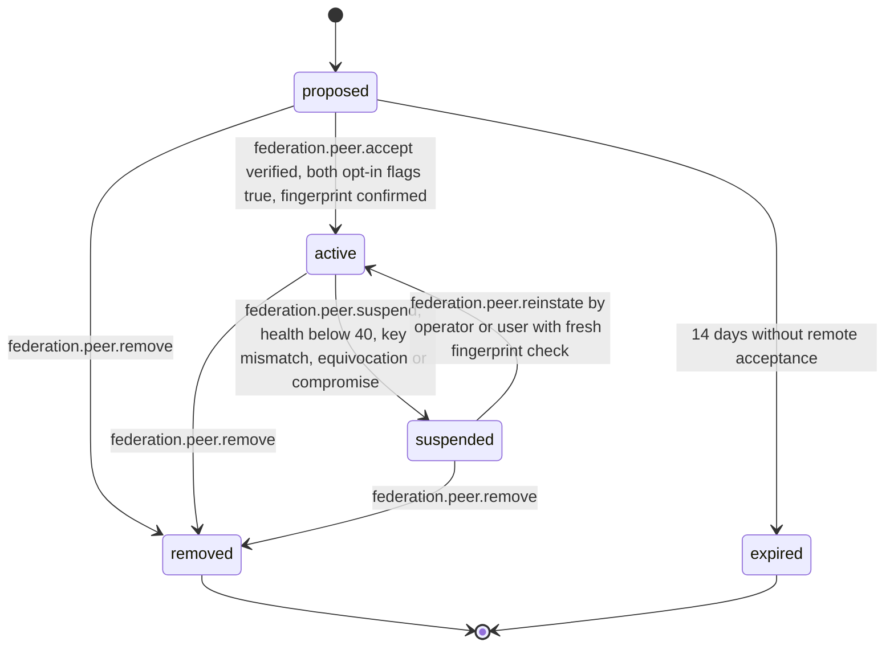

# PS-091-03 — Workflow state machine: Peer trust

**Status:** SPECIFIED (Stage 3). **Module:** [F11.S03.M01 Peer trust](SPEC.md) · **Scope:** MVP · **Code:** `packages/federation/src/interop/trust` · **Contracts:** [CTR-FED-001](../../../planning/contracts/CTR-FED-001.md), [CTR-ID-001](../../../planning/contracts/CTR-ID-001.md), [CTR-EVT-001](../../../planning/contracts/CTR-EVT-001.md), [CTR-ERR-001](../../../planning/contracts/CTR-ERR-001.md), [CTR-CAP-001](../../../planning/contracts/CTR-CAP-001.md), [CTR-IDM-001](../../../planning/contracts/CTR-IDM-001.md), [CTR-FLG-001](../../../planning/contracts/CTR-FLG-001.md), [CTR-OBS-001](../../../planning/contracts/CTR-OBS-001.md), [CTR-IOX-001](../../../planning/contracts/CTR-IOX-001.md), [CTR-PRV-001](../../../planning/contracts/CTR-PRV-001.md)

> Generated from `module.spec.yaml` by `tools/specgen`. Edit the YAML, then run `pnpm spec:render`.

## Requirements

- **PS-091-03.R01** A peer activates only when both sides opted in, and suspension or removal takes effect on the next request.
- **PS-091-03.R02** Suspended peers keep their pinned key and history and can be reinstated by an explicit action, never automatically.
- **PS-091-03.R03** Removed and expired are terminal; peering again creates a new Peer record.

## Specification

### Peer lifecycle

Initial **proposed**; terminal **removed**, **expired**.

| Transition | Trigger | Guard / effect |
|---|---|---|
| proposed -> active | federation.peer.accept verified, both opt-in flags true, fingerprint confirmed | emits federation.peer.added |
| proposed -> expired | 14 days without remote acceptance | no event |
| proposed -> removed | federation.peer.remove | no event |
| active -> suspended | federation.peer.suspend, health below 40, key mismatch, equivocation or compromise | emits federation.peer.suspended |
| suspended -> active | federation.peer.reinstate by operator or user with fresh fingerprint check | emits federation.peer.reinstated |
| active -> removed | federation.peer.remove | emits federation.peer.removed |
| suspended -> removed | federation.peer.remove | emits federation.peer.removed |

### Timeouts and scheduled transitions

- Proposal expiry sweep every 1 h moves proposed peers older than 14 days to expired.
- Health recovery job every 10 min adds 1 point per 100 clean envelopes since the last run, up to 100.
- Key rotation overlap ends 7 days after rotation; the previous key is then removed.

## Verification

| Test | Level | Covers | Scenario | Expected |
|---|---|---|---|---|
| TEST-PS-091-09.T05 | property | PS-091-03.R01, PS-091-03.R02, PS-091-03.R03 | random command sequences on one Peer | only declared transitions succeed; removed and expired never change; active requires both opt-ins |
| TEST-PS-091-09.T06 | integration | PS-091-03.R01, PS-091-06.R02 | proposal not accepted for 14 days | status expired by sweep |
| TEST-PS-091-09.T15 | a11y | PS-091-01.R03, PS-091-03.R02 | operate relay chooser by keyboard and screen reader | fingerprint read in groups, targets ≥ 44 px, status announced |

## Dependencies

Module depends on: F11.S01.M03, F15.S04.M02, F07.S02.M01, CTR-FED-001, CTR-ID-001, CTR-EVT-001, CTR-ERR-001, CTR-CAP-001, CTR-IDM-001, CTR-FLG-001, CTR-OBS-001, CTR-IOX-001, CTR-PRV-001. Predecessor: [domain_schema.md](domain_schema.md).
