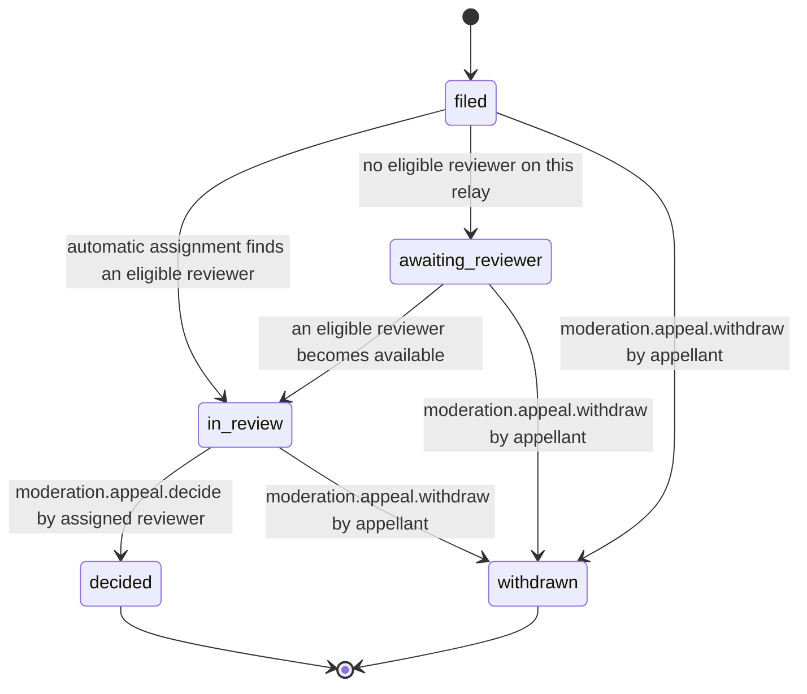

# PS-092-03 — Workflow state machine: Appeals

**Status:** SPECIFIED (Stage 3). **Module:** [F12.S01.M03 Appeals](SPEC.md) · **Scope:** MVP · **Code:** `packages/moderation/src/reporting/appeals` · **Contracts:** [CTR-ID-001](../../../planning/contracts/CTR-ID-001.md), [CTR-EVT-001](../../../planning/contracts/CTR-EVT-001.md), [CTR-ERR-001](../../../planning/contracts/CTR-ERR-001.md), [CTR-CAP-001](../../../planning/contracts/CTR-CAP-001.md), [CTR-IDM-001](../../../planning/contracts/CTR-IDM-001.md), [CTR-PRV-001](../../../planning/contracts/CTR-PRV-001.md), [CTR-FED-001](../../../planning/contracts/CTR-FED-001.md), [CTR-OBS-001](../../../planning/contracts/CTR-OBS-001.md)

> Generated from `module.spec.yaml` by `tools/specgen`. Edit the YAML, then run `pnpm spec:render`.

## Requirements

- **PS-092-03.R01** Appeals follow the declared lifecycle and any other transition is refused with CONFLICT_STATE.
- **PS-092-03.R02** Assignment requires an eligible reviewer and otherwise leaves the appeal awaiting_reviewer with an honest notice.
- **PS-092-03.R03** A decision is final for that relay; overturn emits the decided event that makes F12.S02.M01 revert the action.

## Specification

### Appeal lifecycle

Initial **filed**; terminal **decided**, **withdrawn**.

| Transition | Trigger | Guard / effect |
|---|---|---|
| filed -> in_review | automatic assignment finds an eligible reviewer | reviewerKey set; reviewer differs from decider |
| filed -> awaiting_reviewer | no eligible reviewer on this relay | appellant notice says so; retry hourly |
| awaiting_reviewer -> in_review | an eligible reviewer becomes available | reviewerKey set |
| in_review -> decided | moderation.appeal.decide by assigned reviewer | signed decision statement issued; emits moderation.appeal.decided |
| filed -> withdrawn | moderation.appeal.withdraw by appellant | statement queued |
| awaiting_reviewer -> withdrawn | moderation.appeal.withdraw by appellant | statement queued |
| in_review -> withdrawn | moderation.appeal.withdraw by appellant | statement queued; no decision issued |

### Timeouts and scheduled transitions

- Decision target 14 days after filing; at day 10 the queue escalates to operators and at day 14 an overdue metric and notice to the appellant are produced; no automatic outcome is applied.
- awaiting_reviewer appeals retry assignment every 60 minutes.

## Verification

| Test | Level | Covers | Scenario | Expected |
|---|---|---|---|---|
| TEST-PS-092-09.T03 | property | PS-092-03.R01, PS-092-03.R02 | random sequences of assign, decide, withdraw | only declared transitions succeed and reviewer never equals decider |
| TEST-PS-092-09.T04 | integration | PS-092-03.R02, PS-092-03.R03 | relay with a single moderator; second moderator added | awaiting_reviewer then in_review; decision overturn emits moderation.appeal.decided |
| TEST-PS-092-09.T10 | chaos | PS-092-06.R03, PS-092-03.R03 | receipt lost then retried; decision statement undelivered | stored receipt replayed; vault fetches decision; sync state advances honestly |

## Dependencies

Module depends on: F12.S02.M01, F12.S01.M02, F12.S02.M03, F16.S01.M01, F16.S02.M03, CTR-ID-001, CTR-EVT-001, CTR-ERR-001, CTR-CAP-001, CTR-IDM-001, CTR-PRV-001, CTR-FED-001, CTR-OBS-001. Predecessor: [domain_schema.md](domain_schema.md).
