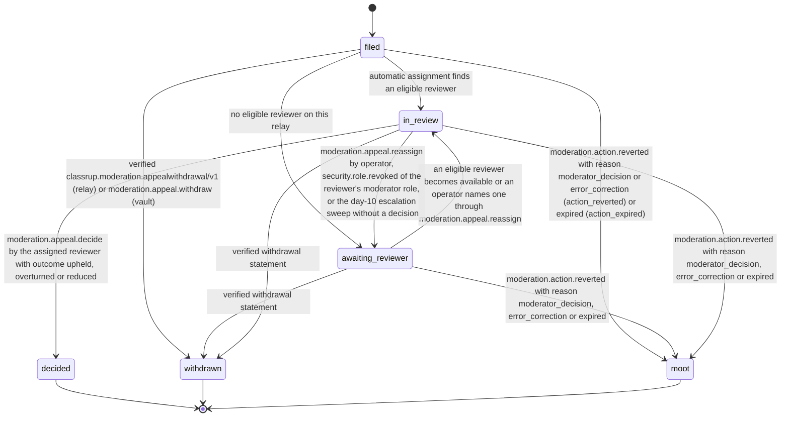
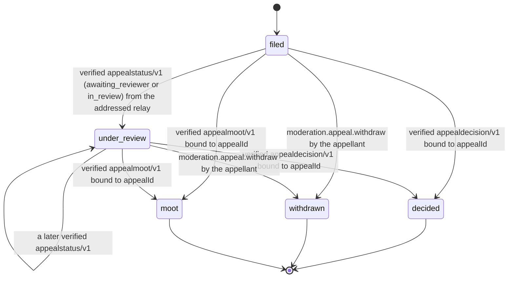
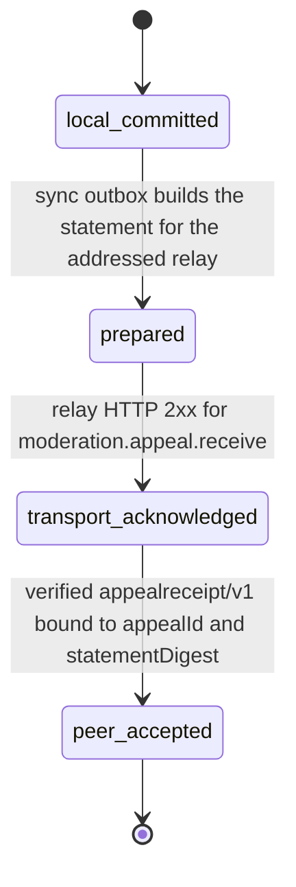

# PS-092-03 — Workflow state machine: Appeals

**Status:** SPECIFIED (Stage 3). **Module:** [F12.S01.M03 Appeals](SPEC.md) · **Scope:** MVP · **Code:** `packages/moderation/src/reporting/appeals` · **Contracts:** [CTR-ID-001](../../../planning/contracts/CTR-ID-001.md), [CTR-EVT-001](../../../planning/contracts/CTR-EVT-001.md), [CTR-ERR-001](../../../planning/contracts/CTR-ERR-001.md), [CTR-CAP-001](../../../planning/contracts/CTR-CAP-001.md), [CTR-IDM-001](../../../planning/contracts/CTR-IDM-001.md), [CTR-PRV-001](../../../planning/contracts/CTR-PRV-001.md), [CTR-FED-001](../../../planning/contracts/CTR-FED-001.md), [CTR-OBS-001](../../../planning/contracts/CTR-OBS-001.md)

> Generated from `module.spec.yaml` by `tools/specgen`. Edit the YAML, then run `pnpm spec:render`.

## Requirements

- **PS-092-03.R01** Appeals follow the declared lifecycle and any other transition is refused with CONFLICT_STATE.
- **PS-092-03.R02** Assignment requires an eligible reviewer and otherwise leaves the appeal awaiting_reviewer with an honest notice.
- **PS-092-03.R03** A decision is final for that relay; overturned and reduced outcomes emit the decided event that makes F12.S02.M01 revert or replace the action.
- **PS-092-03.R04** An appeal on an action that a moderator reverts or that expires before a decision closes as moot with mootReason action_reverted or action_expired, receives a relay-signed moot notice, is never labelled overturned and emits no decided event.
- **PS-092-03.R05** An appeal in review returns to awaiting_reviewer when an operator unassigns the reviewer, the reviewer loses the moderator role, or the day-10 escalation passes without a decision, and reassignment runs immediately.

## Specification

### Appeal lifecycle

Initial **filed**; terminal **decided**, **withdrawn**, **moot**.

| Transition | Trigger | Guard / effect |
|---|---|---|
| filed -> in_review | automatic assignment finds an eligible reviewer | reviewerKey set relay-side; V05 passes; relay-signed appealstatus/v1 in_review without reviewer identity |
| filed -> awaiting_reviewer | no eligible reviewer on this relay | appellant notice says so; retry hourly |
| awaiting_reviewer -> in_review | an eligible reviewer becomes available or an operator names one through moderation.appeal.reassign | reviewerKey set; V05 passes |
| in_review -> awaiting_reviewer | moderation.appeal.reassign by operator, security.role.revoked of the reviewer's moderator role, or the day-10 escalation sweep without a decision | reviewerKey cleared and recorded in the relay audit log; reassignCount + 1; assignment retried at once |
| in_review -> decided | moderation.appeal.decide by the assigned reviewer with outcome upheld, overturned or reduced | decision statement signed by the relay key only; emits moderation.appeal.decided |
| filed -> withdrawn | verified classrup.moderation.appealwithdrawal/v1 (relay) or moderation.appeal.withdraw (vault) | statement queued or stored |
| awaiting_reviewer -> withdrawn | verified withdrawal statement | no decision issued |
| in_review -> withdrawn | verified withdrawal statement | no decision issued |
| filed -> moot | moderation.action.reverted with reason moderator_decision or error_correction (action_reverted) or expired (action_expired) | outcome moot; relay-signed appealmoot/v1 queued; no decided event |
| awaiting_reviewer -> moot | moderation.action.reverted with reason moderator_decision, error_correction or expired | outcome moot; appealmoot/v1 queued; no decided event |
| in_review -> moot | moderation.action.reverted with reason moderator_decision, error_correction or expired | outcome moot; reviewer released; appealmoot/v1 queued; no decided event |

### AppealVaultCopy lifecycle

Initial **filed**; terminal **decided**, **withdrawn**, **moot**.

| Transition | Trigger | Guard / effect |
|---|---|---|
| filed -> under_review | verified appealstatus/v1 (awaiting_reviewer or in_review) from the addressed relay | status shown without reviewer identity |
| under_review -> under_review | a later verified appealstatus/v1 | status refreshed |
| filed -> decided | verified appealdecision/v1 bound to appealId | outcome stored; local moderation.appeal.decided derived |
| under_review -> decided | verified appealdecision/v1 bound to appealId | outcome stored; local moderation.appeal.decided derived |
| filed -> moot | verified appealmoot/v1 bound to appealId | moot reason stored; no decided event |
| under_review -> moot | verified appealmoot/v1 bound to appealId | moot reason stored; no decided event |
| filed -> withdrawn | moderation.appeal.withdraw by the appellant | withdrawal statement queued |
| under_review -> withdrawn | moderation.appeal.withdraw by the appellant | withdrawal statement queued |

### AppealSyncState lifecycle

Initial **local_committed**; terminal **peer_accepted**.

| Transition | Trigger | Guard / effect |
|---|---|---|
| local_committed -> prepared | sync outbox builds the statement for the addressed relay | statement bytes and statementDigest fixed |
| prepared -> transport_acknowledged | relay HTTP 2xx for moderation.appeal.receive | UI 'Sent to relay' |
| transport_acknowledged -> peer_accepted | verified appealreceipt/v1 bound to appealId and statementDigest | UI 'Relay acknowledged' |

**Note:** Relay statements (appealreceipt, appealstatus, appealdecision, appealmoot) are signed by the relay key only; the reviewer key is never part of any statement and is recorded only in the relay copy and the relay audit log (F16.S01.M01).

### Timeouts and scheduled transitions

- Decision target 14 days after filing; at day 10 the queue escalates to operators and an in_review appeal without a decision returns to awaiting_reviewer for reassignment; at day 14 an overdue metric and notice to the appellant are produced; no automatic outcome is applied.
- awaiting_reviewer appeals retry assignment every 60 minutes.
- Prepared appeal statements retry delivery for up to 7 days; the window is still decided by the relay's receive time.

## Verification

| Test | Level | Covers | Scenario | Expected |
|---|---|---|---|---|
| TEST-PS-092-09.T03 | property | PS-092-03.R01, PS-092-03.R02 | random sequences of assign, reassign, decide, withdraw, revert and expiry | only declared transitions succeed; terminal states never change; reviewer principal never equals decider, subject or reporter |
| TEST-PS-092-09.T04 | integration | PS-092-03.R02, PS-092-03.R03 | relay with a single eligible moderator; second moderator added; decision overturned, then another appeal decided reduced | awaiting_reviewer then in_review; overturned emits moderation.appeal.decided that reverts the action; reduced emits the decided event with typed reducedTo and the action is replaced |
| TEST-PS-092-09.T06 | integration | PS-092-04.R03, PS-092-03.R04 | action.applied then action.reverted by moderator_decision before the decision; another action reaches expiry with an appeal in_review | deadline stored; first appeal moot with action_reverted, second moot with action_expired; appealmoot statements issued; no moderation.appeal.decided and no second revert; vault shows Closed as moot, never overturned |
| TEST-PS-092-09.T10 | chaos | PS-092-06.R03, PS-092-03.R03 | decision committed, then the mailbox delivery of the decision statement fails | event and decision stored in one transaction; vault fetches the decision through status_for_appellant; sync state advances honestly |
| TEST-PS-092-09.T16 | integration | PS-092-03.R05 | reviewer M2 loses the moderator role (security.role.revoked); another appeal reaches day 10 in review; operator reassigns a third | each returns to awaiting_reviewer, reviewer recorded in the audit log, a new eligible reviewer is assigned; reassignCount increments |

## Dependencies

Module depends on: F12.S02.M01, F12.S01.M01, F12.S01.M02, F12.S02.M03, F07.S02.M01, F08.S01.M01, F16.S01.M01, F16.S02.M03, F10.S01.M02, F10.S01.M03, F10.S01.M04, F10.S02.M02, CTR-ID-001, CTR-EVT-001, CTR-ERR-001, CTR-CAP-001, CTR-IDM-001, CTR-PRV-001, CTR-FED-001, CTR-OBS-001. Predecessor: [domain_schema.md](domain_schema.md).
