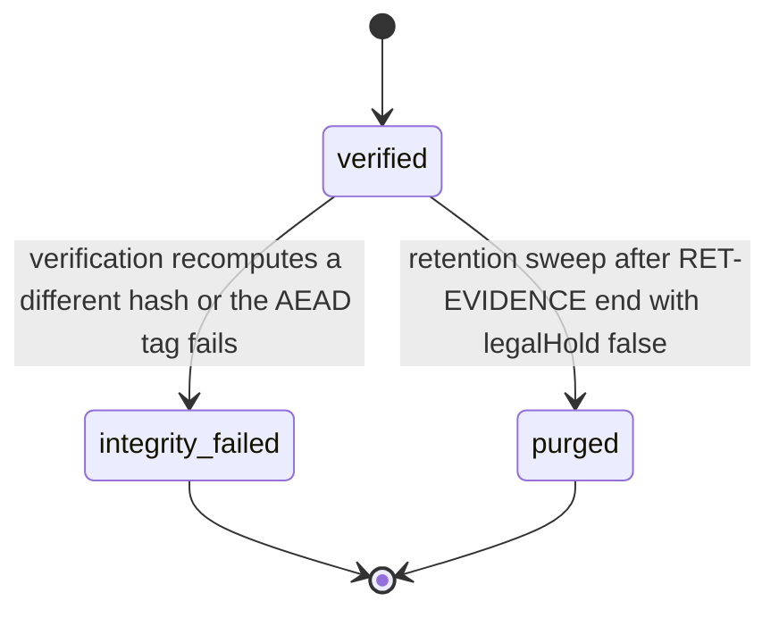

# PS-093-03 — Workflow state machine: Moderation evidence

**Status:** SPECIFIED (Stage 3). **Module:** [F12.S01.M02 Moderation evidence](SPEC.md) · **Scope:** MVP · **Code:** `packages/moderation/src/reporting/evidence` · **Contracts:** [CTR-ID-001](../../../planning/contracts/CTR-ID-001.md), [CTR-EVT-001](../../../planning/contracts/CTR-EVT-001.md), [CTR-ERR-001](../../../planning/contracts/CTR-ERR-001.md), [CTR-CAP-001](../../../planning/contracts/CTR-CAP-001.md), [CTR-IDM-001](../../../planning/contracts/CTR-IDM-001.md), [CTR-PRV-001](../../../planning/contracts/CTR-PRV-001.md), [CTR-FED-001](../../../planning/contracts/CTR-FED-001.md), [CTR-OBS-001](../../../planning/contracts/CTR-OBS-001.md)

> Generated from `module.spec.yaml` by `tools/specgen`. Edit the YAML, then run `pnpm spec:render`.

## Requirements

- **PS-093-03.R01** Snapshot integrity follows the declared lifecycle and any other transition is refused with CONFLICT_STATE.
- **PS-093-03.R02** A failed hash verification moves a snapshot to integrity_failed, which is final, and raises an alert to the store owner.
- **PS-093-03.R03** Purge happens only when retention has ended and no legal hold applies; purge destroys the key and then the blobs.

## Specification

### EvidenceSnapshot lifecycle

Initial **verified**; terminal **integrity_failed**, **purged**.

| Transition | Trigger | Guard / effect |
|---|---|---|
| verified -> integrity_failed | verification recomputes a different hash or the AEAD tag fails | alert metric or vault notice; decisions citing it flagged |
| verified -> purged | retention sweep after RET-EVIDENCE end with legalHold false | key destroyed, blobs deleted, access rows kept as stubs |

### Timeouts and scheduled transitions

- Integrity re-verification sweep verifies 1% of snapshots per day (full coverage every 100 days) plus every snapshot before export; relay sweep runs at 03:30 UTC and the vault sweep runs on idle after app start.

## Verification

| Test | Level | Covers | Scenario | Expected |
|---|---|---|---|---|
| TEST-PS-093-09.T02 | property | PS-093-01.R03, PS-093-03.R01 | random content objects with key order permuted | contentHash identical; mutated body fails verification |
| TEST-PS-093-09.T04 | integration | PS-093-01.R02, PS-093-03.R03, PS-093-04.R03 | retention end with and without legal hold | key destroyed and blobs deleted only without hold |
| TEST-PS-093-09.T05 | integration | PS-093-03.R02 | corrupt stored blob byte then verify | integrity_failed, alert raised, status final |

## Dependencies

Module depends on: F16.S01.M01, F16.S02.M03, CTR-ID-001, CTR-EVT-001, CTR-ERR-001, CTR-CAP-001, CTR-IDM-001, CTR-PRV-001, CTR-FED-001, CTR-OBS-001. Predecessor: [domain_schema.md](domain_schema.md).
