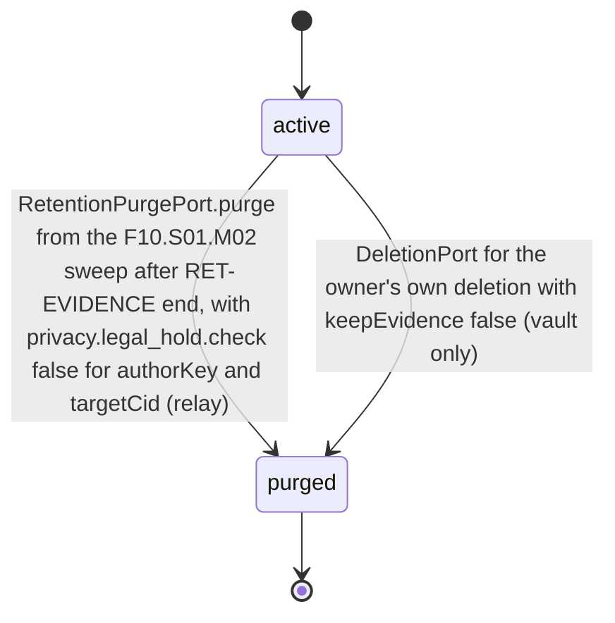
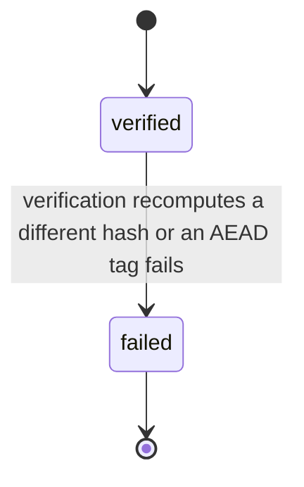
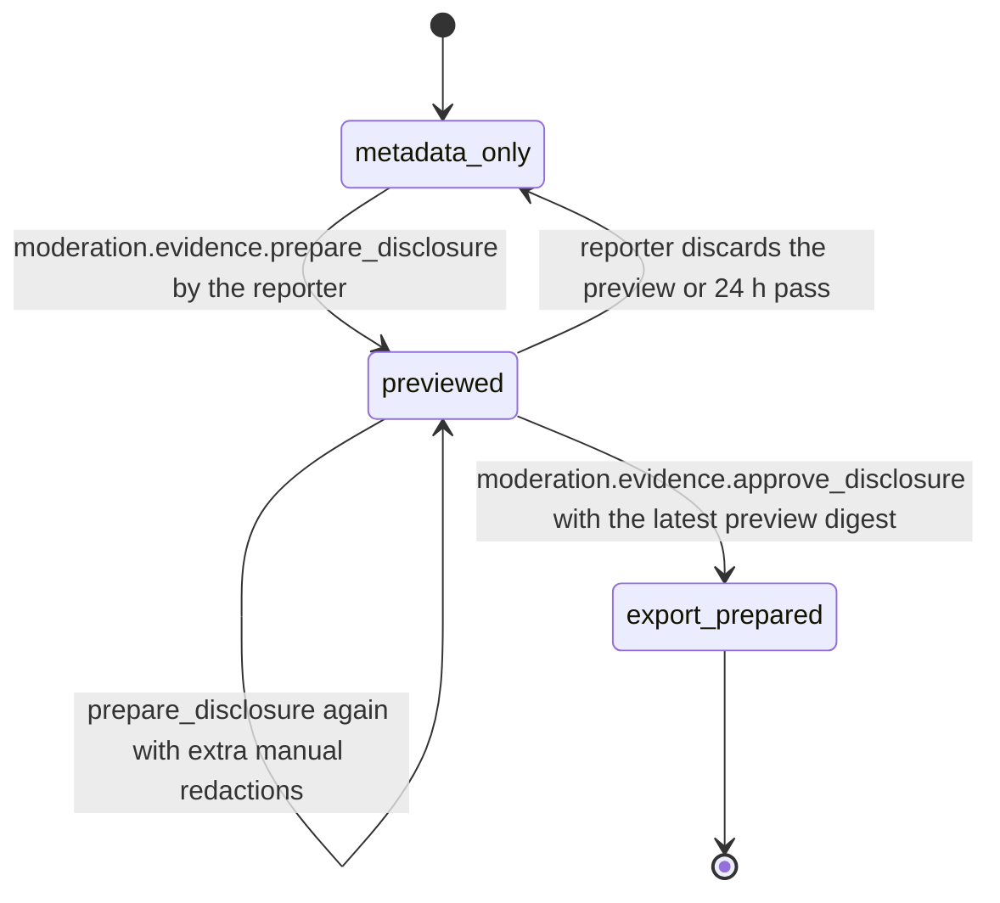

# PS-093-03 — Workflow state machine: Moderation evidence

**Status:** SPECIFIED (Stage 3). **Module:** [F12.S01.M02 Moderation evidence](SPEC.md) · **Scope:** MVP · **Code:** `packages/moderation/src/reporting/evidence` · **Contracts:** [CTR-ID-001](../../../planning/contracts/CTR-ID-001.md), [CTR-EVT-001](../../../planning/contracts/CTR-EVT-001.md), [CTR-ERR-001](../../../planning/contracts/CTR-ERR-001.md), [CTR-CAP-001](../../../planning/contracts/CTR-CAP-001.md), [CTR-IDM-001](../../../planning/contracts/CTR-IDM-001.md), [CTR-PRV-001](../../../planning/contracts/CTR-PRV-001.md), [CTR-FED-001](../../../planning/contracts/CTR-FED-001.md), [CTR-OBS-001](../../../planning/contracts/CTR-OBS-001.md)

> Generated from `module.spec.yaml` by `tools/specgen`. Edit the YAML, then run `pnpm spec:render`.

## Requirements

- **PS-093-03.R01** Snapshot lifecycle, integrity and disclosure follow the declared machines and any other transition is refused with CONFLICT_STATE.
- **PS-093-03.R02** A failed hash verification sets integrity to failed, which never returns to verified, raises an alert to the store owner, and does not exempt the snapshot from retention-end purge.
- **PS-093-03.R03** Purge happens only when retention has ended and no legal hold applies; it removes the snapshot's blob references and destroys a blob's key, then the blob, only when no remaining snapshot references it.
- **PS-093-03.R04** Disclosure of a P2 target moves from metadata_only through a local redacted preview to export prepared only by an explicit reporter approval of that exact preview.

## Specification

### EvidenceSnapshot lifecycle

Initial **active**; terminal **purged**.

| Transition | Trigger | Guard / effect |
|---|---|---|
| active -> purged | RetentionPurgePort.purge from the F10.S01.M02 sweep after RET-EVIDENCE end, with privacy.legal_hold.check false for authorKey and targetCid (relay) | blob references removed; key destroyed then blob deleted for every blob whose refCount reaches 0; access rows reduced to stubs; applies whatever the integrity flag |
| active -> purged | DeletionPort for the owner's own deletion with keepEvidence false (vault only) | same shredding rules; snapshots of other authors' content kept as evidence are pseudonymized instead |

### EvidenceIntegrity lifecycle

Initial **verified**; terminal **failed**.

| Transition | Trigger | Guard / effect |
|---|---|---|
| verified -> failed | verification recomputes a different hash or an AEAD tag fails | alert metric or vault notice; decisions citing it flagged; lifecycle unchanged |

### EvidenceDisclosure lifecycle

Initial **metadata_only**; terminal **export_prepared**.

| Transition | Trigger | Guard / effect |
|---|---|---|
| metadata_only -> previewed | moderation.evidence.prepare_disclosure by the reporter | redact/1 preview built locally with redaction counts and a preview digest; nothing leaves the vault |
| previewed -> previewed | prepare_disclosure again with extra manual redactions | new preview digest replaces the old one |
| previewed -> metadata_only | reporter discards the preview or 24 h pass | preview bytes deleted |
| previewed -> export_prepared | moderation.evidence.approve_disclosure with the latest preview digest | disclosed bytes fixed; disclosure participant_disclosure; ready to seal for the relay |

**Note:** Public targets start and stay public_target and reporter claims stay reporter_claim; only P2 targets use the disclosure machine.

### Timeouts and scheduled transitions

- Integrity re-verification sweep verifies 1% of active snapshots per day (full coverage every 100 days) plus every snapshot before export; relay sweep runs at 03:30 UTC and the vault sweep runs on idle after app start.
- Disclosure previews not approved within 24 h are discarded.

## Verification

| Test | Level | Covers | Scenario | Expected |
|---|---|---|---|---|
| TEST-PS-093-09.T02 | property | PS-093-01.R03, PS-093-03.R01, PS-093-09.R02 | random content objects with key order permuted and known vectors; random sequences of verify, purge and disclosure steps | contentHash identical; mutated body fails verification; only declared transitions succeed; fields other than integrity, lifecycle and legalHold never change |
| TEST-PS-093-09.T04 | integration | PS-093-01.R02, PS-093-03.R03, PS-093-04.R03 | RetentionPurgePort run at RET-EVIDENCE end with and without a relay legal hold | privacy.legal_hold.check called per snapshot; key destroyed and blob deleted only without hold; no purge happens on a privacy.retention.purged event |
| TEST-PS-093-09.T05 | integration | PS-093-03.R02 | corrupt a stored blob byte, verify, then reach retention end | integrity failed, alert raised, never returns to verified; the failed snapshot is purged and its blob shredded at retention end |
| TEST-PS-093-09.T16 | integration | PS-093-01.R04, PS-093-03.R03, PS-093-07.R02 | two snapshots share one blob, one under relay legal hold, both past retention | unheld snapshot purged and refCount drops to 1; blob key survives; after hold release and the next run the blob key is destroyed and the blob deleted |
| TEST-PS-093-09.T18 | unit | PS-093-02.R04, PS-093-03.R04 | disclosure preview of message M; approve with a stale digest; approve with the latest digest | each item redacted by its redact/1 rule and counted; PRECONDITION_FAILED; export_prepared with disclosure participant_disclosure |

## Dependencies

Module depends on: F15.S02.M03, F16.S01.M01, F16.S02.M03, F10.S01.M02, F10.S01.M03, F10.S01.M04, F10.S02.M02, CTR-ID-001, CTR-EVT-001, CTR-ERR-001, CTR-CAP-001, CTR-IDM-001, CTR-PRV-001, CTR-FED-001, CTR-OBS-001. Predecessor: [domain_schema.md](domain_schema.md).
