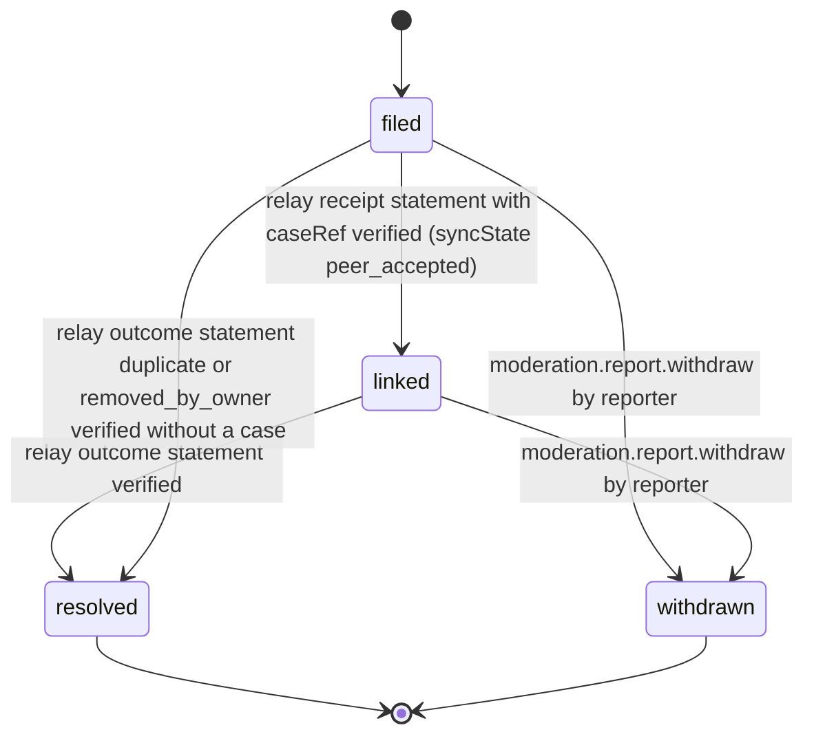

# PS-094-03 — Workflow state machine: Content flags

**Status:** SPECIFIED (Stage 3). **Module:** [F12.S01.M01 Content flags](SPEC.md) · **Scope:** MVP · **Code:** `packages/moderation/src/reporting/flags` · **Contracts:** [CTR-ID-001](../../../planning/contracts/CTR-ID-001.md), [CTR-EVT-001](../../../planning/contracts/CTR-EVT-001.md), [CTR-ERR-001](../../../planning/contracts/CTR-ERR-001.md), [CTR-CAP-001](../../../planning/contracts/CTR-CAP-001.md), [CTR-IDM-001](../../../planning/contracts/CTR-IDM-001.md), [CTR-PRV-001](../../../planning/contracts/CTR-PRV-001.md), [CTR-FED-001](../../../planning/contracts/CTR-FED-001.md), [CTR-OBS-001](../../../planning/contracts/CTR-OBS-001.md)

> Generated from `module.spec.yaml` by `tools/specgen`. Edit the YAML, then run `pnpm spec:render`.

## Requirements

- **PS-094-03.R01** Reports follow the declared lifecycle and any other transition is refused with CONFLICT_STATE.
- **PS-094-03.R02** Sync state advances only through local committed, prepared, transport_acknowledged and peer_accepted, and the UI never shows more than the reached state.
- **PS-094-03.R03** A reporter can withdraw a report while it is filed or linked; withdrawal sends a signed withdrawal statement but cannot recall evidence the relay already holds.

## Specification

### Report lifecycle

Initial **filed**; terminal **resolved**, **withdrawn**.

| Transition | Trigger | Guard / effect |
|---|---|---|
| filed -> linked | relay receipt statement with caseRef verified (syncState peer_accepted) | caseRef stored |
| filed -> withdrawn | moderation.report.withdraw by reporter | withdrawal statement queued; local record kept |
| linked -> resolved | relay outcome statement verified | outcome stored |
| linked -> withdrawn | moderation.report.withdraw by reporter | relay told; case may continue on other evidence |
| filed -> resolved | relay outcome statement duplicate or removed_by_owner verified without a case | outcome stored |

### Timeouts and scheduled transitions

- Prepared statements retry delivery with CTR-IDM-001 backoff for up to 7 days, then show 'not delivered' with export and resend actions.
- Relay side: a received report without a linked case after 24 h raises an operator metric.

## Verification

| Test | Level | Covers | Scenario | Expected |
|---|---|---|---|---|
| TEST-PS-094-09.T03 | property | PS-094-03.R01, PS-094-03.R02 | random sequences of receipts, outcomes and withdrawals on one report | only declared transitions succeed and sync state never skips a step |
| TEST-PS-094-09.T04 | integration | PS-094-03.R03 | withdraw while linked | withdrawal statement queued, local record kept, relay case continues |
| TEST-PS-094-09.T10 | integration | PS-094-03.R02, PS-094-06.R03 | relay offline for 8 days then back | UI shows not delivered after 7 days; manual resend reaches transport_acknowledged |

## Dependencies

Module depends on: F12.S01.M02, F12.S02.M03, F16.S01.M01, F16.S02.M03, CTR-ID-001, CTR-EVT-001, CTR-ERR-001, CTR-CAP-001, CTR-IDM-001, CTR-PRV-001, CTR-FED-001, CTR-OBS-001. Predecessor: [domain_schema.md](domain_schema.md).
