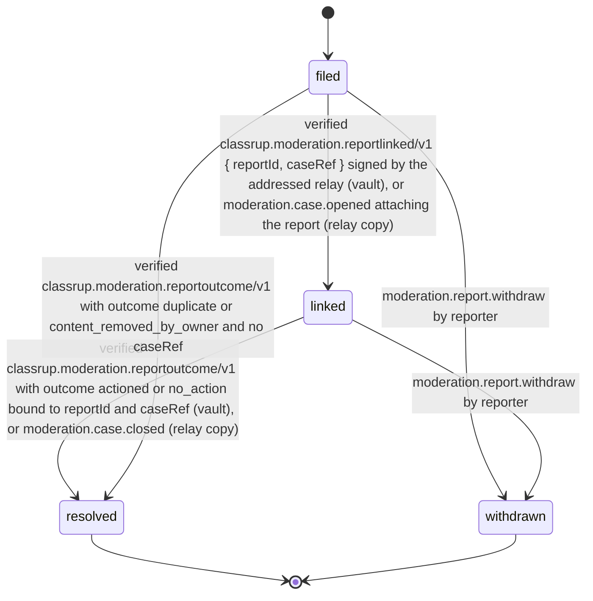
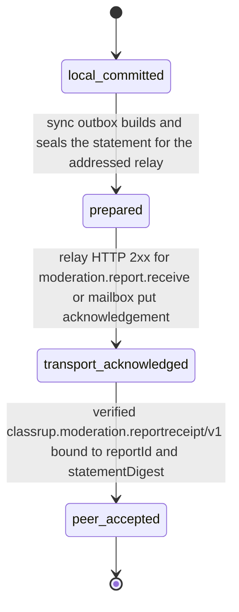

# PS-094-03 — Workflow state machine: Content flags

**Status:** SPECIFIED (Stage 3). **Module:** [F12.S01.M01 Content flags](SPEC.md) · **Scope:** MVP · **Code:** `packages/moderation/src/reporting/flags` · **Contracts:** [CTR-ID-001](../../../planning/contracts/CTR-ID-001.md), [CTR-EVT-001](../../../planning/contracts/CTR-EVT-001.md), [CTR-ERR-001](../../../planning/contracts/CTR-ERR-001.md), [CTR-CAP-001](../../../planning/contracts/CTR-CAP-001.md), [CTR-IDM-001](../../../planning/contracts/CTR-IDM-001.md), [CTR-PRV-001](../../../planning/contracts/CTR-PRV-001.md), [CTR-FED-001](../../../planning/contracts/CTR-FED-001.md), [CTR-OBS-001](../../../planning/contracts/CTR-OBS-001.md)

> Generated from `module.spec.yaml` by `tools/specgen`. Edit the YAML, then run `pnpm spec:render`.

## Requirements

- **PS-094-03.R01** Reports follow the declared lifecycle and any other transition is refused with CONFLICT_STATE.
- **PS-094-03.R02** Sync state advances only through local committed, prepared, transport_acknowledged (relay transport 2xx or mailbox acknowledgement) and peer_accepted (verified relay receipt bound to reportId and statement digest), and the UI never shows more than the reached state.
- **PS-094-03.R03** A reporter can withdraw a report while it is filed or linked; withdrawal sends a signed withdrawal statement but cannot recall evidence the relay already holds.
- **PS-094-03.R04** The relay sends a signed reportlinked statement when it attaches a received report to a case and a signed reportoutcome statement when that case closes, so the reporter's vault can reach linked and resolved and see the outcome actioned or no_action.

## Specification

### Report lifecycle

Initial **filed**; terminal **resolved**, **withdrawn**.

| Transition | Trigger | Guard / effect |
|---|---|---|
| filed -> linked | verified classrup.moderation.reportlinked/v1 { reportId, caseRef } signed by the addressed relay (vault), or moderation.case.opened attaching the report (relay copy) | caseRef stored |
| filed -> withdrawn | moderation.report.withdraw by reporter | withdrawal statement queued; local record kept |
| linked -> resolved | verified classrup.moderation.reportoutcome/v1 with outcome actioned or no_action bound to reportId and caseRef (vault), or moderation.case.closed (relay copy) | outcome stored |
| linked -> withdrawn | moderation.report.withdraw by reporter | relay told; case may continue on other evidence |
| filed -> resolved | verified classrup.moderation.reportoutcome/v1 with outcome duplicate or content_removed_by_owner and no caseRef | outcome stored; caseRef stays empty |

### ReportSyncState lifecycle

Initial **local_committed**; terminal **peer_accepted**.

| Transition | Trigger | Guard / effect |
|---|---|---|
| local_committed -> prepared | sync outbox builds and seals the statement for the addressed relay | statement bytes and statementDigest fixed; UI 'Saved on this device' |
| prepared -> transport_acknowledged | relay HTTP 2xx for moderation.report.receive or mailbox put acknowledgement | relayReceivedAt stored as a relay-clock claim; UI 'Sent to relay' |
| transport_acknowledged -> peer_accepted | verified classrup.moderation.reportreceipt/v1 bound to reportId and statementDigest | receipt stored; UI 'Relay acknowledged' |

**Note:** A 2xx response that already carries the signed receipt records transport_acknowledged and then peer_accepted as two ordered writes in one vault transaction, so each state has its own trigger and no step is skipped.

### Timeouts and scheduled transitions

- Prepared statements retry delivery with CTR-IDM-001 backoff for up to 7 days, then show 'not delivered' with export and resend actions.
- Relay side: a received report without a linked case after 24 h raises an operator metric.
- Vault label sweep on app idle and before display removes advisory labels whose expiresAt has passed.

## Verification

| Test | Level | Covers | Scenario | Expected |
|---|---|---|---|---|
| TEST-PS-094-09.T03 | property | PS-094-03.R01, PS-094-03.R02 | random sequences of transport results, receipts, link, outcome and withdrawal statements on one report | only declared transitions succeed; transport_acknowledged only after a relay 2xx or mailbox acknowledgement; peer_accepted only after a verified receipt bound to reportId and digest; no state is skipped |
| TEST-PS-094-09.T04 | integration | PS-094-03.R03 | withdraw while linked | withdrawal statement queued, local record kept, relay case continues |
| TEST-PS-094-09.T06 | integration | PS-094-04.R03, PS-094-03.R04 | case.opened then case.closed delivered twice on the relay | reports linked and resolved once; one reportlinked and one reportoutcome statement per reporter; the vault applies each once |
| TEST-PS-094-09.T10 | integration | PS-094-03.R02, PS-094-06.R03 | relay offline for 8 days then back | UI shows not delivered after 7 days; manual resend reaches transport_acknowledged then peer_accepted |
| TEST-PS-094-09.T16 | e2e | PS-094-03.R02, PS-094-08.R02 | mobile reporter files a report offline then reconnects | single report, delivery status progresses Saved, Sent, Relay acknowledged honestly, axe zero serious issues |
| TEST-PS-094-09.T19 | integration | PS-094-03.R04 | report filed, case opened, moderation.action.apply with closeCase true | vault receives reportlinked then reportoutcome actioned and shows Resolved; status_for_reporter returns the same statements |
| TEST-PS-094-09.T26 | integration | PS-094-04.R06, PS-094-03.R04 | a second reporter's report arrives after case C is open and is merged by F12.S02.M01; moderation.case.opened redelivered | link_case called in the intake transaction; the second reporter's vault receives one reportlinked for C and reaches linked; the fallback consumer sends nothing twice |

## Dependencies

Module depends on: F12.S01.M02, F12.S02.M03, F12.S03.M03, F07.S02.M02, F08.S01.M01, F11.S01.M01, F16.S01.M01, F16.S02.M03, F10.S01.M02, F10.S01.M03, F10.S01.M04, F10.S02.M02, CTR-ID-001, CTR-EVT-001, CTR-ERR-001, CTR-CAP-001, CTR-IDM-001, CTR-PRV-001, CTR-FED-001, CTR-OBS-001. Predecessor: [domain_schema.md](domain_schema.md).
