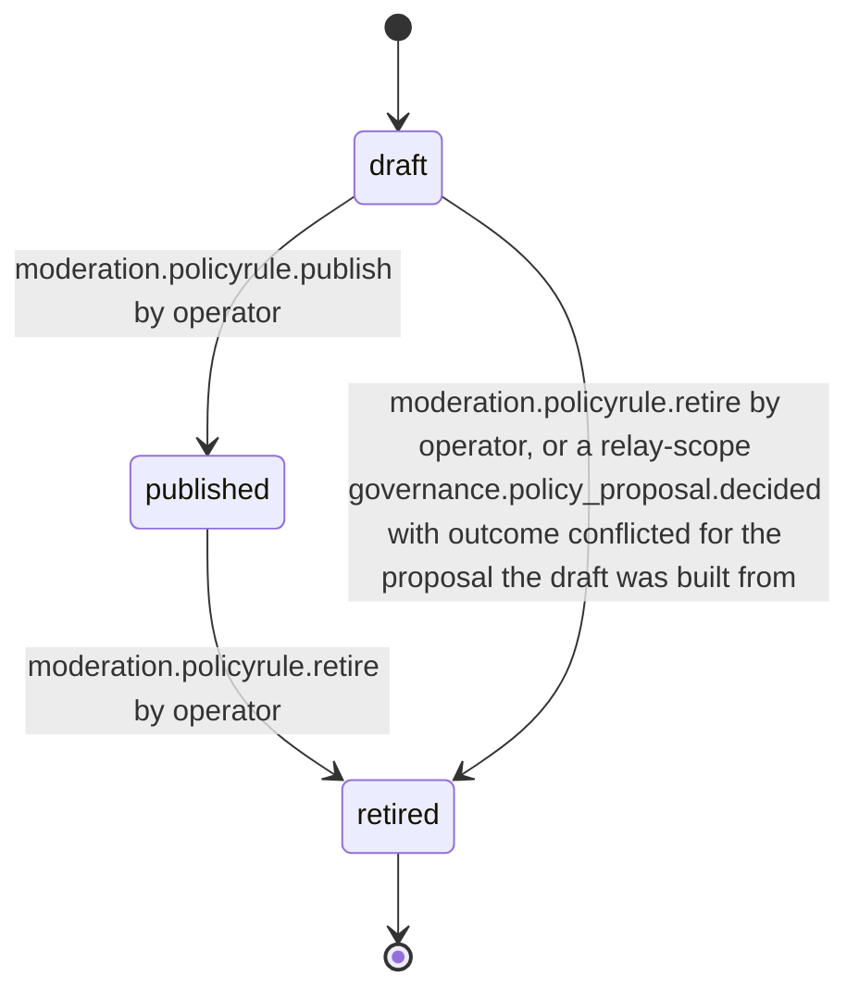
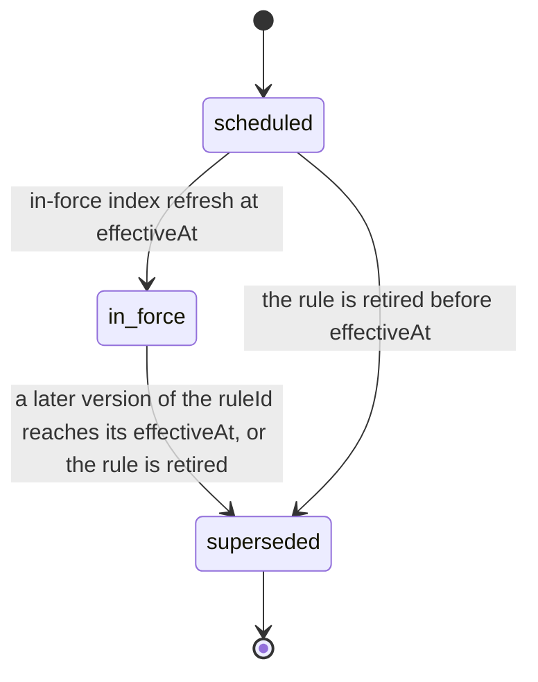

# PS-095-03 — Workflow state machine: Abuse policy

**Status:** SPECIFIED (Stage 3). **Module:** [F12.S02.M03 Abuse policy](SPEC.md) · **Scope:** MVP · **Code:** `packages/moderation/src/policy/abuse` · **Contracts:** [CTR-ID-001](../../../planning/contracts/CTR-ID-001.md), [CTR-EVT-001](../../../planning/contracts/CTR-EVT-001.md), [CTR-ERR-001](../../../planning/contracts/CTR-ERR-001.md), [CTR-CAP-001](../../../planning/contracts/CTR-CAP-001.md), [CTR-FED-001](../../../planning/contracts/CTR-FED-001.md), [CTR-PRV-001](../../../planning/contracts/CTR-PRV-001.md), [CTR-OBS-001](../../../planning/contracts/CTR-OBS-001.md)

> Generated from `module.spec.yaml` by `tools/specgen`. Edit the YAML, then run `pnpm spec:render`.

## Requirements

- **PS-095-03.R01** Rule versions follow the declared lifecycle and any other transition is refused with CONFLICT_STATE.
- **PS-095-03.R02** Publishing a version supersedes the previous in-force version at effectiveAt, and the previous stays readable.
- **PS-095-03.R03** Retiring a rule prevents new citations and leaves all existing citations valid.
- **PS-095-03.R04** The in-force state of a published version moves from scheduled to in_force at effectiveAt and to superseded when a later version takes effect or the rule is retired, and only an in_force version is citable for a decision at that time.
- **PS-095-03.R05** A governance-built draft starts in state draft with governanceRef and is published only by an operator through moderation.policyrule.publish; a conflicted outcome discards the proposal's unpublished drafts and flags a version already published from it without changing that version.

## Specification

### PolicyRule lifecycle

Initial **draft**; terminal **retired**.

| Transition | Trigger | Guard / effect |
|---|---|---|
| draft -> published | moderation.policyrule.publish by operator | statement signed; inForce scheduled or in_force by effectiveAt; emits moderation.policy.published |
| published -> retired | moderation.policyrule.retire by operator | retiredAt set; inForce superseded; later versions of the ID are refused |
| draft -> retired | moderation.policyrule.retire by operator, or a relay-scope governance.policy_proposal.decided with outcome conflicted for the proposal the draft was built from | draft discarded without publication (reason governance_conflicted for the latter) |

### PolicyRuleInForce lifecycle

Initial **scheduled**; terminal **superseded**.

| Transition | Trigger | Guard / effect |
|---|---|---|
| scheduled -> in_force | in-force index refresh at effectiveAt | the previous in_force version of the ruleId becomes superseded in the same write |
| in_force -> superseded | a later version of the ruleId reaches its effectiveAt, or the rule is retired | stays readable; not citable for later decision times |
| scheduled -> superseded | the rule is retired before effectiveAt | never citable |

### Timeouts and scheduled transitions

- Scheduled versions become in force at effectiveAt; a check every 60 s refreshes the in-force index.
- Discarded drafts are deleted 30 days after discard.

## Verification

| Test | Level | Covers | Scenario | Expected |
|---|---|---|---|---|
| TEST-PS-095-09.T03 | property | PS-095-01.R02, PS-095-01.R04, PS-095-03.R01 | random sequences of draft, publish, retire, edit and clock advances | published versions never change; at most one version of each ruleId in force at any instant; only declared transitions succeed |
| TEST-PS-095-09.T04 | integration | PS-095-03.R02, PS-095-03.R03 | action cites v1, v2 published and in force, rule retired | action still resolves v1 text; v1 superseded; retired rule not citable for new actions |
| TEST-PS-095-09.T16 | integration | PS-095-03.R04, PS-095-04.R04 | v2 scheduled for next week; check_citable for v2 now and after effectiveAt, and for v1 after v2 takes effect | scheduled and not citable; in_force and citable; v1 superseded and not citable for later decisions while still readable |
| TEST-PS-095-09.T17 | integration | PS-095-04.R05, PS-095-02.R05, PS-095-03.R05 | relay-scope decided events for platform_policy: approved with proposedChange for POL-FRAUD-001 and new POL-SCAM-001 delivered twice, a vault-scope copy, a prohibited_rule target, a digest mismatch, a publisher that is not an operator key of the relay, then conflicted for the approved proposal | one draft per (decisionCid, ruleId) with governanceRef built without a get call; the copy, the other target, the mismatch and the foreign publisher create nothing; conflicted discards the unpublished drafts with reason governance_conflicted; nothing is published |

## Dependencies

Module depends on: F18.S01.M02, F18.S02.M01, F16.S02.M02, F16.S01.M01, F16.S02.M03, CTR-ID-001, CTR-EVT-001, CTR-ERR-001, CTR-CAP-001, CTR-FED-001, CTR-PRV-001, CTR-OBS-001. Predecessor: [domain_schema.md](domain_schema.md).
