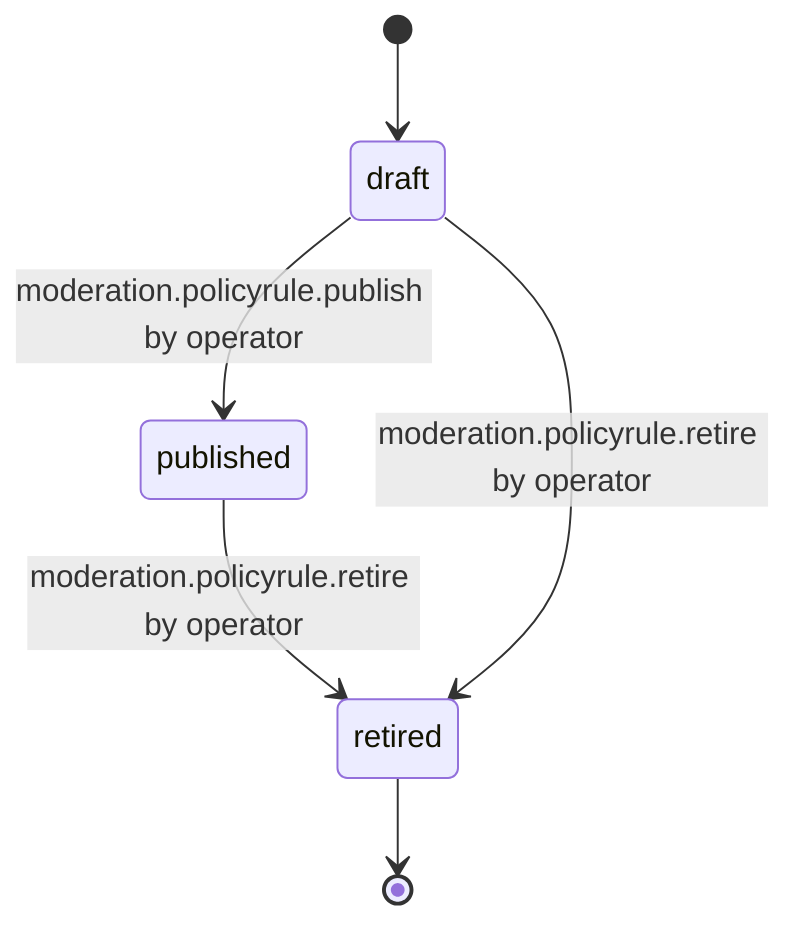

# PS-095-03 — Workflow state machine: Abuse policy

**Status:** SPECIFIED (Stage 3). **Module:** [F12.S02.M03 Abuse policy](SPEC.md) · **Scope:** MVP · **Code:** `packages/moderation/src/policy/abuse` · **Contracts:** [CTR-ID-001](../../../planning/contracts/CTR-ID-001.md), [CTR-EVT-001](../../../planning/contracts/CTR-EVT-001.md), [CTR-ERR-001](../../../planning/contracts/CTR-ERR-001.md), [CTR-CAP-001](../../../planning/contracts/CTR-CAP-001.md), [CTR-FED-001](../../../planning/contracts/CTR-FED-001.md), [CTR-PRV-001](../../../planning/contracts/CTR-PRV-001.md), [CTR-OBS-001](../../../planning/contracts/CTR-OBS-001.md)

> Generated from `module.spec.yaml` by `tools/specgen`. Edit the YAML, then run `pnpm spec:render`.

## Requirements

- **PS-095-03.R01** Rule versions follow the declared lifecycle and any other transition is refused with CONFLICT_STATE.
- **PS-095-03.R02** Publishing a version supersedes the previous in-force version at effectiveAt, and the previous stays readable.
- **PS-095-03.R03** Retiring a rule prevents new citations and leaves all existing citations valid.

## Specification

### PolicyRule lifecycle

Initial **draft**; terminal **retired**.

| Transition | Trigger | Guard / effect |
|---|---|---|
| draft -> published | moderation.policyrule.publish by operator | statement signed; emits moderation.policy.published |
| published -> retired | moderation.policyrule.retire by operator | retiredAt set; later versions of the ID are refused |
| draft -> retired | moderation.policyrule.retire by operator | draft discarded without publication |

### Timeouts and scheduled transitions

- Scheduled versions become in force at effectiveAt; a check every 60 s refreshes the in-force index.

## Verification

| Test | Level | Covers | Scenario | Expected |
|---|---|---|---|---|
| TEST-PS-095-09.T03 | property | PS-095-01.R02, PS-095-03.R01 | random sequences of draft, publish, retire, edit | published versions never change; exactly one version in force |
| TEST-PS-095-09.T04 | integration | PS-095-03.R02, PS-095-03.R03 | action cites v1, v2 published, rule retired | action still resolves v1 text; retired rule not citable for new actions |

## Dependencies

Module depends on: F16.S01.M01, F16.S02.M03, CTR-ID-001, CTR-EVT-001, CTR-ERR-001, CTR-CAP-001, CTR-FED-001, CTR-PRV-001, CTR-OBS-001. Predecessor: [domain_schema.md](domain_schema.md).
