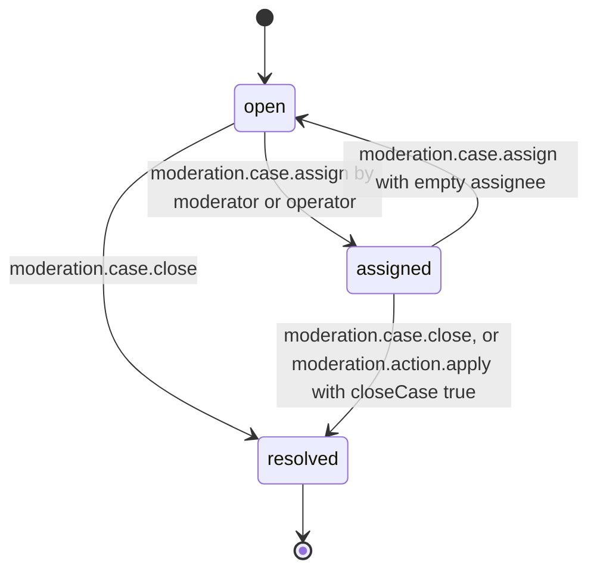
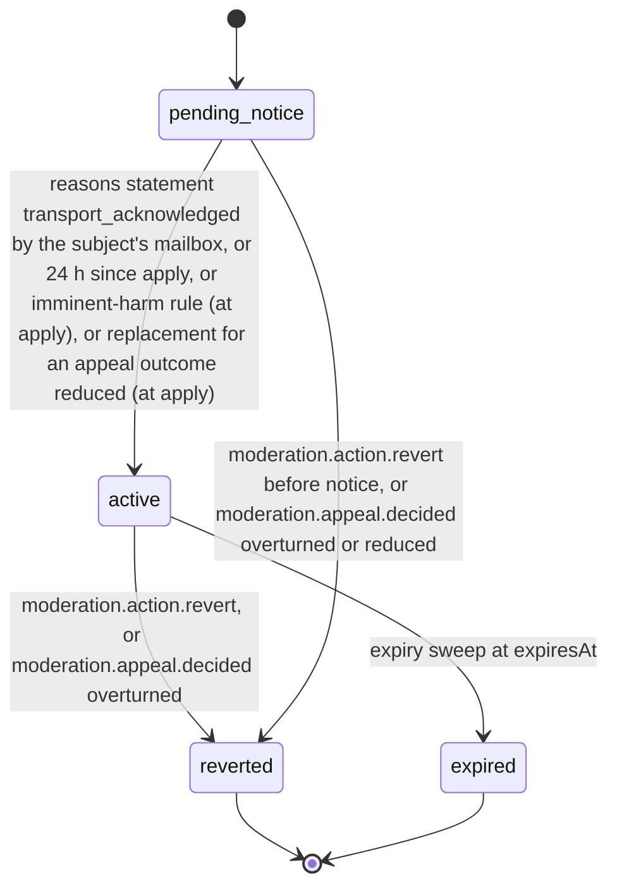

# PS-096-03 — Workflow state machine: Enforcement actions

**Status:** SPECIFIED (Stage 3). **Module:** [F12.S02.M01 Enforcement actions](SPEC.md) · **Scope:** MVP · **Code:** `packages/moderation/src/policy/enforcement` · **Contracts:** [CTR-ID-001](../../../planning/contracts/CTR-ID-001.md), [CTR-EVT-001](../../../planning/contracts/CTR-EVT-001.md), [CTR-ERR-001](../../../planning/contracts/CTR-ERR-001.md), [CTR-CAP-001](../../../planning/contracts/CTR-CAP-001.md), [CTR-IDM-001](../../../planning/contracts/CTR-IDM-001.md), [CTR-PRV-001](../../../planning/contracts/CTR-PRV-001.md), [CTR-FED-001](../../../planning/contracts/CTR-FED-001.md), [CTR-OBS-001](../../../planning/contracts/CTR-OBS-001.md)

> Generated from `module.spec.yaml` by `tools/specgen`. Edit the YAML, then run `pnpm spec:render`.

## Requirements

- **PS-096-03.R01** Cases and actions follow the declared lifecycles and any other transition is refused with CONFLICT_STATE.
- **PS-096-03.R02** An action takes effect only after its statement of reasons is transport_acknowledged by the subject's mailbox or 24 hours have passed since apply, except imminent-harm rules where effect is first and notice follows within 24 h.
- **PS-096-03.R03** Revert and expiry restore the relay-side effect, publish the reversal and, when an advisory was published, a signed advisory retraction; they never alter the original statement.
- **PS-096-03.R04** An appeal outcome reduced reverts the contested action with reason appeal_reduced and applies a new linked action with the reduced kind, expiry and capabilities and a new statement of reasons in one relay transaction.
- **PS-096-03.R05** Advisories carry the action's expiresAt, and subscriber vaults drop them at expiry or on the verified retraction.

## Specification

### ModerationCase lifecycle

Initial **open**; terminal **resolved**.

| Transition | Trigger | Guard / effect |
|---|---|---|
| open -> assigned | moderation.case.assign by moderator or operator | assigneeKey set |
| assigned -> open | moderation.case.assign with empty assignee | assignee cleared |
| open -> resolved | moderation.case.close | outcome no_action, duplicate or content_removed_by_owner; emits moderation.case.closed |
| assigned -> resolved | moderation.case.close, or moderation.action.apply with closeCase true | outcome set (actioned needs at least one action); emits moderation.case.closed |

### EnforcementAction lifecycle

Initial **pending_notice**; terminal **reverted**, **expired**.

| Transition | Trigger | Guard / effect |
|---|---|---|
| pending_notice -> active | reasons statement transport_acknowledged by the subject's mailbox, or 24 h since apply, or imminent-harm rule (at apply), or replacement for an appeal outcome reduced (at apply) | effect applied on relay; emits moderation.action.applied |
| active -> reverted | moderation.action.revert, or moderation.appeal.decided overturned | effect removed; reversal statement and, if an advisory exists, advisory retraction issued; emits moderation.action.reverted |
| active -> expired | expiry sweep at expiresAt | effect removed; advisory retraction issued if an advisory exists; emits moderation.action.reverted with reason expired |
| pending_notice -> reverted | moderation.action.revert before notice, or moderation.appeal.decided overturned or reduced | no effect was applied; reversal statement issued |

**Note:** Appeal outcome reduced on an active action uses active -> reverted with revertReason appeal_reduced; in the same transaction the replacement action is created with replacesActionId and goes pending_notice -> active at apply, and the events are emitted in the order reverted, applied.

### Timeouts and scheduled transitions

- Expiry sweep every 60 s moves active actions with expiresAt ≤ now to expired.
- pending_notice actions become active 24 h after apply even if the mailbox never acknowledged, with the statement available by query.
- Cases open for 14 days without an assignee raise an operator alert metric.

## Verification

| Test | Level | Covers | Scenario | Expected |
|---|---|---|---|---|
| TEST-PS-096-09.T03 | property | PS-096-03.R01 | random sequences of open, assign, close, apply, revert, expiry and appeal outcomes | only declared transitions succeed; terminal states never change |
| TEST-PS-096-09.T04 | integration | PS-096-03.R02 | mailbox acknowledges the statement after 2 h; mailbox down for 24 h; imminent-harm rule | active at acknowledgement; active at 24 h with the statement retrievable; imminent-harm effect first and notice follows |
| TEST-PS-096-09.T05 | integration | PS-096-03.R03, PS-096-04.R03 | operator revert and expiry of actions that published advisories | effect removed, reversal and advisory retraction signed, original statement unchanged, events in the same transaction as the state change |
| TEST-PS-096-09.T18 | integration | PS-096-03.R04 | appeal decided reduced from suspend_relay_access 90 days to restrict_feature 7 days; then the same with a failure injected after the revert | contested action reverted appeal_reduced and replacement active with a new statement in one transaction, events reverted then applied; with the failure neither change is stored |
| TEST-PS-096-09.T19 | integration | PS-096-03.R05, PS-096-01.R03 | action with advisory expires; another is overturned on appeal; subscriber vault syncs the feed | advisories carry expiresAt; retraction published with seq and advisory cid; subscriber drops both labels |

## Dependencies

Module depends on: F12.S02.M03, F12.S01.M01, F12.S01.M02, F12.S03.M03, F06.S01.M01, F08.S01.M01, F07.S02.M01, F11.S01.M01, F16.S01.M01, F16.S02.M03, F10.S01.M02, F10.S01.M03, F10.S01.M04, F10.S02.M02, CTR-ID-001, CTR-EVT-001, CTR-ERR-001, CTR-CAP-001, CTR-IDM-001, CTR-PRV-001, CTR-FED-001, CTR-OBS-001. Predecessor: [domain_schema.md](domain_schema.md).
