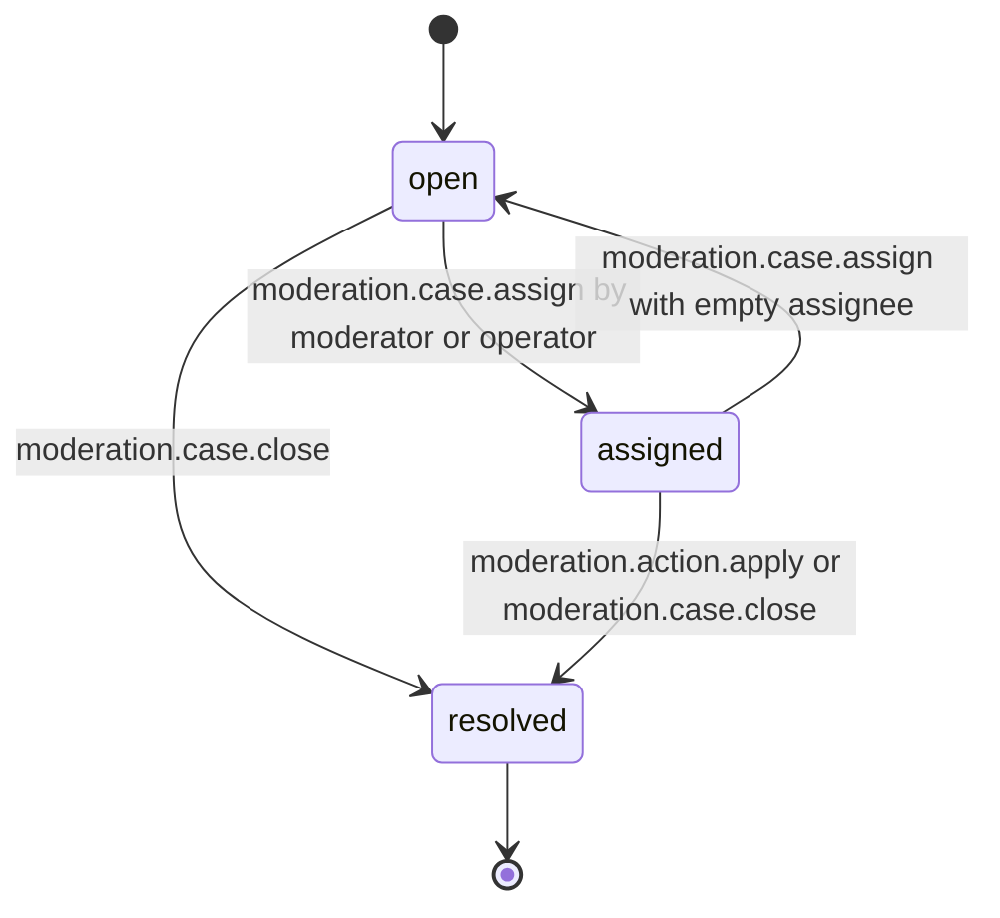
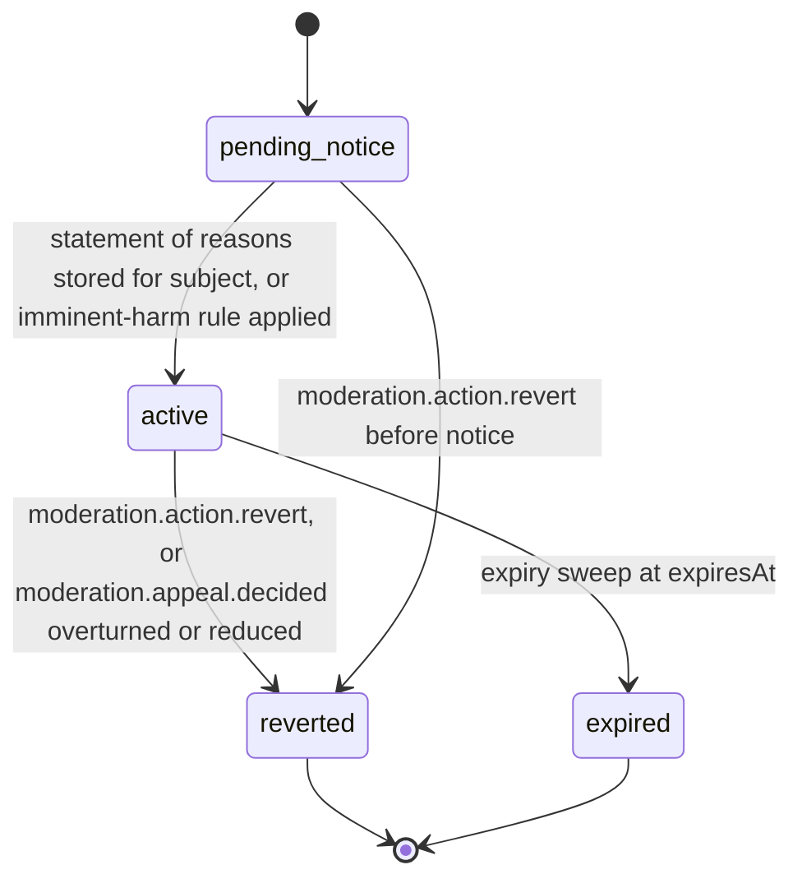

# PS-096-03 — Workflow state machine: Enforcement actions

**Status:** SPECIFIED (Stage 3). **Module:** [F12.S02.M01 Enforcement actions](SPEC.md) · **Scope:** MVP · **Code:** `packages/moderation/src/policy/enforcement` · **Contracts:** [CTR-ID-001](../../../planning/contracts/CTR-ID-001.md), [CTR-EVT-001](../../../planning/contracts/CTR-EVT-001.md), [CTR-ERR-001](../../../planning/contracts/CTR-ERR-001.md), [CTR-CAP-001](../../../planning/contracts/CTR-CAP-001.md), [CTR-IDM-001](../../../planning/contracts/CTR-IDM-001.md), [CTR-PRV-001](../../../planning/contracts/CTR-PRV-001.md), [CTR-FED-001](../../../planning/contracts/CTR-FED-001.md), [CTR-OBS-001](../../../planning/contracts/CTR-OBS-001.md)

> Generated from `module.spec.yaml` by `tools/specgen`. Edit the YAML, then run `pnpm spec:render`.

## Requirements

- **PS-096-03.R01** Cases and actions follow the declared lifecycles and any other transition is refused with CONFLICT_STATE.
- **PS-096-03.R02** An action takes effect only after its statement of reasons is stored for the subject, except imminent-harm rules where effect is first and notice follows within 24 h.
- **PS-096-03.R03** Revert and expiry restore the relay-side effect and publish the reversal; they never alter the original statement.

## Specification

### ModerationCase lifecycle

Initial **open**; terminal **resolved**.

| Transition | Trigger | Guard / effect |
|---|---|---|
| open -> assigned | moderation.case.assign by moderator or operator | assigneeKey set |
| assigned -> open | moderation.case.assign with empty assignee | assignee cleared |
| open -> resolved | moderation.case.close | outcome no_action, duplicate or content_removed_by_owner; emits moderation.case.closed |
| assigned -> resolved | moderation.action.apply or moderation.case.close | outcome set; emits moderation.case.closed |

### EnforcementAction lifecycle

Initial **pending_notice**; terminal **reverted**, **expired**.

| Transition | Trigger | Guard / effect |
|---|---|---|
| pending_notice -> active | statement of reasons stored for subject, or imminent-harm rule applied | effect applied on relay; emits moderation.action.applied |
| active -> reverted | moderation.action.revert, or moderation.appeal.decided overturned or reduced | effect removed; emits moderation.action.reverted |
| active -> expired | expiry sweep at expiresAt | effect removed; emits moderation.action.reverted with reason expired |
| pending_notice -> reverted | moderation.action.revert before notice | no effect was applied |

### Timeouts and scheduled transitions

- Expiry sweep every 60 s moves active actions with expiresAt ≤ now to expired.
- pending_notice actions become active after 24 h even if the mailbox is unreachable, with the statement available by query.
- Cases open for 14 days without an assignee raise an operator alert metric.

## Verification

| Test | Level | Covers | Scenario | Expected |
|---|---|---|---|---|
| TEST-PS-096-09.T03 | property | PS-096-03.R01 | random sequences of assign, close, apply, revert, expiry | only declared transitions succeed; terminal states never change |
| TEST-PS-096-09.T04 | integration | PS-096-03.R02 | mailbox down on apply; imminent-harm rule | stays pending_notice up to 24 h; imminent-harm effect first and notice follows |
| TEST-PS-096-09.T05 | integration | PS-096-03.R03, PS-096-04.R03 | appeal overturn event and expiry | action reverted, reversal statement signed, original statement unchanged |

## Dependencies

Module depends on: F12.S02.M03, F12.S01.M02, F16.S01.M01, F16.S02.M03, CTR-ID-001, CTR-EVT-001, CTR-ERR-001, CTR-CAP-001, CTR-IDM-001, CTR-PRV-001, CTR-FED-001, CTR-OBS-001. Predecessor: [domain_schema.md](domain_schema.md).
