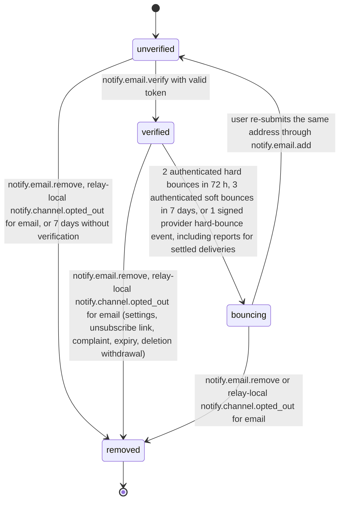
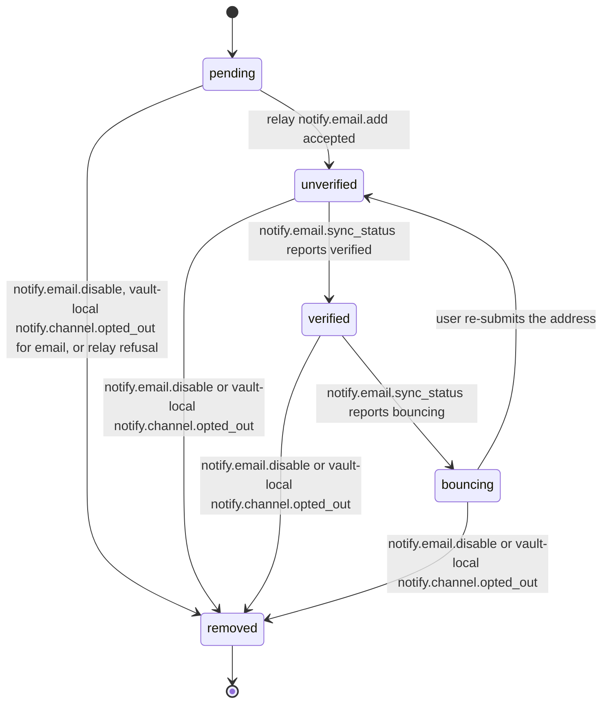
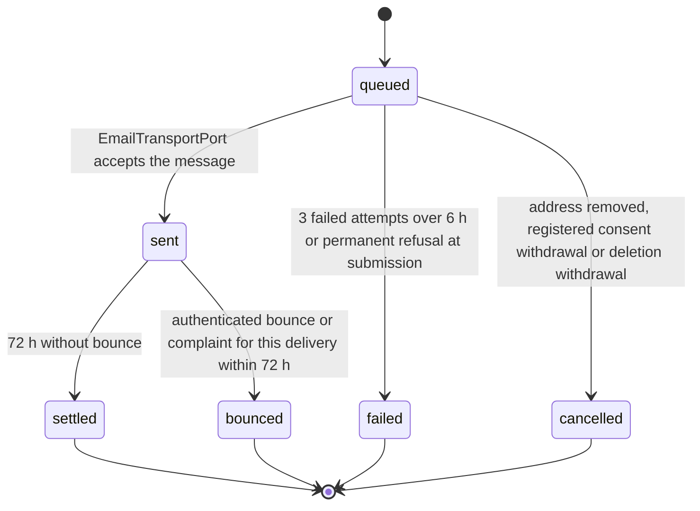

# PS-102-03 — Workflow state machine: Email delivery

**Status:** SPECIFIED (Stage 3). **Module:** [F13.S01.M02 Email delivery](SPEC.md) · **Scope:** MVP · **Code:** `packages/notify/src/delivery/email` · **Contracts:** [CTR-FED-001](../../../planning/contracts/CTR-FED-001.md), [CTR-ID-001](../../../planning/contracts/CTR-ID-001.md), [CTR-EVT-001](../../../planning/contracts/CTR-EVT-001.md), [CTR-ERR-001](../../../planning/contracts/CTR-ERR-001.md), [CTR-CAP-001](../../../planning/contracts/CTR-CAP-001.md), [CTR-PRV-001](../../../planning/contracts/CTR-PRV-001.md), [CTR-IDM-001](../../../planning/contracts/CTR-IDM-001.md), [CTR-OBS-001](../../../planning/contracts/CTR-OBS-001.md), [CTR-FLG-001](../../../planning/contracts/CTR-FLG-001.md)

> Generated from `module.spec.yaml` by `tools/specgen`. Edit the YAML, then run `pnpm spec:render`.

## Requirements

- **PS-102-03.R01** An EmailAddress relay copy moves unverified to verified to bouncing to removed; removed is terminal and a returning user adds the address again as a new record.
- **PS-102-03.R02** An EmailDelivery moves queued to sent to settled or bounced, queued to failed, or queued to cancelled; settled, bounced, failed and cancelled are terminal, and a bounce for a settled delivery leaves that row unchanged but still applies the address transition and emits notify.email.bounced.
- **PS-102-03.R03** Removal, a registered email consent withdrawal or the deletion withdrawal registered at the relay erase the address ciphertext within 24 hours and cancel queued deliveries.
- **PS-102-03.R04** When the vault learns from notify.email.get_mine on sync that its address became bouncing, it updates the vault email target and emits vault-local notify.email.bounced, which the inbox routes to the security notice template notify.tpl.security.email_stopped.
- **PS-102-03.R05** Verified to bouncing requires two authenticated hard bounces within 72 hours, three authenticated soft bounces within 7 days, or one signed provider hard-bounce event, so a single forged or stray report cannot cut off security email.

## Specification

### EmailAddress lifecycle

Initial **unverified**; terminal **removed**.

| Transition | Trigger | Guard / effect |
|---|---|---|
| unverified -> verified | notify.email.verify with valid token | verifiedAt set; token erased |
| verified -> bouncing | 2 authenticated hard bounces in 72 h, 3 authenticated soft bounces in 7 days, or 1 signed provider hard-bounce event, including reports for settled deliveries | sends stop; emits notify.email.bounced (relay-local) |
| bouncing -> unverified | user re-submits the same address through notify.email.add | new verification token issued; counters reset |
| unverified -> removed | notify.email.remove, relay-local notify.channel.opted_out for email, or 7 days without verification | ciphertext erased; queued deliveries cancelled |
| verified -> removed | notify.email.remove, relay-local notify.channel.opted_out for email (settings, unsubscribe link, complaint, expiry, deletion withdrawal) | ciphertext erased; queued deliveries cancelled |
| bouncing -> removed | notify.email.remove or relay-local notify.channel.opted_out for email | ciphertext erased |

### EmailAddress vault target lifecycle

Initial **pending**; terminal **removed**.

| Transition | Trigger | Guard / effect |
|---|---|---|
| pending -> unverified | relay notify.email.add accepted | emailAddressId stored |
| unverified -> verified | notify.email.sync_status reports verified | status mirrored |
| verified -> bouncing | notify.email.sync_status reports bouncing | emits notify.email.bounced (vault-local) |
| bouncing -> unverified | user re-submits the address | relay add called again |
| pending -> removed | notify.email.disable, vault-local notify.channel.opted_out for email, or relay refusal | address deleted from the vault within 24 h |
| unverified -> removed | notify.email.disable or vault-local notify.channel.opted_out | relay remove queued; address deleted from the vault within 24 h |
| verified -> removed | notify.email.disable or vault-local notify.channel.opted_out | relay remove queued; address deleted from the vault within 24 h |
| bouncing -> removed | notify.email.disable or vault-local notify.channel.opted_out | relay remove queued; address deleted from the vault within 24 h |

### EmailDelivery lifecycle

Initial **queued**; terminal **settled**, **bounced**, **failed**, **cancelled**.

| Transition | Trigger | Guard / effect |
|---|---|---|
| queued -> sent | EmailTransportPort accepts the message | emits notify.email.sent |
| queued -> failed | 3 failed attempts over 6 h or permanent refusal at submission | failure reason stored |
| queued -> cancelled | address removed, registered consent withdrawal or deletion withdrawal | no send; cancelReason stored |
| sent -> bounced | authenticated bounce or complaint for this delivery within 72 h | address counters updated; emits notify.email.bounced |
| sent -> settled | 72 h without bounce | row kept until retention; later reports update only the address |

### Timeouts and scheduled transitions

- Unverified addresses are removed 7 days after creation.
- Verification tokens expire after 24 hours.
- Delivery retries at 5 minutes, 1 hour and 6 hours after the first attempt; deliveries settle 72 hours after sending.
- The vault runs notify.email.sync_status at app open, every 6 hours while open and on each service-worker wake.

## Verification

| Test | Level | Covers | Scenario | Expected |
|---|---|---|---|---|
| TEST-PS-102-09.T04 | property | PS-102-03.R01, PS-102-03.R02, PS-102-03.R03 | random sequences of add, verify, authenticated bounces, remove, withdrawal and expiry | terminal states never change; queued deliveries cancel on removal and withdrawal; ciphertext erased within 24 h |
| TEST-PS-102-09.T06 | integration | PS-102-04.R03, PS-102-03.R03 | relay-local notify.channel.opted_out for email to the relay instance; vault-local opted_out, privacy.deletion.requested and privacy.deletion.completed to the vault instance | relay cancels queued deliveries and erases ciphertext; vault target removed; deletion request only shows paused and erases nothing; completed signs nothing |
| TEST-PS-102-09.T10 | integration | PS-102-03.R05, PS-102-02.R04 | one authenticated hard bounce, a second within 72 h, 3 authenticated soft bounces, one signed provider event, a complaint from the configured feedback loop, a bounce for a settled delivery | bouncing only after the thresholds; complaint registers a withdrawal via unsubscribe_link; settled row unchanged while the address becomes bouncing and notify.email.bounced is emitted |
| TEST-PS-102-09.T15 | integration | PS-102-03.R04 | relay copy becomes bouncing; vault runs sync_status at app open | vault target becomes bouncing and vault-local notify.email.bounced is emitted once; the inbox shows notify.tpl.security.email_stopped |

## Dependencies

Module depends on: F13.S02.M03, F16.S02.M02, F11.S01.M03, F07.S02.M01, F15.S01.M01, F15.S02.M01, F15.S04.M03, F12.S03.M03, F10.S01.M01, F10.S01.M02, F10.S01.M03, F10.S01.M04, F10.S02.M02, CTR-FED-001, CTR-ID-001, CTR-EVT-001, CTR-ERR-001, CTR-CAP-001, CTR-PRV-001, CTR-IDM-001, CTR-OBS-001, CTR-FLG-001. Predecessor: [domain_schema.md](domain_schema.md).
