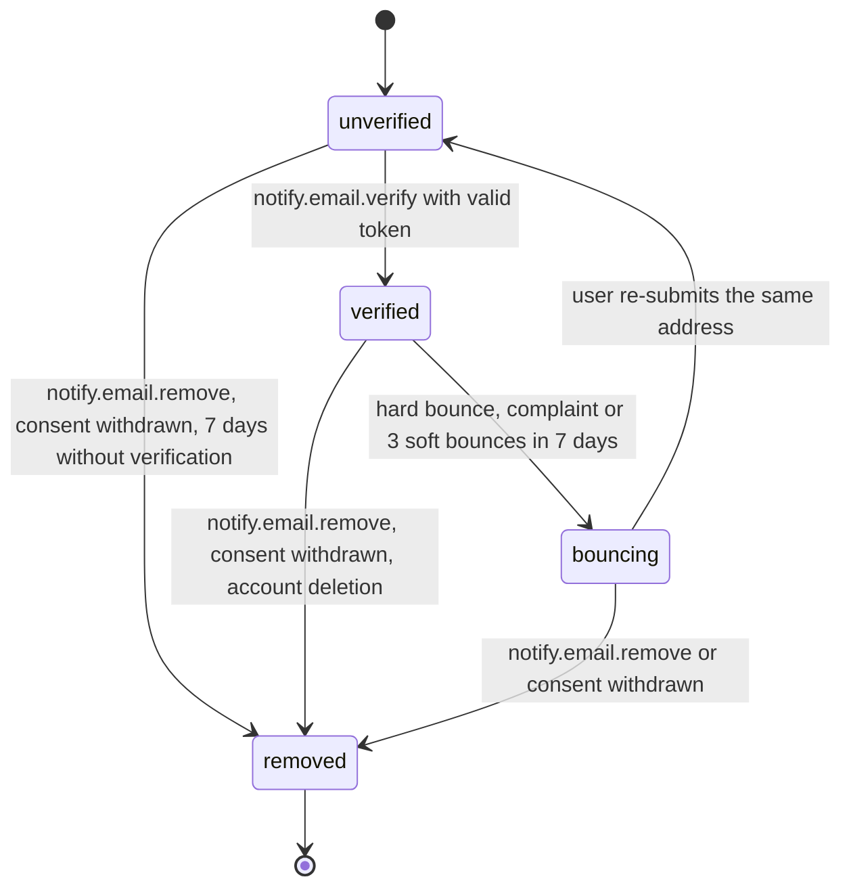
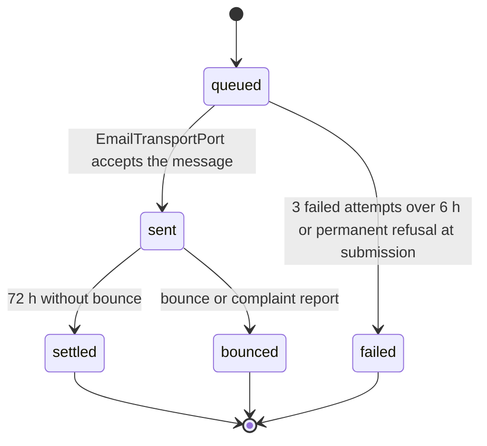

# PS-102-03 — Workflow state machine: Email delivery

**Status:** SPECIFIED (Stage 3). **Module:** [F13.S01.M02 Email delivery](SPEC.md) · **Scope:** MVP · **Code:** `packages/notify/src/delivery/email` · **Contracts:** [CTR-FED-001](../../../planning/contracts/CTR-FED-001.md), [CTR-ID-001](../../../planning/contracts/CTR-ID-001.md), [CTR-EVT-001](../../../planning/contracts/CTR-EVT-001.md), [CTR-ERR-001](../../../planning/contracts/CTR-ERR-001.md), [CTR-CAP-001](../../../planning/contracts/CTR-CAP-001.md), [CTR-PRV-001](../../../planning/contracts/CTR-PRV-001.md), [CTR-IDM-001](../../../planning/contracts/CTR-IDM-001.md), [CTR-OBS-001](../../../planning/contracts/CTR-OBS-001.md), [CTR-FLG-001](../../../planning/contracts/CTR-FLG-001.md)

> Generated from `module.spec.yaml` by `tools/specgen`. Edit the YAML, then run `pnpm spec:render`.

## Requirements

- **PS-102-03.R01** An EmailAddress moves unverified to verified to bouncing to removed; removed is terminal and a returning user adds the address again as a new record.
- **PS-102-03.R02** An EmailDelivery moves queued to sent to settled or bounced, or queued to failed; settled, bounced and failed are terminal.
- **PS-102-03.R03** Removal erases the address ciphertext within 24 hours and cancels queued deliveries.

## Specification

### EmailAddress lifecycle

Initial **unverified**; terminal **removed**.

| Transition | Trigger | Guard / effect |
|---|---|---|
| unverified -> verified | notify.email.verify with valid token | verifiedAt set; token erased |
| verified -> bouncing | hard bounce, complaint or 3 soft bounces in 7 days | sends stop; in-app notice created by the app on next sync |
| bouncing -> unverified | user re-submits the same address | new verification token issued |
| unverified -> removed | notify.email.remove, consent withdrawn, 7 days without verification | ciphertext erased |
| verified -> removed | notify.email.remove, consent withdrawn, account deletion | ciphertext erased |
| bouncing -> removed | notify.email.remove or consent withdrawn | ciphertext erased |

### EmailDelivery lifecycle

Initial **queued**; terminal **settled**, **bounced**, **failed**.

| Transition | Trigger | Guard / effect |
|---|---|---|
| queued -> sent | EmailTransportPort accepts the message | emits notify.email.sent |
| queued -> failed | 3 failed attempts over 6 h or permanent refusal at submission | failure reason stored |
| sent -> bounced | bounce or complaint report | address status updated; emits notify.email.bounced |
| sent -> settled | 72 h without bounce | delivery row kept until retention |

### Timeouts and scheduled transitions

- Unverified addresses are removed 7 days after creation.
- Verification tokens expire after 24 hours.
- Delivery retries at 5 minutes, 1 hour and 6 hours after the first attempt.

## Verification

| Test | Level | Covers | Scenario | Expected |
|---|---|---|---|---|
| TEST-PS-102-09.T04 | property | PS-102-03.R01, PS-102-03.R02, PS-102-03.R03 | random sequences of add, verify, bounce, remove, expiry | terminal states never change; bounce stops sends; removal erases ciphertext within 24 h |

## Dependencies

Module depends on: F13.S02.M03, CTR-FED-001, CTR-ID-001, CTR-EVT-001, CTR-ERR-001, CTR-CAP-001, CTR-PRV-001, CTR-IDM-001, CTR-OBS-001, CTR-FLG-001. Predecessor: [domain_schema.md](domain_schema.md).
