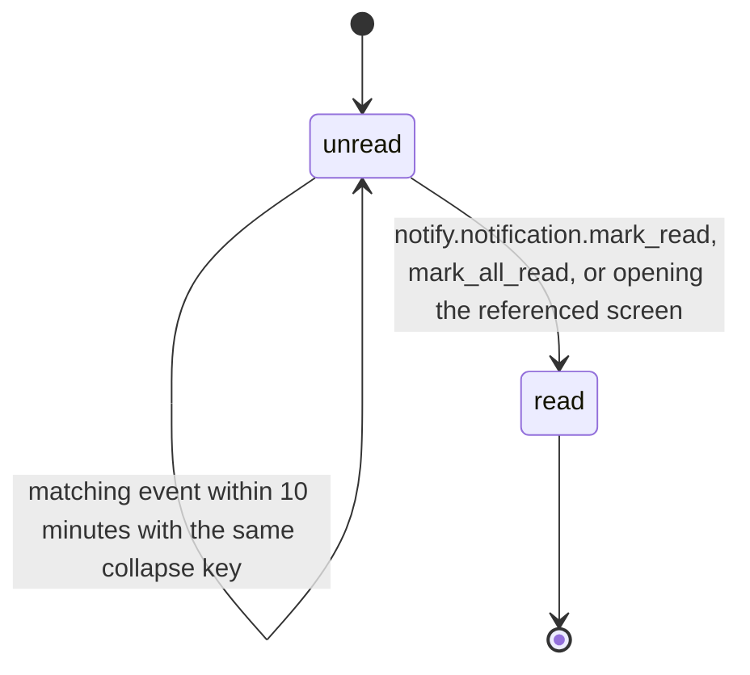

# PS-103-03 — Workflow state machine: In-app notifications

**Status:** SPECIFIED (Stage 3). **Module:** [F13.S01.M03 In-app notifications](SPEC.md) · **Scope:** MVP · **Code:** `packages/notify/src/delivery/inapp` · **Contracts:** [CTR-FED-001](../../../planning/contracts/CTR-FED-001.md), [CTR-ID-001](../../../planning/contracts/CTR-ID-001.md), [CTR-EVT-001](../../../planning/contracts/CTR-EVT-001.md), [CTR-ERR-001](../../../planning/contracts/CTR-ERR-001.md), [CTR-CAP-001](../../../planning/contracts/CTR-CAP-001.md), [CTR-PRV-001](../../../planning/contracts/CTR-PRV-001.md), [CTR-IDM-001](../../../planning/contracts/CTR-IDM-001.md), [CTR-OBS-001](../../../planning/contracts/CTR-OBS-001.md), [CTR-FLG-001](../../../planning/contracts/CTR-FLG-001.md)

> Generated from `module.spec.yaml` by `tools/specgen`. Edit the YAML, then run `pnpm spec:render`.

## Requirements

- **PS-103-03.R01** A Notification starts unread and becomes read; collapsing keeps it unread and increments count, and a read notification is never reopened except by a new collapse window starting a new row.
- **PS-103-03.R02** Deletion by cap or retention is not a state; rows are physically removed with a local tombstone count.
- **PS-103-03.R03** Read is terminal for the row, and new matching events after the collapse window create a new unread row.

## Specification

### Notification lifecycle

Initial **unread**; terminal **read**.

| Transition | Trigger | Guard / effect |
|---|---|---|
| unread -> unread | matching event within 10 minutes with the same collapse key | count + 1, updatedAt bumped; emits notify.notification.created with collapsed true |
| unread -> read | notify.notification.mark_read, mark_all_read, or opening the referenced screen | readAt set; actor added to the known-actor index; emits notify.notification.read |

### Timeouts and scheduled transitions

- Collapse window 10 minutes from createdAt of the unread row.
- Rows older than 30 days are removed by a daily local sweep (security rows 30 days as well; counts kept).

## Verification

| Test | Level | Covers | Scenario | Expected |
|---|---|---|---|---|
| TEST-PS-103-09.T03 | property | PS-103-03.R01, PS-103-03.R02, PS-103-03.R03 | random sequences of events within and beyond 10-minute windows, reads and sweeps | count equals collapsed events; read never reopens; new window creates new row |

## Dependencies

Module depends on: F13.S02.M04, F07.S02.M02, F08.S01.M01, F08.S01.M02, F08.S03.M03, F12.S03.M03, F10.S01.M02, F10.S01.M03, F10.S01.M04, F10.S02.M02, CTR-FED-001, CTR-ID-001, CTR-EVT-001, CTR-ERR-001, CTR-CAP-001, CTR-PRV-001, CTR-IDM-001, CTR-OBS-001, CTR-FLG-001. Predecessor: [domain_schema.md](domain_schema.md).
