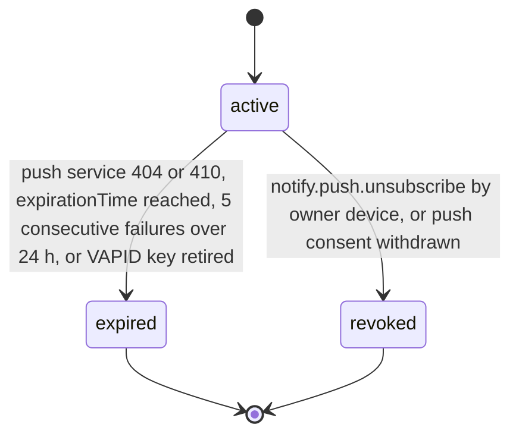

# PS-104-03 — Workflow state machine: Web push delivery

**Status:** SPECIFIED (Stage 3). **Module:** [F13.S01.M01 Web push delivery](SPEC.md) · **Scope:** MVP · **Code:** `packages/notify/src/delivery/push` · **Contracts:** [CTR-FED-001](../../../planning/contracts/CTR-FED-001.md), [CTR-ID-001](../../../planning/contracts/CTR-ID-001.md), [CTR-EVT-001](../../../planning/contracts/CTR-EVT-001.md), [CTR-ERR-001](../../../planning/contracts/CTR-ERR-001.md), [CTR-CAP-001](../../../planning/contracts/CTR-CAP-001.md), [CTR-PRV-001](../../../planning/contracts/CTR-PRV-001.md), [CTR-IDM-001](../../../planning/contracts/CTR-IDM-001.md), [CTR-OBS-001](../../../planning/contracts/CTR-OBS-001.md), [CTR-FLG-001](../../../planning/contracts/CTR-FLG-001.md)

> Generated from `module.spec.yaml` by `tools/specgen`. Edit the YAML, then run `pnpm spec:render`.

## Requirements

- **PS-104-03.R01** A PushSubscription starts active and ends expired or revoked; both are terminal and re-enabling creates a new subscription.
- **PS-104-03.R02** A 404 or 410 from the push service expires the subscription immediately; other failures only increment the counter and expire after 5 consecutive failures over at least 24 hours.
- **PS-104-03.R03** Withdrawal of push consent revokes all subscriptions of the user at that relay.

## Specification

### PushSubscription lifecycle

Initial **active**; terminal **expired**, **revoked**.

| Transition | Trigger | Guard / effect |
|---|---|---|
| active -> expired | push service 404 or 410, expirationTime reached, 5 consecutive failures over 24 h, or VAPID key retired | endpoint and keys erased; emits notify.push.failed with reason gone |
| active -> revoked | notify.push.unsubscribe by owner device, or push consent withdrawn | endpoint and keys erased |

### Timeouts and scheduled transitions

- Expired and revoked rows are purged 30 days after the transition; secrets are erased at the transition.
- Subscriptions with no successful send and no user activity for 90 days are probed once and expired if the probe fails.

## Verification

| Test | Level | Covers | Scenario | Expected |
|---|---|---|---|---|
| TEST-PS-104-09.T04 | property | PS-104-03.R01, PS-104-03.R02, PS-104-03.R03 | random sequences of subscribe, send outcomes (201, 404, 410, 429, 500), unsubscribe, consent withdrawal | expired and revoked never change; 410 expires at once; 5 failures over 24 h expire |
| TEST-PS-104-09.T06 | integration | PS-104-04.R03, PS-104-03.R03 | channel opted out and VAPID key revoked events delivered | subscriptions revoked or expired and secrets erased |

## Dependencies

Module depends on: F13.S02.M03, F16.S02.M01, CTR-FED-001, CTR-ID-001, CTR-EVT-001, CTR-ERR-001, CTR-CAP-001, CTR-PRV-001, CTR-IDM-001, CTR-OBS-001, CTR-FLG-001. Predecessor: [domain_schema.md](domain_schema.md).
