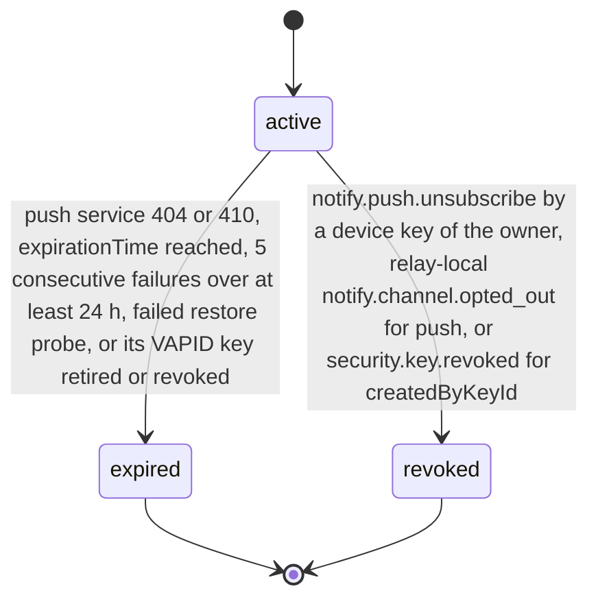
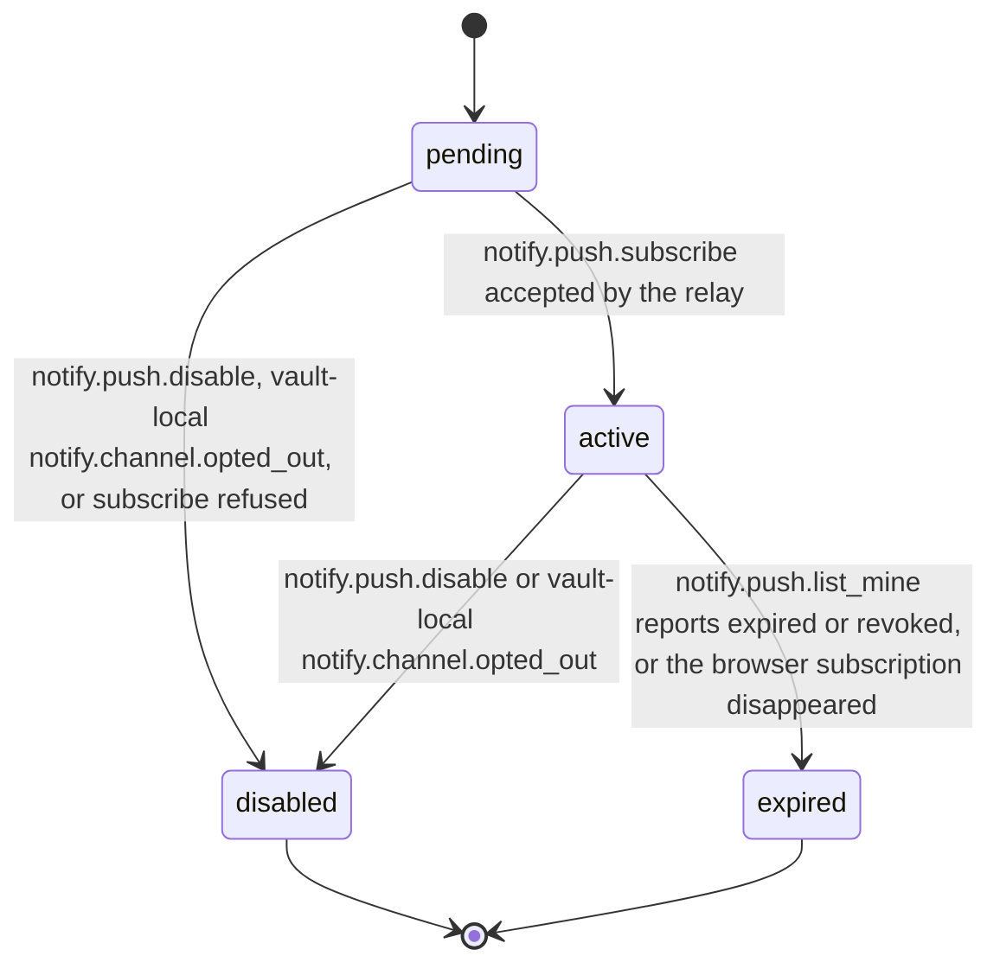

# PS-104-03 — Workflow state machine: Web push delivery

**Status:** SPECIFIED (Stage 3). **Module:** [F13.S01.M01 Web push delivery](SPEC.md) · **Scope:** MVP · **Code:** `packages/notify/src/delivery/push` · **Contracts:** [CTR-FED-001](../../../planning/contracts/CTR-FED-001.md), [CTR-ID-001](../../../planning/contracts/CTR-ID-001.md), [CTR-EVT-001](../../../planning/contracts/CTR-EVT-001.md), [CTR-ERR-001](../../../planning/contracts/CTR-ERR-001.md), [CTR-CAP-001](../../../planning/contracts/CTR-CAP-001.md), [CTR-PRV-001](../../../planning/contracts/CTR-PRV-001.md), [CTR-IDM-001](../../../planning/contracts/CTR-IDM-001.md), [CTR-OBS-001](../../../planning/contracts/CTR-OBS-001.md), [CTR-FLG-001](../../../planning/contracts/CTR-FLG-001.md)

> Generated from `module.spec.yaml` by `tools/specgen`. Edit the YAML, then run `pnpm spec:render`.

## Requirements

- **PS-104-03.R01** A relay PushSubscription starts active and ends expired or revoked; both are terminal, secrets are erased at the transition, and re-enabling creates a new subscription.
- **PS-104-03.R02** A 404 or 410 from the push service expires the subscription immediately; transient failures and 401 or 403 rejections of that one subscription only increment its counter and expire it after 5 consecutive failures over at least 24 hours.
- **PS-104-03.R03** A push consent withdrawal registered at the relay (relay-local notify.channel.opted_out) and a revocation of the device key that created the subscription revoke it at that relay, and the vault-local notify.channel.opted_out disables the push target on the device.
- **PS-104-03.R04** The vault push target moves from pending to active and ends disabled or expired; the vault learns relay-side expiry from notify.push.list_mine on app open and shows Re-enable push.

## Specification

### PushSubscription lifecycle

Initial **active**; terminal **expired**, **revoked**.

| Transition | Trigger | Guard / effect |
|---|---|---|
| active -> expired | push service 404 or 410, expirationTime reached, 5 consecutive failures over at least 24 h, failed restore probe, or its VAPID key retired or revoked | secret erased; emits notify.push.failed with reason gone |
| active -> revoked | notify.push.unsubscribe by a device key of the owner, relay-local notify.channel.opted_out for push, or security.key.revoked for createdByKeyId | secret erased in the same transaction |

### PushSubscription vault target lifecycle

Initial **pending**; terminal **disabled**, **expired**.

| Transition | Trigger | Guard / effect |
|---|---|---|
| pending -> active | notify.push.subscribe accepted by the relay | subscriptionId and vapidKeyId stored |
| pending -> disabled | notify.push.disable, vault-local notify.channel.opted_out, or subscribe refused | PushManager.unsubscribe called |
| active -> disabled | notify.push.disable or vault-local notify.channel.opted_out | PushManager.unsubscribe called; relay unsubscribe queued in the sync outbox |
| active -> expired | notify.push.list_mine reports expired or revoked, or the browser subscription disappeared | Re-enable push shown; a new target is created on re-enable |

### Timeouts and scheduled transitions

- Expired and revoked relay rows are purged 30 days after the transition; secrets are erased at the transition.
- Relay subscriptions with no successful send for 90 days are probed once and expired if the probe fails.
- Subscriptions bound to a VAPID key retired by scheduled rotation expire 30 days after the rotation.

## Verification

| Test | Level | Covers | Scenario | Expected |
|---|---|---|---|---|
| TEST-PS-104-09.T04 | property | PS-104-03.R01, PS-104-03.R02 | random sequences of subscribe, send outcomes (201, 401, 403, 404, 410, 429, 500) and unsubscribe | expired and revoked never change; 410 expires at once; 5 failures over 24 h expire; 401 and 403 affect only that subscription |
| TEST-PS-104-09.T06 | integration | PS-104-04.R03, PS-104-03.R03, PS-104-01.R02 | relay-local notify.channel.opted_out for push and security.key.revoked for the VAPID key delivered to the relay instance; vault-local opted_out to the vault instance | relay subscriptions revoked or expired with secrets erased in the same transaction; vault target disabled and PushManager.unsubscribe called |
| TEST-PS-104-09.T17 | abuse | PS-104-05.R04, PS-104-03.R03 | device key K is revoked in F16.S02.M02; K then signs subscribe, list and unsubscribe; a request signed before revocationEffectiveFrom arrives late | the subscription created by K is revoked; every later request refused UNAUTHENTICATED; the late pre-revocation request is refused because the key is no longer active |
| TEST-PS-104-09.T18 | unit | PS-104-01.R04, PS-104-03.R04, PS-104-04.R04 | enable, disable and expiry discovered by list_mine in the vault; inspect the push target record and the outgoing request | target moves pending, active, then disabled or expired; record holds no endpoint or keys; subscribe body is sealed and the request carries no device label |

## Dependencies

Module depends on: F13.S02.M03, F16.S02.M02, F07.S02.M01, F15.S01.M01, F15.S02.M01, F12.S03.M03, F10.S01.M01, F10.S01.M02, F10.S01.M03, F10.S01.M04, F10.S02.M02, CTR-FED-001, CTR-ID-001, CTR-EVT-001, CTR-ERR-001, CTR-CAP-001, CTR-PRV-001, CTR-IDM-001, CTR-OBS-001, CTR-FLG-001. Predecessor: [domain_schema.md](domain_schema.md).
