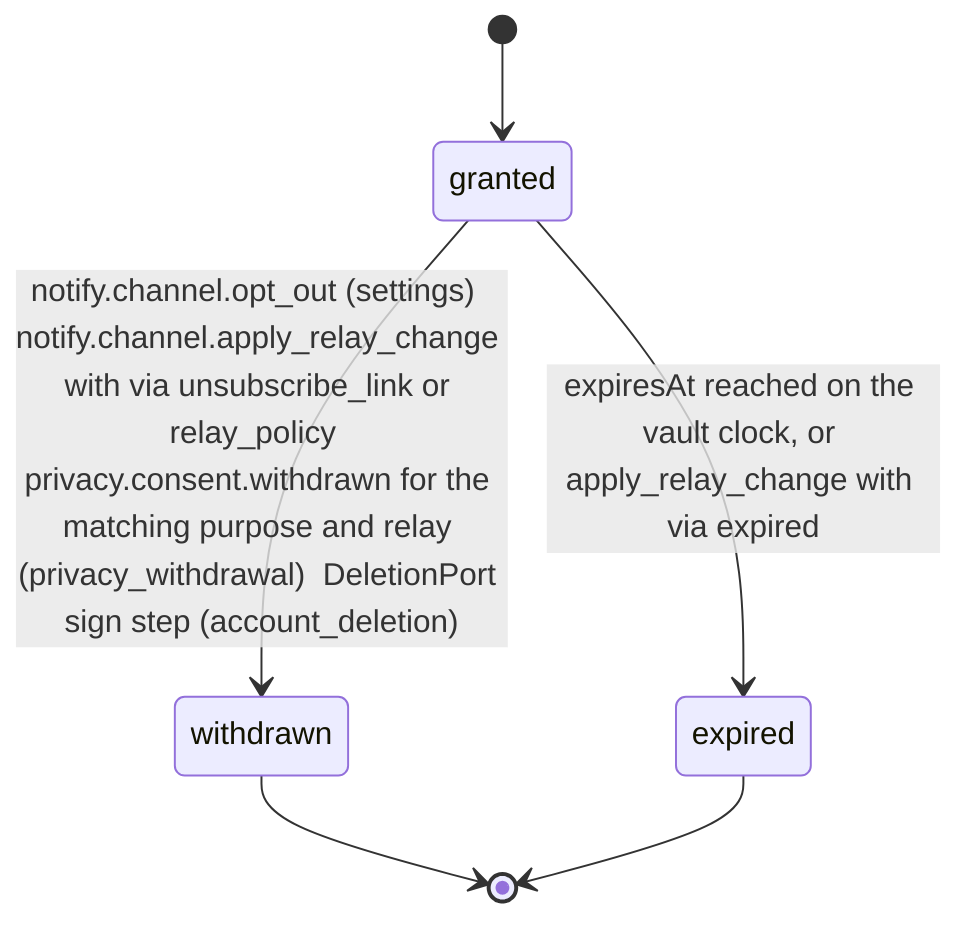
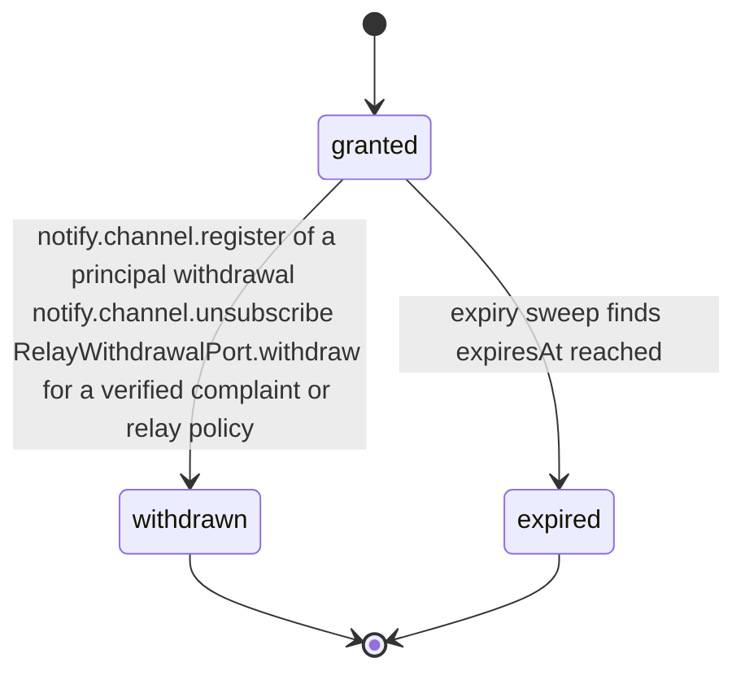

# PS-107-03 — Workflow state machine: Channel opt-in/opt-out

**Status:** SPECIFIED (Stage 3). **Module:** [F13.S02.M03 Channel opt-in/opt-out](SPEC.md) · **Scope:** MVP · **Code:** `packages/notify/src/preferences/opt` · **Contracts:** [CTR-FED-001](../../../planning/contracts/CTR-FED-001.md), [CTR-ID-001](../../../planning/contracts/CTR-ID-001.md), [CTR-EVT-001](../../../planning/contracts/CTR-EVT-001.md), [CTR-ERR-001](../../../planning/contracts/CTR-ERR-001.md), [CTR-CAP-001](../../../planning/contracts/CTR-CAP-001.md), [CTR-PRV-001](../../../planning/contracts/CTR-PRV-001.md), [CTR-IDM-001](../../../planning/contracts/CTR-IDM-001.md), [CTR-OBS-001](../../../planning/contracts/CTR-OBS-001.md), [CTR-FLG-001](../../../planning/contracts/CTR-FLG-001.md)

> Generated from `module.spec.yaml` by `tools/specgen`. Edit the YAML, then run `pnpm spec:render`.

## Requirements

- **PS-107-03.R01** A ChannelConsent starts granted when created and ends withdrawn or expired; both are terminal and a new consent needs a new record.
- **PS-107-03.R02** Withdrawal takes effect in the vault immediately and at the relay as soon as the relay registers the withdrawal, which emits the relay-local notify.channel.opted_out that erases the relay copies of push and email.
- **PS-107-03.R03** Expiry happens 365 days after grant and is enforced by the relay sweep independent of the app; the vault applies it from its own clock or from the relay-signed withdrawal receipt with via expired.
- **PS-107-03.R04** Withdrawals made at the relay (unsubscribe link, verified complaint, relay policy, expiry) reach the vault as relay-signed withdrawal receipts fetched with notify.channel.list_changes and applied with notify.channel.apply_relay_change.
- **PS-107-03.R05** During a pending deletion the consent shows paused, derived from privacy.deletion.assert_not_pending with nothing stored, and at execution the DeletionPort sign step signs withdrawals with via account_deletion for every granted consent and queues them to each relay before any key is revoked or destroyed.

## Specification

### ChannelConsent lifecycle

Initial **granted**; terminal **withdrawn**, **expired**.

| Transition | Trigger | Guard / effect |
|---|---|---|
| granted -> withdrawn | notify.channel.opt_out (settings); notify.channel.apply_relay_change with via unsubscribe_link or relay_policy; privacy.consent.withdrawn for the matching purpose and relay (privacy_withdrawal); DeletionPort sign step (account_deletion) | withdrawal statement queued unless the change came from the relay; emits notify.channel.opted_out (vault-local) with via |
| granted -> expired | expiresAt reached on the vault clock, or apply_relay_change with via expired | vault prompts reconfirmation; emits notify.channel.opted_out with via expired |

### ChannelConsent relay registration lifecycle

Initial **granted**; terminal **withdrawn**, **expired**.

| Transition | Trigger | Guard / effect |
|---|---|---|
| granted -> withdrawn | notify.channel.register of a principal withdrawal; notify.channel.unsubscribe; RelayWithdrawalPort.withdraw for a verified complaint or relay policy | relay stops sending; relay-signed receipt issued for relay-side withdrawals; emits notify.channel.opted_out (relay-local) |
| granted -> expired | expiry sweep finds expiresAt reached | relay stops sending; receipt with via expired issued; emits notify.channel.opted_out (relay-local) with via expired |

### Timeouts and scheduled transitions

- Relay sweep every 5 minutes marks consents past expiresAt as expired.
- Vault prompts reconfirmation 14 days before expiry.
- The vault calls notify.channel.list_changes at app open, every 15 minutes while open and on each service-worker wake.

## Verification

| Test | Level | Covers | Scenario | Expected |
|---|---|---|---|---|
| TEST-PS-107-09.T03 | property | PS-107-03.R01, PS-107-03.R02, PS-107-03.R03 | random sequences of opt in, opt out, expiry, unsubscribe and privacy withdrawal | terminal states never change; withdrawal always wins over grant; every relay-side withdrawal emits a relay-local opted_out |
| TEST-PS-107-09.T07 | integration | PS-107-06.R01, PS-107-06.R02, PS-107-06.R03, PS-107-03.R04 | register twice, unsubscribe twice, vault offline during a relay unsubscribe then list_changes | single registration and one receipt; peer_accepted only after the acceptance signature; apply_relay_change withdraws with via unsubscribe_link |
| TEST-PS-107-09.T16 | integration | PS-107-03.R05, PS-107-04.R06 | deletion requested, cancel on day 13; a second request executed; DeletionPort plan, export section and retention purge with F10 doubles | during grace consents show paused and nothing reaches relays; cancel restores granted with no event; at execution withdrawals with via account_deletion are queued to every relay before destroy_keys; section exported; records pseudonymized when kept |
| TEST-PS-107-09.T17 | integration | PS-107-03.R03 | consent passes expiresAt while the app is closed | relay sweep expires it, issues a receipt with via expired and emits relay-local opted_out; vault applies it on next sync with via expired |

## Dependencies

Module depends on: F10.S01.M01, F07.S01.M01, F07.S02.M01, F11.S01.M01, F11.S03.M01, F15.S01.M01, F15.S02.M01, F16.S02.M02, F12.S03.M03, F10.S01.M02, F10.S01.M03, F10.S01.M04, F10.S02.M02, CTR-FED-001, CTR-ID-001, CTR-EVT-001, CTR-ERR-001, CTR-CAP-001, CTR-PRV-001, CTR-IDM-001, CTR-OBS-001, CTR-FLG-001. Predecessor: [domain_schema.md](domain_schema.md).
