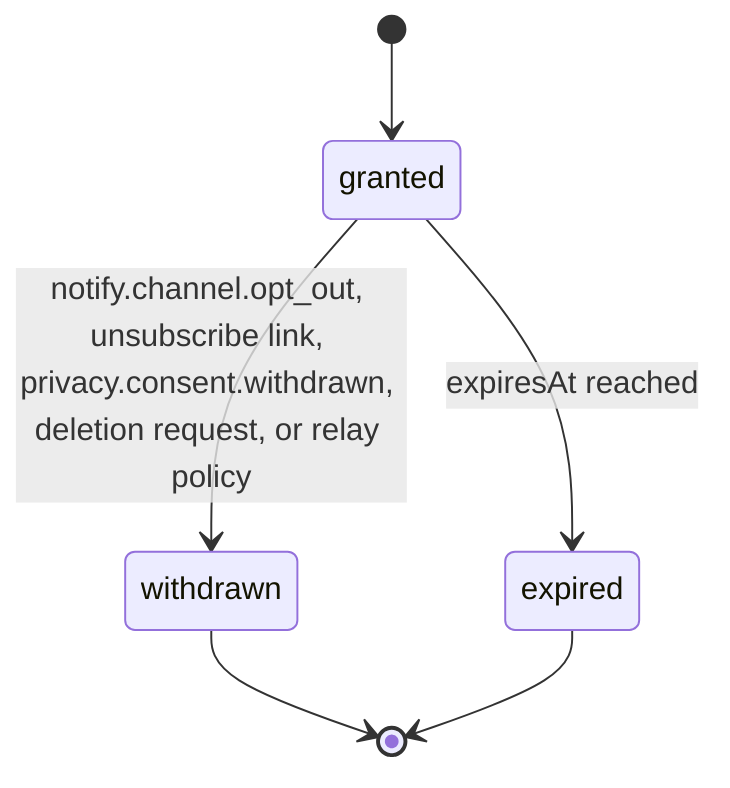

# PS-107-03 — Workflow state machine: Channel opt-in/opt-out

**Status:** SPECIFIED (Stage 3). **Module:** [F13.S02.M03 Channel opt-in/opt-out](SPEC.md) · **Scope:** MVP · **Code:** `packages/notify/src/preferences/opt` · **Contracts:** [CTR-FED-001](../../../planning/contracts/CTR-FED-001.md), [CTR-ID-001](../../../planning/contracts/CTR-ID-001.md), [CTR-EVT-001](../../../planning/contracts/CTR-EVT-001.md), [CTR-ERR-001](../../../planning/contracts/CTR-ERR-001.md), [CTR-CAP-001](../../../planning/contracts/CTR-CAP-001.md), [CTR-PRV-001](../../../planning/contracts/CTR-PRV-001.md), [CTR-IDM-001](../../../planning/contracts/CTR-IDM-001.md), [CTR-OBS-001](../../../planning/contracts/CTR-OBS-001.md), [CTR-FLG-001](../../../planning/contracts/CTR-FLG-001.md)

> Generated from `module.spec.yaml` by `tools/specgen`. Edit the YAML, then run `pnpm spec:render`.

## Requirements

- **PS-107-03.R01** A ChannelConsent starts granted when created and ends withdrawn or expired; both are terminal and a new consent needs a new record.
- **PS-107-03.R02** Withdrawal takes effect at the relay as soon as the relay processes it and in the vault immediately.
- **PS-107-03.R03** Expiry happens 365 days after grant and is enforced by the relay independent of the app.

## Specification

### ChannelConsent lifecycle

Initial **granted**; terminal **withdrawn**, **expired**.

| Transition | Trigger | Guard / effect |
|---|---|---|
| granted -> withdrawn | notify.channel.opt_out, unsubscribe link, privacy.consent.withdrawn, deletion request, or relay policy | relay stops sending; emits notify.channel.opted_out |
| granted -> expired | expiresAt reached | relay stops sending; vault prompts reconfirmation; emits notify.channel.opted_out with reason expired |

### Timeouts and scheduled transitions

- Relay sweep every 5 minutes marks consents past expiresAt as expired.
- Vault prompts reconfirmation 14 days before expiry.

## Verification

| Test | Level | Covers | Scenario | Expected |
|---|---|---|---|---|
| TEST-PS-107-09.T03 | property | PS-107-03.R01, PS-107-03.R02, PS-107-03.R03 | random sequences of opt in, opt out, expiry, unsubscribe and privacy withdrawal | terminal states never change; withdrawal always wins over grant |

## Dependencies

Module depends on: F10.S01.M01, F07.S01.M01, CTR-FED-001, CTR-ID-001, CTR-EVT-001, CTR-ERR-001, CTR-CAP-001, CTR-PRV-001, CTR-IDM-001, CTR-OBS-001, CTR-FLG-001. Predecessor: [domain_schema.md](domain_schema.md).
