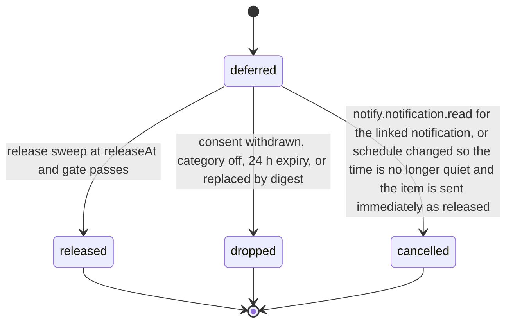

# PS-108-03 — Workflow state machine: Quiet-hours enforcement

**Status:** SPECIFIED (Stage 3). **Module:** [F13.S02.M01 Quiet-hours enforcement](SPEC.md) · **Scope:** MVP · **Code:** `packages/notify/src/preferences/quiet` · **Contracts:** [CTR-FED-001](../../../planning/contracts/CTR-FED-001.md), [CTR-ID-001](../../../planning/contracts/CTR-ID-001.md), [CTR-EVT-001](../../../planning/contracts/CTR-EVT-001.md), [CTR-ERR-001](../../../planning/contracts/CTR-ERR-001.md), [CTR-CAP-001](../../../planning/contracts/CTR-CAP-001.md), [CTR-PRV-001](../../../planning/contracts/CTR-PRV-001.md), [CTR-IDM-001](../../../planning/contracts/CTR-IDM-001.md), [CTR-OBS-001](../../../planning/contracts/CTR-OBS-001.md)

> Generated from `module.spec.yaml` by `tools/specgen`. Edit the YAML, then run `pnpm spec:render`.

## Requirements

- **PS-108-03.R01** A DeferredNotification starts deferred and ends released, dropped or cancelled; all three are terminal and are never reopened.
- **PS-108-03.R02** Release happens only when the clock passes releaseAt and a fresh consent, category and quiet-hours check still allows sending.
- **PS-108-03.R03** Changing the schedule, consent or matrix triggers re-evaluation of all deferred items of the user within 60 seconds.

## Specification

### DeferredNotification lifecycle

Initial **deferred**; terminal **released**, **dropped**, **cancelled**.

| Transition | Trigger | Guard / effect |
|---|---|---|
| deferred -> released | release sweep at releaseAt and gate passes | channel send command invoked; emits notify.notification.released |
| deferred -> dropped | consent withdrawn, category off, 24 h expiry, or replaced by digest | dropReason stored |
| deferred -> cancelled | notify.notification.read for the linked notification, or schedule changed so the time is no longer quiet and the item is sent immediately as released | cancelReason stored |

### Timeouts and scheduled transitions

- Release sweep every 30 s on the relay and every 30 s in the running vault.
- Items are dropped with reason expired 24 h after deferredAt.

## Verification

| Test | Level | Covers | Scenario | Expected |
|---|---|---|---|---|
| TEST-PS-108-09.T03 | property | PS-108-03.R01, PS-108-03.R02, PS-108-03.R03 | random sequences of dispatch, schedule changes, consent changes, reads and clock jumps | terminal states never change; no send without consent; nothing deferred beyond 24 h; urgent never deferred |
| TEST-PS-108-09.T04 | integration | PS-108-03.R02 | night of 2026-03-08 and 2026-11-01 New York | release at 07:00 local on both, i.e. 11:00 UTC and 12:00 UTC, plus jitter ≤ 300 s |

## Dependencies

Module depends on: F13.S02.M02, F13.S02.M03, F13.S02.M04, F13.S01.M01, F13.S01.M02, F13.S01.M03, CTR-FED-001, CTR-ID-001, CTR-EVT-001, CTR-ERR-001, CTR-CAP-001, CTR-PRV-001, CTR-IDM-001, CTR-OBS-001. Predecessor: [domain_schema.md](domain_schema.md).
