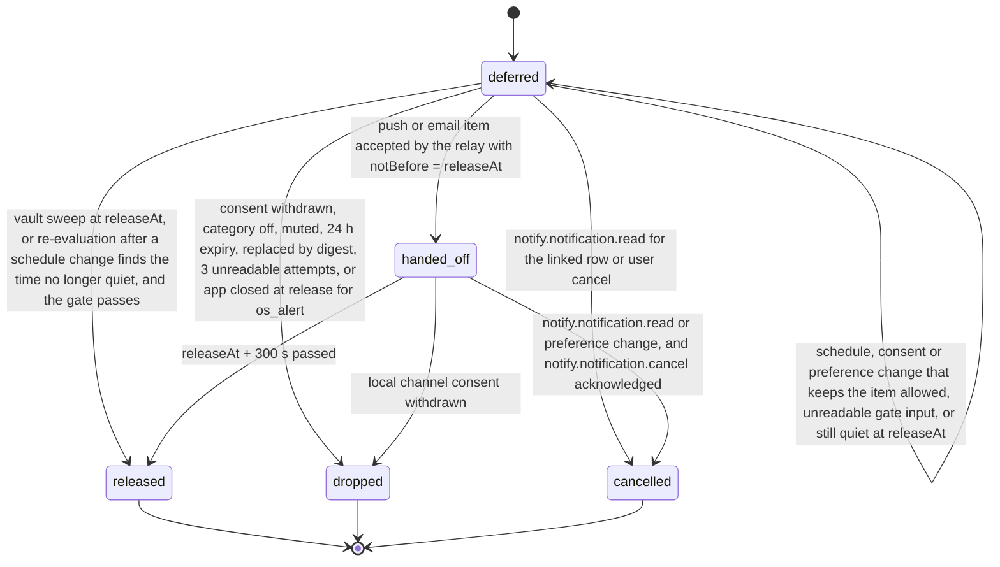
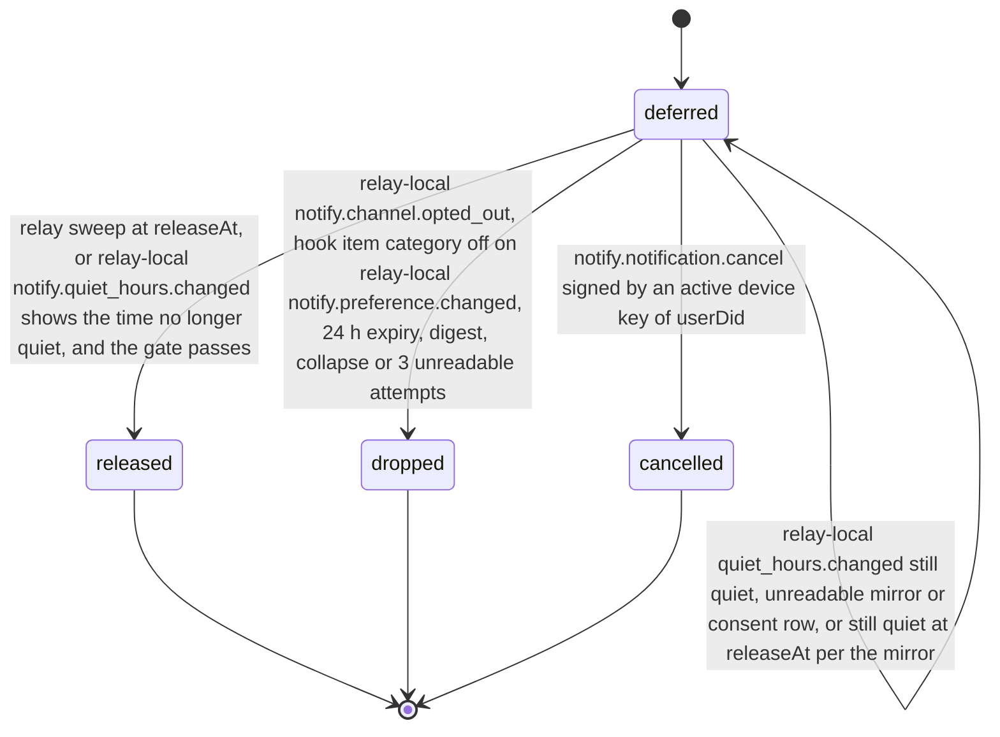

# PS-108-03 — Workflow state machine: Quiet-hours enforcement

**Status:** SPECIFIED (Stage 3). **Module:** [F13.S02.M01 Quiet-hours enforcement](SPEC.md) · **Scope:** MVP · **Code:** `packages/notify/src/preferences/quiet` · **Contracts:** [CTR-FED-001](../../../planning/contracts/CTR-FED-001.md), [CTR-ID-001](../../../planning/contracts/CTR-ID-001.md), [CTR-EVT-001](../../../planning/contracts/CTR-EVT-001.md), [CTR-ERR-001](../../../planning/contracts/CTR-ERR-001.md), [CTR-CAP-001](../../../planning/contracts/CTR-CAP-001.md), [CTR-PRV-001](../../../planning/contracts/CTR-PRV-001.md), [CTR-IDM-001](../../../planning/contracts/CTR-IDM-001.md), [CTR-OBS-001](../../../planning/contracts/CTR-OBS-001.md)

> Generated from `module.spec.yaml` by `tools/specgen`. Edit the YAML, then run `pnpm spec:render`.

## Requirements

- **PS-108-03.R01** A DeferredNotification ends released, dropped or cancelled, all terminal and never reopened; the vault record passes through handed_off while the relay holds its sealed item.
- **PS-108-03.R02** Release happens only when the clock passes releaseAt and a fresh consent, matrix and quiet-hours check still allows sending; a check that cannot be read, or a time still quiet at releaseAt, re-defers with attempt + 1, bounded by expiresAt.
- **PS-108-03.R03** Changing the schedule, consent or matrix re-evaluates all deferred items of the user within 60 seconds - items no longer quiet are released with reason schedule_changed, items no longer allowed are dropped, and relay items are re-evaluated on the relay-local events of the mirror and registration commands.
- **PS-108-03.R04** More than 5 items for one user and channel due in one sweep are replaced by one digest alert carrying the count, and the replaced items are dropped with reason superseded_by_digest.

## Specification

### DeferredNotification lifecycle

Initial **deferred**; terminal **released**, **dropped**, **cancelled**.

| Transition | Trigger | Guard / effect |
|---|---|---|
| deferred -> released | vault sweep at releaseAt, or re-evaluation after a schedule change finds the time no longer quiet, and the gate passes | os_alert shown or push/email requested from the relay now; digest when more than 5 are due; emits notify.notification.released with reason window_end, schedule_changed or retry |
| deferred -> handed_off | push or email item accepted by the relay with notBefore = releaseAt | dispatchId stored; the relay holds only sealed bytes and the tag |
| deferred -> deferred | schedule, consent or preference change that keeps the item allowed, unreadable gate input, or still quiet at releaseAt | releaseAt recomputed, attempt + 1, never beyond expiresAt |
| deferred -> dropped | consent withdrawn, category off, muted, 24 h expiry, replaced by digest, 3 unreadable attempts, or app closed at release for os_alert | dropReason stored; inbox row unaffected |
| deferred -> cancelled | notify.notification.read for the linked row or user cancel | cancelReason read_in_app or user_cancelled |
| handed_off -> released | releaseAt + 300 s passed | delivery belongs to the relay and the UI shows its status as unknown; emits notify.notification.released |
| handed_off -> cancelled | notify.notification.read or preference change, and notify.notification.cancel acknowledged | cancelReason read_in_app or preference_changed |
| handed_off -> dropped | local channel consent withdrawn | the relay drops its item when the withdrawal is registered there; dropReason no_consent |

### DeferredNotification relay record lifecycle

Initial **deferred**; terminal **released**, **dropped**, **cancelled**.

| Transition | Trigger | Guard / effect |
|---|---|---|
| deferred -> released | relay sweep at releaseAt, or relay-local notify.quiet_hours.changed shows the time no longer quiet, and the gate passes | notify.push.send or notify.email.send called; emits notify.notification.released |
| deferred -> deferred | relay-local quiet_hours.changed still quiet, unreadable mirror or consent row, or still quiet at releaseAt per the mirror | releaseAt recomputed, attempt + 1, bounded by expiresAt |
| deferred -> dropped | relay-local notify.channel.opted_out, hook item category off on relay-local notify.preference.changed, 24 h expiry, digest, collapse or 3 unreadable attempts | dropReason stored |
| deferred -> cancelled | notify.notification.cancel signed by an active device key of userDid | cancelReason stored; nothing is sent |

### Timeouts and scheduled transitions

- Release sweep every 30 s on the relay and every 30 s in the running vault; each sweep loops over batches of 500 until no item with releaseAt ≤ now remains.
- Items are dropped with reason expired 24 h after deferredAt.
- Unreadable gate input re-defers for 5 minutes, at most 3 times.

## Verification

| Test | Level | Covers | Scenario | Expected |
|---|---|---|---|---|
| TEST-PS-108-09.T03 | property | PS-108-03.R01, PS-108-03.R02, PS-108-03.R03 | random sequences of dispatch, schedule changes, consent changes, reads, read failures and clock jumps | terminal states never change; no send without consent; nothing deferred beyond 24 h; urgent never deferred; re-deferral bounded by expiresAt |
| TEST-PS-108-09.T04 | integration | PS-108-03.R02 | night of 2026-03-08 and 2026-11-01 New York | release at 07:00 local on both, i.e. 11:00 UTC and 12:00 UTC, plus jitter ≤ 300 s |
| TEST-PS-108-09.T06 | integration | PS-108-04.R03, PS-108-03.R03 | vault-local quiet_hours.changed, channel.opted_out, preference.changed and notification.read; relay-local quiet_hours.changed, opted_out and preference.changed from the mirror and registration commands | items recomputed, released with reason schedule_changed, dropped or cancelled with documented reasons in each environment |
| TEST-PS-108-09.T17 | integration | PS-108-04.R05, PS-108-03.R01 | push handed off with notBefore 07:00; user reads the row at 06:30 | notify.notification.cancel acknowledged; vault item cancelled; relay sends nothing |
| TEST-PS-108-09.T18 | integration | PS-108-03.R04, PS-108-01.R04 | 7 items for one user due in one sweep at the relay and in the vault | one digest alert notify.tpl.system.digest with count 7 and no reference; the 7 items dropped with superseded_by_digest; digest sent only because at least one replaced item's cell is still on |

## Dependencies

Module depends on: F13.S02.M02, F13.S02.M03, F13.S02.M04, F13.S01.M01, F13.S01.M02, F13.S01.M03, F08.S01.M01, F10.S01.M01, F10.S01.M02, F10.S01.M03, F10.S01.M04, F10.S02.M02, F16.S02.M02, F07.S02.M01, F15.S01.M01, F12.S03.M03, CTR-FED-001, CTR-ID-001, CTR-EVT-001, CTR-ERR-001, CTR-CAP-001, CTR-PRV-001, CTR-IDM-001, CTR-OBS-001. Predecessor: [domain_schema.md](domain_schema.md).
