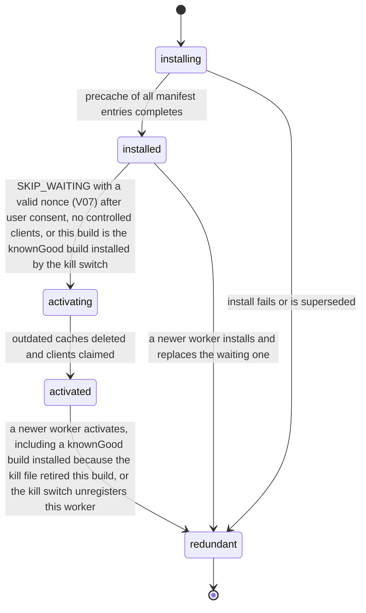

# PS-114-03 — Workflow state machine: PWA caching

**Status:** SPECIFIED (Stage 3). **Module:** [F15.S01.M02 PWA caching](SPEC.md) · **Scope:** MVP · **Code:** `apps/pwa/src/platform/cache` · **Contracts:** [CTR-CAP-001](../../../planning/contracts/CTR-CAP-001.md), [CTR-ID-001](../../../planning/contracts/CTR-ID-001.md), [CTR-OBS-001](../../../planning/contracts/CTR-OBS-001.md), [CTR-PRV-001](../../../planning/contracts/CTR-PRV-001.md), [CTR-UX-001](../../../planning/contracts/CTR-UX-001.md), [CTR-ERR-001](../../../planning/contracts/CTR-ERR-001.md)

> Generated from `module.spec.yaml` by `tools/specgen`. Edit the YAML, then run `pnpm spec:render`.

## Requirements

- **PS-114-03.R01** The worker follows the browser lifecycle installing, installed (waiting), activating, activated, redundant, and does not skip waiting on its own.
- **PS-114-03.R02** Activation only happens after the user consents (SKIP_WAITING with a valid nonce), when no client of the previous worker is open, or when the kill file retires the active build and the known-good build named there takes its place.
- **PS-114-03.R03** Activation deletes every classrup- cache not on the allowlist before the new worker handles fetches.
- **PS-114-03.R04** When the kill file names the active build (buildId in killedBuilds or releaseSeq below minReleaseSeq), the worker deletes all classrup- caches of that build within one update check and is replaced by the knownGood build, or unregisters itself when none can be installed; IndexedDB is never touched.

## Specification

### ServiceWorkerVersion lifecycle

Initial **installing**; terminal **redundant**.

| Transition | Trigger | Guard / effect |
|---|---|---|
| installing -> installed | precache of all manifest entries completes | all entries fetched and verified by revision hash; any failure aborts install and keeps the old worker |
| installed -> activating | SKIP_WAITING with a valid nonce (V07) after user consent, no controlled clients, or this build is the knownGood build installed by the kill switch | no automatic skipWaiting otherwise |
| activating -> activated | outdated caches deleted and clients claimed | cleanupOutdatedCaches plus allowlist deletion; clientsClaim only after the consent or kill-switch path |
| activated -> redundant | a newer worker activates, including a knownGood build installed because the kill file retired this build, or the kill switch unregisters this worker | old precache removed; on kill all classrup- caches of this build deleted, IndexedDB untouched |
| installing -> redundant | install fails or is superseded | no state kept |
| installed -> redundant | a newer worker installs and replaces the waiting one | waiting worker discarded and its nonce invalid |

### Timeouts and scheduled transitions

- Install precache fetch times out after 60000 ms; the old worker keeps serving.
- Update and kill-file check: registration.update() and a no-store fetch of /sw-kill.json on app start, on visibilitychange to visible, and every 3600000 ms.
- Runtime image entries expire after 2592000000 ms (30 days) and entries beyond 200 per partition are evicted least recently used.
- A SKIP_WAITING nonce is valid for 60000 ms and for one use.

## Verification

| Test | Level | Covers | Scenario | Expected |
|---|---|---|---|---|
| TEST-PS-114-09.T04 | e2e | PS-114-03.R01, PS-114-03.R02, PS-114-03.R03 | install build A, then deploy build B, tab remains open | B stays waiting until SKIP_WAITING with B's nonce after consent; after activation only B caches remain |
| TEST-PS-114-09.T05 | integration | PS-114-03.R02 | worker B installed with a failing precache entry | install aborted, A keeps serving, no partial cache of B remains |
| TEST-PS-114-09.T19 | e2e | PS-114-10.R03, PS-114-03.R04 | kill file names active build B with knownGood A; then a kill file names B with no knownGood | within one update check B's caches are deleted and A activates; in the second case the worker unregisters and all classrup- caches are deleted; IndexedDB vault untouched in both |
| TEST-PS-114-09.T20 | integration | PS-114-07.R02, PS-114-03.R04 | 201 distinct images viewed, then clock advanced 31 days and 3 new images viewed | at most 200 entries after the first step; after the advance only the 3 fresh entries remain |

## Dependencies

Module depends on: F15.S02.M01, F15.S02.M03, CTR-CAP-001, CTR-ID-001, CTR-OBS-001, CTR-PRV-001, CTR-UX-001, CTR-ERR-001. Predecessor: [domain_schema.md](domain_schema.md).
