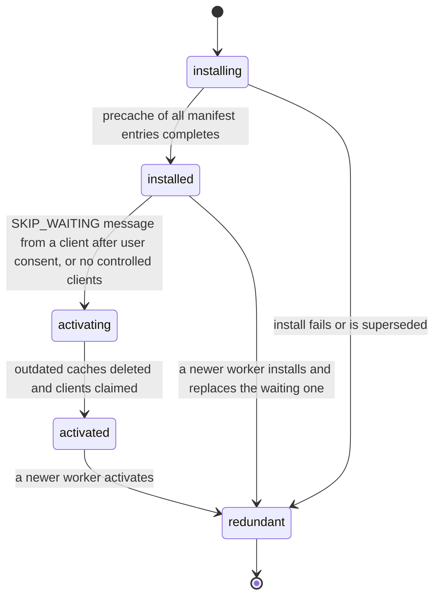

# PS-114-03 — Workflow state machine: PWA caching

**Status:** SPECIFIED (Stage 3). **Module:** [F15.S01.M02 PWA caching](SPEC.md) · **Scope:** MVP · **Code:** `apps/pwa/src/platform/cache` · **Contracts:** [CTR-OBS-001](../../../planning/contracts/CTR-OBS-001.md), [CTR-PRV-001](../../../planning/contracts/CTR-PRV-001.md), [CTR-UX-001](../../../planning/contracts/CTR-UX-001.md), [CTR-ERR-001](../../../planning/contracts/CTR-ERR-001.md)

> Generated from `module.spec.yaml` by `tools/specgen`. Edit the YAML, then run `pnpm spec:render`.

## Requirements

- **PS-114-03.R01** The worker follows the browser lifecycle installing, installed (waiting), activating, activated, redundant, and does not skip waiting on its own.
- **PS-114-03.R02** Activation only happens after the user consents (message SKIP_WAITING) or when no client of the previous worker is open.
- **PS-114-03.R03** Activation deletes every classrup- cache not on the allowlist before the new worker handles fetches.

## Specification

### ServiceWorkerVersion lifecycle

Initial **installing**; terminal **redundant**.

| Transition | Trigger | Guard / effect |
|---|---|---|
| installing -> installed | precache of all manifest entries completes | all entries fetched and verified by revision hash; any failure aborts install and keeps the old worker |
| installed -> activating | SKIP_WAITING message from a client after user consent, or no controlled clients | no automatic skipWaiting |
| activating -> activated | outdated caches deleted and clients claimed | cleanupOutdatedCaches plus allowlist deletion; clientsClaim only after consent path |
| activated -> redundant | a newer worker activates | old precache removed by the new worker |
| installing -> redundant | install fails or is superseded | no state kept |
| installed -> redundant | a newer worker installs and replaces the waiting one | waiting worker discarded |

### Timeouts and scheduled transitions

- Install precache fetch times out after 60000 ms; the old worker keeps serving.
- Update check: registration.update() on app start, on visibilitychange to visible, and every 3600000 ms.
- Runtime image entries expire after 2592000000 ms (30 days) and entries beyond 200 are evicted least recently used.

## Verification

| Test | Level | Covers | Scenario | Expected |
|---|---|---|---|---|
| TEST-PS-114-09.T04 | e2e | PS-114-03.R01, PS-114-03.R02, PS-114-03.R03 | install build A, then deploy build B, tab remains open | B stays waiting until SKIP_WAITING after consent; after activation only B caches remain |
| TEST-PS-114-09.T05 | integration | PS-114-03.R02 | worker B installed with a failing precache entry | install aborted, A keeps serving, no partial cache of B remains |

## Dependencies

Module depends on: CTR-OBS-001, CTR-PRV-001, CTR-UX-001, CTR-ERR-001. Predecessor: [domain_schema.md](domain_schema.md).
