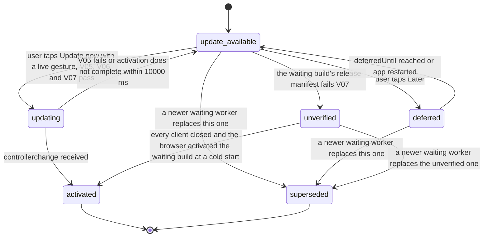

# PS-115-03 — Workflow state machine: PWA install

**Status:** SPECIFIED (Stage 3). **Module:** [F15.S01.M03 PWA install](SPEC.md) · **Scope:** MVP · **Code:** `apps/pwa/src/platform/install` · **Contracts:** [CTR-UX-001](../../../planning/contracts/CTR-UX-001.md), [CTR-OBS-001](../../../planning/contracts/CTR-OBS-001.md), [CTR-PRV-001](../../../planning/contracts/CTR-PRV-001.md)

> Generated from `module.spec.yaml` by `tools/specgen`. Edit the YAML, then run `pnpm spec:render`.

## Requirements

- **PS-115-03.R01** Install and update each follow explicit states and the UI shows only the state reached.
- **PS-115-03.R02** While a client of the running build is open, a waiting worker is activated only after consent with a live user gesture, never by automatic skipWaiting; once every client is closed the browser activates a waiting worker at the next cold start, so consent covers live tabs only and the spec does not claim more.
- **PS-115-03.R03** Deferral is time-boxed so the user is asked again after 24 hours but never forced.
- **PS-115-03.R04** A waiting build whose release manifest fails V07 is never offered for update; the unverified-build warning is shown and persisted so that the next start, if the browser activated that build anyway, still shows the warning.

## Specification

### UpdateAttempt lifecycle

Initial **update_available**; terminal **activated**, **superseded**.

| Transition | Trigger | Guard / effect |
|---|---|---|
| update_available -> updating | user taps Update now with a live gesture, V05, V06 and V07 pass | draft saved, nonce fetched through GET_VERSION, SKIP_WAITING posted |
| update_available -> deferred | user taps Later | deferredUntil = now + 86400000 ms |
| update_available -> unverified | the waiting build's release manifest fails V07 | Update hidden, unverified-build warning shown, unverifiedBuildId persisted |
| deferred -> update_available | deferredUntil reached or app restarted | banner shown again after V07 is re-checked |
| updating -> activated | controllerchange received | page reloaded once |
| updating -> update_available | V05 fails or activation does not complete within 10000 ms | message states why and offers retry |
| update_available -> superseded | a newer waiting worker replaces this one | banner now refers to the newer build |
| deferred -> superseded | a newer waiting worker replaces this one | banner now refers to the newer build |
| unverified -> superseded | a newer waiting worker replaces the unverified one | V07 checked again for the newer build |
| unverified -> activated | every client closed and the browser activated the waiting build at a cold start | not preventable by consent; the next start shows the unverified-build warning from unverifiedBuildId |

### Timeouts and scheduled transitions

- Update check on app start, on visibilitychange to visible and every 3600000 ms.
- Deferral lasts 86400000 ms; install card back-off 2592000000 ms (30 days).
- Activation wait after SKIP_WAITING is 10000 ms; the nonce is valid for 60000 ms.

## Verification

| Test | Level | Covers | Scenario | Expected |
|---|---|---|---|---|
| TEST-PS-115-09.T03 | property | PS-115-03.R01, PS-115-03.R03 | random sequences of waiting-worker, verification results, Later, Update now and timer events | only declared transitions occur; deferral always 24 h |
| TEST-PS-115-09.T04 | e2e | PS-115-03.R02, PS-115-02.R03, PS-115-06.R01 | signed build B deployed while A is open with an unsaved draft | banner appears; Update now saves the draft first then activates; reload shows B with draft restored; no update without a click |
| TEST-PS-115-09.T05 | e2e | PS-115-03.R02, PS-115-06.R02 | activation does not complete within 10 s (simulated) | state returns to update_available with explanation; A still works |
| TEST-PS-115-09.T19 | abuse | PS-115-02.R04, PS-115-03.R02, PS-115-03.R04, PS-115-05.R03 | unsigned build B' deployed while A is open; then all tabs closed and the app reopened | no Update button, warning shown with PLATFORM_UPDATE_UNVERIFIED in diagnostics; after the cold start B' runs (browser behavior) and the warning is shown again from unverifiedBuildId |

## Dependencies

Module depends on: F15.S01.M01, F15.S01.M02, CTR-UX-001, CTR-OBS-001, CTR-PRV-001. Predecessor: [domain_schema.md](domain_schema.md).
