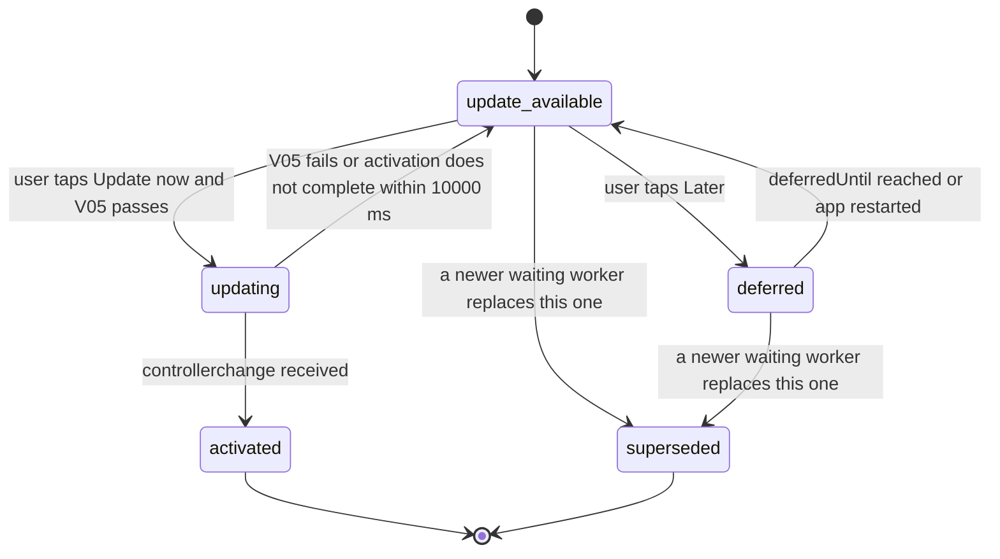

# PS-115-03 — Workflow state machine: PWA install

**Status:** SPECIFIED (Stage 3). **Module:** [F15.S01.M03 PWA install](SPEC.md) · **Scope:** MVP · **Code:** `apps/pwa/src/platform/install` · **Contracts:** [CTR-UX-001](../../../planning/contracts/CTR-UX-001.md), [CTR-OBS-001](../../../planning/contracts/CTR-OBS-001.md), [CTR-PRV-001](../../../planning/contracts/CTR-PRV-001.md)

> Generated from `module.spec.yaml` by `tools/specgen`. Edit the YAML, then run `pnpm spec:render`.

## Requirements

- **PS-115-03.R01** Install and update each follow explicit states and the UI shows only the state reached.
- **PS-115-03.R02** A waiting worker is activated only after consent; there is no automatic skipWaiting.
- **PS-115-03.R03** Deferral is time-boxed so the user is asked again after 24 hours but never forced.

## Specification

### UpdateAttempt lifecycle

Initial **update_available**; terminal **activated**, **superseded**.

| Transition | Trigger | Guard / effect |
|---|---|---|
| update_available -> updating | user taps Update now and V05 passes | draft saved, SKIP_WAITING posted |
| update_available -> deferred | user taps Later | deferredUntil = now + 86400000 ms |
| deferred -> update_available | deferredUntil reached or app restarted | banner shown again |
| updating -> activated | controllerchange received | page reloaded once |
| updating -> update_available | V05 fails or activation does not complete within 10000 ms | message states why and offers retry |
| update_available -> superseded | a newer waiting worker replaces this one | banner now refers to the newer build |
| deferred -> superseded | a newer waiting worker replaces this one | banner now refers to the newer build |

### Timeouts and scheduled transitions

- Update check on app start, on visibilitychange to visible and every 3600000 ms.
- Deferral lasts 86400000 ms; install card back-off 2592000000 ms (30 days).
- Activation wait after SKIP_WAITING is 10000 ms.

## Verification

| Test | Level | Covers | Scenario | Expected |
|---|---|---|---|---|
| TEST-PS-115-09.T03 | property | PS-115-03.R01, PS-115-03.R03 | random sequences of waiting-worker, Later, Update now and timer events | only declared transitions occur; deferral always 24 h |
| TEST-PS-115-09.T04 | e2e | PS-115-03.R02, PS-115-02.R03, PS-115-06.R01 | build B deployed while A is open with an unsaved draft | banner appears; Update now saves the draft first then activates; reload shows B with draft restored; no update without a click |
| TEST-PS-115-09.T05 | e2e | PS-115-03.R02, PS-115-06.R02 | activation does not complete within 10 s (simulated) | state returns to update_available with explanation; A still works |

## Dependencies

Module depends on: F15.S01.M01, F15.S01.M02, CTR-UX-001, CTR-OBS-001, CTR-PRV-001. Predecessor: [domain_schema.md](domain_schema.md).
