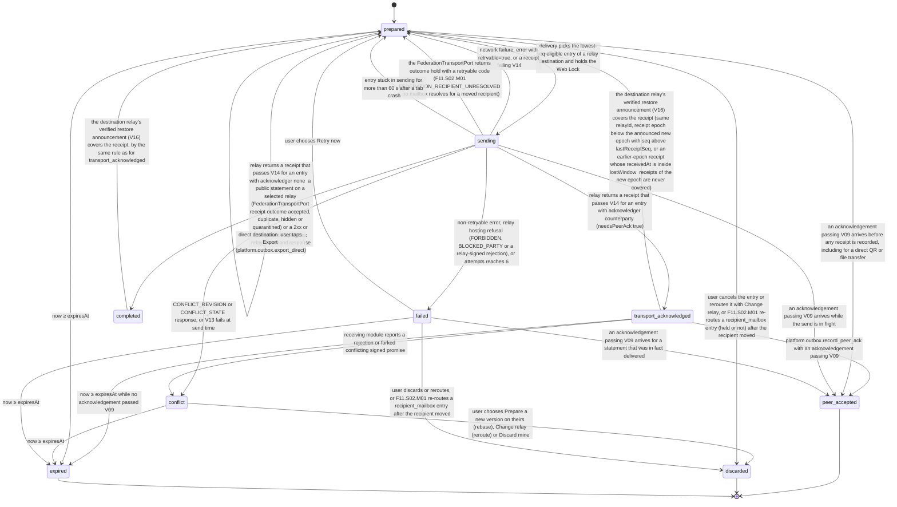

# PS-116-03 — Workflow state machine: Offline outbox

**Status:** SPECIFIED (Stage 3). **Module:** [F15.S01.M01 Offline outbox](SPEC.md) · **Scope:** MVP · **Code:** `apps/pwa/src/platform/offline` · **Contracts:** [CTR-ID-001](../../../planning/contracts/CTR-ID-001.md), [CTR-IDM-001](../../../planning/contracts/CTR-IDM-001.md), [CTR-ERR-001](../../../planning/contracts/CTR-ERR-001.md), [CTR-PRV-001](../../../planning/contracts/CTR-PRV-001.md), [CTR-UX-001](../../../planning/contracts/CTR-UX-001.md), [CTR-OBS-001](../../../planning/contracts/CTR-OBS-001.md), [CTR-CAP-001](../../../planning/contracts/CTR-CAP-001.md), [CTR-FED-001](../../../planning/contracts/CTR-FED-001.md), [CTR-IOX-001](../../../planning/contracts/CTR-IOX-001.md), [CTR-EVT-001](../../../planning/contracts/CTR-EVT-001.md)

> Generated from `module.spec.yaml` by `tools/specgen`. Edit the YAML, then run `pnpm spec:render`.

## Requirements

- **PS-116-03.R01** Entries follow the declared lifecycle and any transition not listed is refused with CONFLICT_STATE.
- **PS-116-03.R02** transport_acknowledged is recorded only after a relay receipt verifies (V14) and peer_accepted only after a verified acknowledgement of the exact cid (V09), which is accepted from prepared, sending, failed or transport_acknowledged; a network failure or a missing reply never advances the state, a direct transfer stays prepared (export prepared) after its bytes are produced, and the UI shows the state reached.
- **PS-116-03.R03** Conflict and failed entries block only later entries with the same destination and aggregateKey, are never auto-merged or auto-retried, and forked conflicting promises freeze the affected coordination instead of choosing a winner.
- **PS-116-03.R04** A rebase or reroute never edits an entry; the old entry moves to discarded with reason superseded or rerouted and supersededBy, and the replacement is a new entry with a new id and seq, re-validated by V04, V05, V10 and V11.
- **PS-116-03.R05** A verified restore announcement of the destination relay that covers an entry's receipt returns the entry from transport_acknowledged to prepared, and it is resent with the same cid or Idempotency-Key.
- **PS-116-03.R06** An entry that needs no peer acknowledgement (a public statement on a selected relay or a relay command) moves to completed when its relay receipt verifies; completed is its final sync state, claims only relay receipt (the transport acknowledged row of CONSISTENCY_STATES, never peer acceptance), is kept until createdAt + 30 days and is reopened to prepared only by a verified restore announcement covering its receipt.
- **PS-116-03.R07** A transport_acknowledged entry that reaches its expiry without a verified acknowledgement ends in expired with expiredOutcome unconfirmed, a terminal unconfirmed outcome shown with the transport_acknowledged text (delivered to the relay, peer has not confirmed), never as failed and never as not sent.
- **PS-116-03.R08** An entry for which the FederationTransportPort reports a hold (the retryable F11.S02.M01 FEDERATION_RECIPIENT_UNRESOLVED) stays prepared with heldReason recipient_unresolved, consumes no attempt and is not sent until F11.S02.M01 re-routes it, which discards it as rerouted and prepares a new entry with the same payload and cid for the recipient's new mailbox; the 7-day unsent expiry still applies.

## Specification

### OutboxEntry lifecycle

Initial **prepared**; terminal **peer_accepted**, **discarded**, **expired**.

| Transition | Trigger | Guard / effect |
|---|---|---|
| prepared -> sending | delivery picks the lowest-seq eligible entry of a relay destination and holds the Web Lock | nextAttemptAt ≤ now, heldReason unset, vault unlocked, relay not frozen (V15), V13 holds for relay commands, no lower-seq entry of same aggregateKey unresolved; attempts += 1; firstAttemptAt set on the first attempt; sentDigest recorded |
| sending -> transport_acknowledged | relay returns a receipt that passes V14 for an entry with acknowledger counterparty (needsPeerAck true) | store relayReceipt and transportAcknowledgedAt; expiresAt = min(transportAcknowledgedAt + 30 d, createdAt + 30 d); relay time kept as relay-clock evidence only; chip 'Delivered to relay <display name>, peer has not confirmed' |
| sending -> completed | relay returns a receipt that passes V14 for an entry with acknowledger none: a public statement on a selected relay (FederationTransportPort receipt outcome accepted, duplicate, hidden or quarantined) or a 2xx or Idempotent-Replay 2xx relay_command response | store relayReceipt and transportAcknowledgedAt; expiresAt = createdAt + 30 d; final sync state, chip 'Delivered to relay <display name>, no peer confirmation needed'; receipt copied into the domain record's provenance |
| completed -> prepared | the destination relay's verified restore announcement (V16) covers the receipt, by the same rule as for transport_acknowledged | relayReceipt moved to history, attempts reset to 0, resent with the same cid or Idempotency-Key; expiresAt unchanged |
| sending -> prepared | network failure, error with retryable=true, or a receipt failing V14 | schedule nextAttemptAt by full-jitter backoff (base 500 ms, cap 30 s, retryAfterMs honored) while attempts < 6 |
| sending -> prepared | the FederationTransportPort returns outcome hold with a retryable code (F11.S02.M01 FEDERATION_RECIPIENT_UNRESOLVED: no mailbox resolves for a moved recipient) | heldReason recipient_unresolved; the attempt is not counted; nextAttemptAt unset so delivery skips the entry until F11.S02.M01 re-routes it or reports a resolved route; expiresAt unchanged |
| sending -> conflict | CONFLICT_REVISION or CONFLICT_STATE response, or V13 fails at send time | store currentRevision and state (or failureReason unsafe_replay); show the resolve-or-discard prompt |
| sending -> failed | non-retryable error, relay hosting refusal (FORBIDDEN, BLOCKED_PARTY or a relay-signed rejection), or attempts reaches 6 | store error code and fields; failureReason relay_rejected with the relay's signed reason cid for hosting refusals (shown by F01.S01.M03 as relay_rejected), rejected or retry_exhausted otherwise; show failure with Retry now and Discard |
| sending -> prepared | entry stuck in sending for more than 60 s after a tab crash | recovery at startup; same idempotencyKey or cid is reused |
| transport_acknowledged -> peer_accepted | platform.outbox.record_peer_ack with an acknowledgement passing V09 | store peerAckCid |
| transport_acknowledged -> conflict | receiving module reports a rejection or forked conflicting signed promise | store reason; affected coordination frozen by the owning module |
| transport_acknowledged -> expired | now ≥ expiresAt while no acknowledgement passed V09 | expiredOutcome unconfirmed; payload erased; terminal unconfirmed outcome shown with the sync.state.transport_acknowledged text 'Delivered to relay <display name>, peer has not confirmed', never as failed |
| transport_acknowledged -> prepared | the destination relay's verified restore announcement (V16) covers the receipt (same relayId, receipt epoch below the announced new epoch with seq above lastReceiptSeq, or an earlier-epoch receipt whose receivedAt is inside lostWindow; receipts of the new epoch are never covered) | relayReceipt moved to history, attempts reset to 0, resent with the same cid or Idempotency-Key; expiresAt unchanged |
| conflict -> discarded | user chooses Prepare a new version on theirs (rebase), Change relay (reroute) or Discard mine | discardReason superseded, rerouted or user; for a rebase the owning module signs a new statement enqueued as a new entry (new id, seq and cid, supersedes {entryId, cid}, expectedRevision = currentRevision); for a reroute a new entry keeps payload and cid with a new id, seq and destination |
| failed -> prepared | user chooses Retry now | attempts reset to 0 and nextAttemptAt = now; firstAttemptAt kept so V13 still applies |
| prepared -> discarded | user cancels the entry or reroutes it with Change relay, or F11.S02.M01 re-routes a recipient_mailbox entry (held or not) after the recipient moved | removed from the delivery set; a reroute creates a new entry (same payload and cid, new id, seq, destination and descriptor re-validated by V04, V05, V10, V11, V17) with supersedes set and heldReason cleared |
| failed -> discarded | user discards or reroutes, or F11.S02.M01 re-routes a recipient_mailbox entry after the recipient moved | removed from the delivery set; a reroute creates a new entry as above |
| prepared -> expired | now ≥ expiresAt | expiredOutcome unsent; payload erased; UI states the action was not sent |
| conflict -> expired | now ≥ expiresAt | expiredOutcome unsent; payload erased; UI states the action was not sent |
| failed -> expired | now ≥ expiresAt | expiredOutcome unsent; payload erased; UI states the action was not sent |
| prepared -> peer_accepted | an acknowledgement passing V09 arrives before any receipt is recorded, including for a direct QR or file transfer | store peerAckCid |
| sending -> peer_accepted | an acknowledgement passing V09 arrives while the send is in flight | store peerAckCid; a late receipt is still stored as evidence |
| failed -> peer_accepted | an acknowledgement passing V09 arrives for a statement that was in fact delivered | store peerAckCid |
| prepared -> prepared | direct destination: user taps Export (platform.outbox.export_direct) | QR or file bytes produced, exportedAt set, label Export prepared; never resent automatically |

### Timeouts and scheduled transitions

- Unsent entries expire 604800000 ms (7 days) after createdAt; the expiry prompt is shown from day 6 (518400000 ms).
- transport_acknowledged entries waiting for a counterparty acknowledgement expire at min(transportAcknowledgedAt + 2592000000 ms, createdAt + 2592000000 ms), never later than createdAt + 30 days.
- completed entries (acknowledger none) are deleted with their receipt at createdAt + 2592000000 ms by the retention purge; the receipt is copied into the domain record's provenance when it is verified.
- A held entry (heldReason recipient_unresolved) is not sent while held and still expires 604800000 ms (7 days) after createdAt as unsent.
- A relay command whose firstAttemptAt is older than 82800000 ms (23 h) is sent only when V13 holds.
- An entry in sending for more than 60000 ms without a response is reset to prepared at the next startup or delivery tick.
- Delivery tick runs on the online event, visibilitychange to visible, app start, and every 60000 ms while unsent entries exist; the destination relay's /.well-known/classrup-relay.json (key history, revocations, restore announcements) is re-read at most every 21600000 ms (6 h) and immediately after a receipt fails V14.

## Verification

| Test | Level | Covers | Scenario | Expected |
|---|---|---|---|---|
| TEST-PS-116-09.T03 | property | PS-116-03.R01, PS-116-01.R02 | random sequences of delivery results, acknowledgements, restore announcements and user actions on one entry | only declared transitions occur, terminal states never change, seq stays strictly increasing, expiresAt never exceeds createdAt + 30 d |
| TEST-PS-116-09.T04 | integration | PS-116-03.R02, PS-116-06.R01, PS-116-06.R03 | kill the tab after send and before receipt, restart within 1 h | entry resent with same cid or Idempotency-Key, stub relay applies once, entry ends transport_acknowledged |
| TEST-PS-116-09.T05 | integration | PS-116-03.R02, PS-116-02.R03 | relay receipt arrives, then an acknowledgement signed by a non-counterparty key, then the real one | forged ack rejected with PLATFORM_OUTBOX_ACK_MISMATCH; entry stays transport_acknowledged until the real ack gives peer_accepted |
| TEST-PS-116-09.T06 | integration | PS-116-03.R03, PS-116-02.R02 | entry 3 gets 409 CONFLICT_REVISION; entries 4 (same aggregate) and 5 (other aggregate) queued | 3 becomes conflict, 4 waits, 5 is sent; nothing merged |
| TEST-PS-116-09.T15 | a11y | PS-116-03.R02 | outbox sheet, conflict dialog and storage panel scanned with axe | zero serious or critical issues; aria-live announces state changes with the documented accessible names; targets ≥ 44 px |
| TEST-PS-116-09.T16 | integration | PS-116-04.R01, PS-116-03.R03 | two vaults send conflicting acceptances for one reservation; receiving module reports the fork | entry becomes conflict, affected coordination frozen, no winner chosen |
| TEST-PS-116-09.T23 | abuse | PS-116-02.R03, PS-116-03.R04 | after a rebase of entry E (old cid A, new cid B) C1 replays its ack over A for the new entry; C2 (same cycle) signs an ack over B; C1 signs over B with a key revoked before verification | all three rejected with PLATFORM_OUTBOX_ACK_MISMATCH; only C1's ack over B with an active key gives peer_accepted |
| TEST-PS-116-09.T26 | integration | PS-116-03.R02 | direct:<did> entry exported as QR, then file; acknowledgement arrives while prepared; separately an ack arrives while a relay entry is sending | exportedAt set, state stays prepared, delivery loop never sends it; both acks give peer_accepted without a receipt |
| TEST-PS-116-09.T27 | integration | PS-116-03.R02, PS-116-04.R05 | publication with audience public (acknowledger none): verified receipt with outcome accepted; second publication refused by the relay with a signed reason | first ends completed without any peer acknowledgement; second ends failed with failureReason relay_rejected and the reason cid that F01.S01.M03 shows as relay_rejected |
| TEST-PS-116-09.T28 | integration | PS-116-03.R04, PS-116-01.R03 | rebase a conflict entry and reroute a prepared entry to relay r2 | old entries discarded with reasons superseded and rerouted; new entries have new id and seq (new cid for the rebase, same cid for the reroute) and passed V04, V05, V10, V11 |
| TEST-PS-116-09.T29 | integration | PS-116-03.R05, PS-116-06.R04 | stub relay restores a backup and publishes a signed restore announcement covering receipt seq above 88000; another announcement is signed by an unknown key | covered transport_acknowledged entries return to prepared and are resent once with the same cid or Idempotency-Key; the unsigned announcement is ignored with PLATFORM_OUTBOX_RECEIPT_INVALID |
| TEST-PS-116-09.T35 | integration | PS-116-03.R06, PS-116-03.R07 | listing receipt verifies; a restore announcement then covers it; an offer receipt verifies and no acknowledgement arrives for 30 d | listing completed, back to prepared, resent once with the same cid and completed again; offer expired with expiredOutcome unconfirmed, payload erased, chip still 'Delivered to relay Old Town Swap, peer has not confirmed', never failed |
| TEST-PS-116-09.T36 | integration | PS-116-03.R08 | FederationTransportPort returns outcome hold with FEDERATION_RECIPIENT_UNRESOLVED for an offer to moved recipient C1; 10 delivery ticks pass; F11.S02.M01 calls resolve reroute with cause recipient_moved and C1's new mailbox; separately a held entry reaches 7 d | attempts stay 0 and no request is sent while held; the held entry is discarded as rerouted and a new entry with the same payload and cid is sent to the new mailbox; the second expires with expiredOutcome unsent |

## Dependencies

Module depends on: F15.S02.M02, F15.S02.M03, F15.S02.M01, F15.S04.M03, F11.S01.M01, F10.S02.M02, F14.S02.M01, CTR-ID-001, CTR-IDM-001, CTR-ERR-001, CTR-PRV-001, CTR-UX-001, CTR-OBS-001, CTR-CAP-001, CTR-FED-001, CTR-IOX-001, CTR-EVT-001. Predecessor: [domain_schema.md](domain_schema.md).
