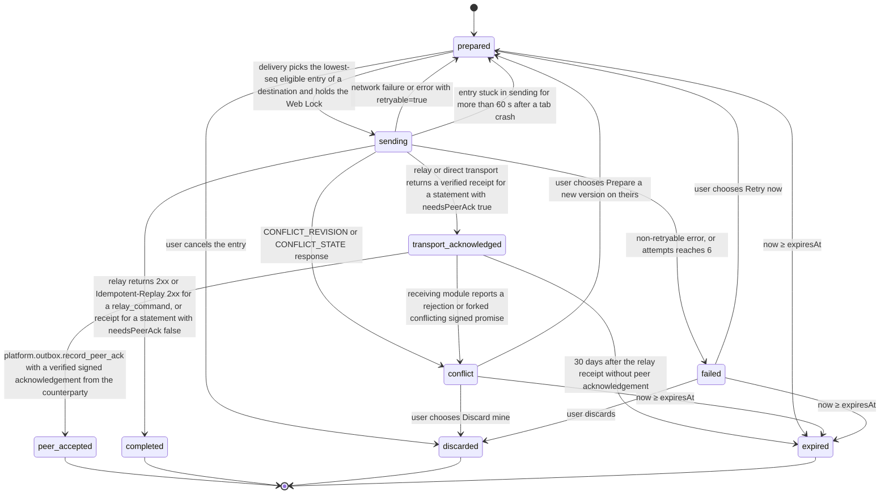

# PS-116-03 — Workflow state machine: Offline outbox

**Status:** SPECIFIED (Stage 3). **Module:** [F15.S01.M01 Offline outbox](SPEC.md) · **Scope:** MVP · **Code:** `apps/pwa/src/platform/offline` · **Contracts:** [CTR-ID-001](../../../planning/contracts/CTR-ID-001.md), [CTR-IDM-001](../../../planning/contracts/CTR-IDM-001.md), [CTR-ERR-001](../../../planning/contracts/CTR-ERR-001.md), [CTR-PRV-001](../../../planning/contracts/CTR-PRV-001.md), [CTR-UX-001](../../../planning/contracts/CTR-UX-001.md), [CTR-OBS-001](../../../planning/contracts/CTR-OBS-001.md), [CTR-CAP-001](../../../planning/contracts/CTR-CAP-001.md), [CTR-FED-001](../../../planning/contracts/CTR-FED-001.md), [CTR-IOX-001](../../../planning/contracts/CTR-IOX-001.md), [CTR-EVT-001](../../../planning/contracts/CTR-EVT-001.md)

> Generated from `module.spec.yaml` by `tools/specgen`. Edit the YAML, then run `pnpm spec:render`.

## Requirements

- **PS-116-03.R01** Entries follow the declared lifecycle and any transition not listed is refused with CONFLICT_STATE.
- **PS-116-03.R02** transport_acknowledged is recorded only after a relay receipt is verified and peer_accepted only after a verified signed peer acknowledgement; a network failure or a missing reply never advances the state, and the UI shows the state reached.
- **PS-116-03.R03** Conflict and failed entries block only later entries with the same destination and aggregateKey, are never auto-merged or auto-retried, and forked conflicting promises freeze the affected coordination instead of choosing a winner.

## Specification

### OutboxEntry lifecycle

Initial **prepared**; terminal **peer_accepted**, **completed**, **discarded**, **expired**.

| Transition | Trigger | Guard / effect |
|---|---|---|
| prepared -> sending | delivery picks the lowest-seq eligible entry of a destination and holds the Web Lock | nextAttemptAt ≤ now, vault unlocked, no lower-seq entry of same aggregateKey unresolved; attempts += 1 |
| sending -> transport_acknowledged | relay or direct transport returns a verified receipt for a statement with needsPeerAck true | store relayReceipt; relay time kept as relay-clock evidence only |
| sending -> completed | relay returns 2xx or Idempotent-Replay 2xx for a relay_command, or receipt for a statement with needsPeerAck false | store response id |
| sending -> prepared | network failure or error with retryable=true | schedule nextAttemptAt by full-jitter backoff (base 500 ms, cap 30 s, retryAfterMs honored) while attempts < 6 |
| sending -> conflict | CONFLICT_REVISION or CONFLICT_STATE response | store currentRevision and state; show the resolve-or-discard prompt |
| sending -> failed | non-retryable error, or attempts reaches 6 | store error code and fields; show failure with Retry now and Discard |
| sending -> prepared | entry stuck in sending for more than 60 s after a tab crash | recovery at startup; same idempotencyKey or cid is reused |
| transport_acknowledged -> peer_accepted | platform.outbox.record_peer_ack with a verified signed acknowledgement from the counterparty | store peerAckCid |
| transport_acknowledged -> conflict | receiving module reports a rejection or forked conflicting signed promise | store reason; affected coordination frozen by the owning module |
| transport_acknowledged -> expired | 30 days after the relay receipt without peer acknowledgement | UI says the peer never confirmed |
| conflict -> prepared | user chooses Prepare a new version on theirs | new statement signed under a new cid (or new idempotencyKey for a relay command), expectedRevision set to currentRevision, attempts reset to 0; old payload kept only in history |
| failed -> prepared | user chooses Retry now | attempts reset to 0 and nextAttemptAt = now |
| prepared -> discarded | user cancels the entry | removed from the delivery set |
| conflict -> discarded | user chooses Discard mine | removed from the delivery set |
| failed -> discarded | user discards | removed from the delivery set |
| prepared -> expired | now ≥ expiresAt | UI states the action was not sent |
| conflict -> expired | now ≥ expiresAt | UI states the action was not sent |
| failed -> expired | now ≥ expiresAt | UI states the action was not sent |

### Timeouts and scheduled transitions

- Unsent entries expire 604800000 ms (7 days) after createdAt; the expiry prompt is shown from day 6 (518400000 ms).
- transport_acknowledged entries expire 2592000000 ms (30 days) after the relay receipt if no peer acknowledgement arrived.
- An entry in sending for more than 60000 ms without a response is reset to prepared at the next startup or delivery tick.
- Delivery tick runs on the online event, visibilitychange to visible, app start, and every 60000 ms while unsent entries exist.

## Verification

| Test | Level | Covers | Scenario | Expected |
|---|---|---|---|---|
| TEST-PS-116-09.T03 | property | PS-116-03.R01, PS-116-01.R02 | random sequences of delivery results, acknowledgements and user actions on one entry | only declared transitions occur, terminal states never change, seq stays strictly increasing |
| TEST-PS-116-09.T04 | integration | PS-116-03.R02, PS-116-06.R01, PS-116-06.R03 | kill the tab after send and before receipt, restart | entry resent with same cid or Idempotency-Key, stub relay applies once, entry ends transport_acknowledged or completed |
| TEST-PS-116-09.T05 | integration | PS-116-03.R02, PS-116-02.R03 | relay receipt arrives, then a forged acknowledgement signed by a non-counterparty key, then the real one | forged ack rejected with PLATFORM_OUTBOX_ACK_MISMATCH; entry stays transport_acknowledged until the real ack gives peer_accepted |
| TEST-PS-116-09.T06 | integration | PS-116-03.R03, PS-116-02.R02 | entry 3 gets 409 CONFLICT_REVISION; entries 4 (same aggregate) and 5 (other aggregate) queued | 3 becomes conflict, 4 waits, 5 is sent; nothing merged |
| TEST-PS-116-09.T14 | e2e | PS-116-03.R03, PS-116-06.R03 | two tabs open, device offline, three actions queued, device reconnects, relay then stopped | exactly one tab delivers, order preserved, UI shows Reached relay for delivered entries and unknown for the rest, local data intact |
| TEST-PS-116-09.T16 | integration | PS-116-04.R01, PS-116-07.R03, PS-116-03.R03 | two vaults send conflicting acceptances for one reservation; receiving module reports the fork | entry becomes conflict, affected coordination frozen, no winner chosen |

## Dependencies

Module depends on: F15.S02.M02, CTR-ID-001, CTR-IDM-001, CTR-ERR-001, CTR-PRV-001, CTR-UX-001, CTR-OBS-001, CTR-CAP-001, CTR-FED-001, CTR-IOX-001, CTR-EVT-001. Predecessor: [domain_schema.md](domain_schema.md).
