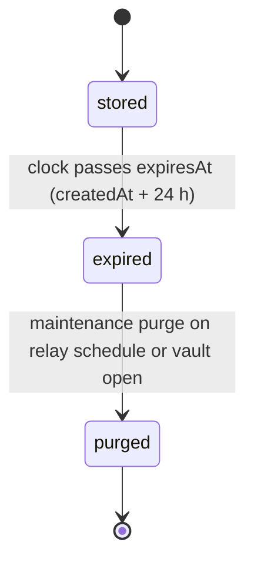

# PS-117-03 — Workflow state machine: API and command bus

**Status:** SPECIFIED (Stage 3). **Module:** [F15.S02.M02 API and command bus](SPEC.md) · **Scope:** MVP · **Code:** `packages/kernel/src/bus` · **Contracts:** [CTR-ID-001](../../../planning/contracts/CTR-ID-001.md), [CTR-ERR-001](../../../planning/contracts/CTR-ERR-001.md), [CTR-EVT-001](../../../planning/contracts/CTR-EVT-001.md), [CTR-IDM-001](../../../planning/contracts/CTR-IDM-001.md), [CTR-CAP-001](../../../planning/contracts/CTR-CAP-001.md), [CTR-FLG-001](../../../planning/contracts/CTR-FLG-001.md), [CTR-SCH-001](../../../planning/contracts/CTR-SCH-001.md), [CTR-OBS-001](../../../planning/contracts/CTR-OBS-001.md), [CTR-PRV-001](../../../planning/contracts/CTR-PRV-001.md), [CTR-TST-001](../../../planning/contracts/CTR-TST-001.md), [CTR-IOX-001](../../../planning/contracts/CTR-IOX-001.md)

> Generated from `module.spec.yaml` by `tools/specgen`. Edit the YAML, then run `pnpm spec:render`.

## Requirements

- **PS-117-03.R01** defineMachine rejects at definition time any terminal state with an outgoing transition, any ambiguous (from, event) pair and an initial state that does not occur in the table.
- **PS-117-03.R02** next(state, event) returns the declared target state or CONFLICT_STATE with params.state and params.event, and can(state, event) agrees with next.
- **PS-117-03.R03** Each machine exports its transition table (from, to, on and edges()) so module tests compare it with the module.spec.yaml rows.

## Specification

### IdempotencyRecord lifecycle

Initial **stored**; terminal **purged**.

| Transition | Trigger | Guard / effect |
|---|---|---|
| stored -> expired | clock passes expiresAt (createdAt + 24 h) | lookups ignore the record and the handler runs again |
| expired -> purged | maintenance purge on relay schedule or vault open | row deleted |

### Timeouts and scheduled transitions

- IdempotencyRecord expires 24 h after creation; purgeExpired runs with the relay maintenance sweep and when the vault opens.
- Relay login nonces expire 120 s after issue; relay access tokens expire after 7 days idle or 30 days absolute.

## Verification

| Test | Level | Covers | Scenario | Expected |
|---|---|---|---|---|
| TEST-PS-117-09.T07 | unit | PS-117-03.R01, PS-117-03.R02, PS-117-03.R03 | invalid machine definitions and declared or undeclared transitions | definition errors; next returns target or CONFLICT_STATE with state and event; edges exported |
| TEST-PS-117-09.T08 | property | PS-117-03.R02, PS-117-09.R03 | random event sequences on the offer machine, 200 runs | only declared transitions succeed; terminal states absorb nothing |

## Dependencies

Module depends on: F15.S02.M03, F15.S03.M01, CTR-ID-001, CTR-ERR-001, CTR-EVT-001, CTR-IDM-001, CTR-CAP-001, CTR-FLG-001, CTR-SCH-001, CTR-OBS-001, CTR-PRV-001, CTR-TST-001, CTR-IOX-001. Predecessor: [domain_schema.md](domain_schema.md).
