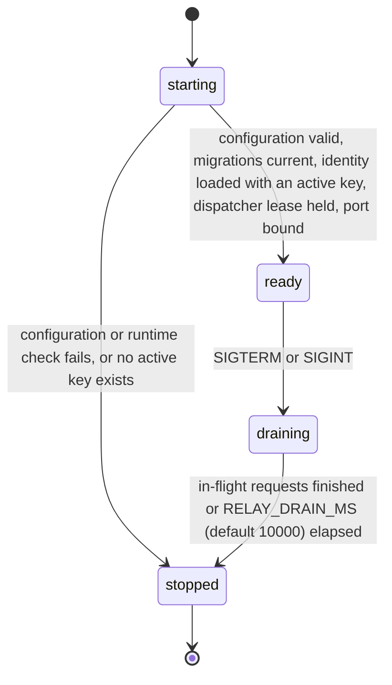
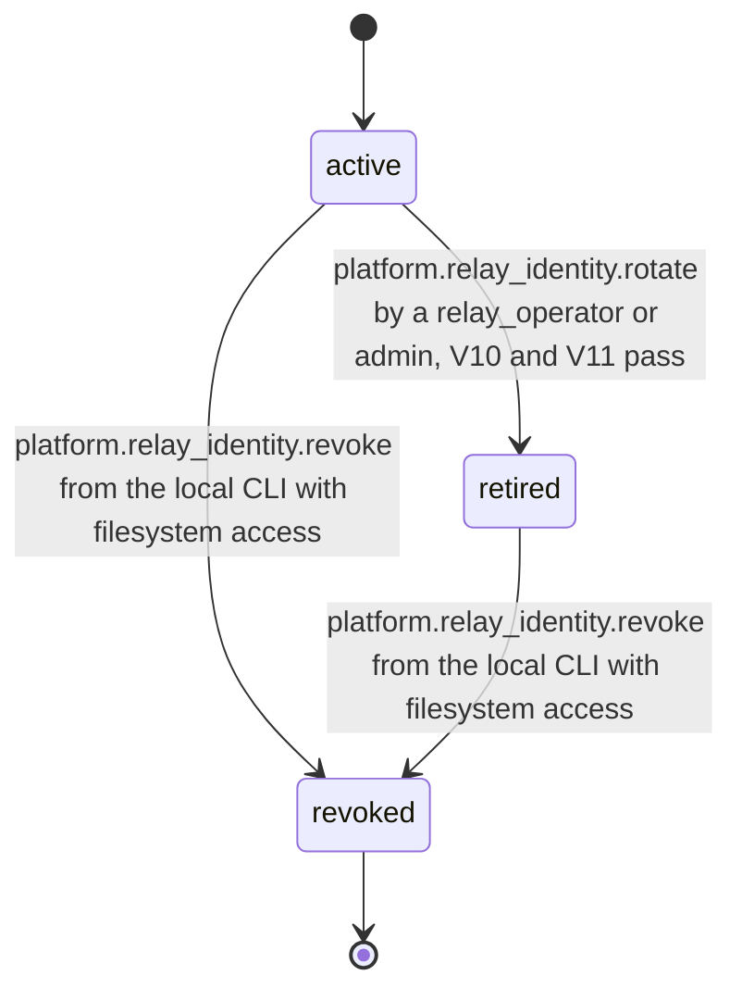

# PS-118-03 — Workflow state machine: Relay service

**Status:** SPECIFIED (Stage 3). **Module:** [F15.S02.M01 Relay service](SPEC.md) · **Scope:** MVP · **Code:** `apps/relay/src/relays` · **Contracts:** [CTR-ID-001](../../../planning/contracts/CTR-ID-001.md), [CTR-EVT-001](../../../planning/contracts/CTR-EVT-001.md), [CTR-IDM-001](../../../planning/contracts/CTR-IDM-001.md), [CTR-ERR-001](../../../planning/contracts/CTR-ERR-001.md), [CTR-CAP-001](../../../planning/contracts/CTR-CAP-001.md), [CTR-FED-001](../../../planning/contracts/CTR-FED-001.md), [CTR-OBS-001](../../../planning/contracts/CTR-OBS-001.md), [CTR-PRV-001](../../../planning/contracts/CTR-PRV-001.md), [CTR-IOX-001](../../../planning/contracts/CTR-IOX-001.md), [CTR-SCH-001](../../../planning/contracts/CTR-SCH-001.md)

> Generated from `module.spec.yaml` by `tools/specgen`. Edit the YAML, then run `pnpm spec:render`.

## Requirements

- **PS-118-03.R01** The process follows starting, ready, draining, stopped, and /readyz is true only in ready.
- **PS-118-03.R02** Shutdown is ordered, meaning stop accepting, drain in-flight requests for up to 10 s, stop the dispatcher after its current batch, run the registered pre-checkpoint hooks (the F15.S03.M02 final WAL archive), checkpoint with TRUNCATE only if every hook succeeded, and close the database.
- **PS-118-03.R03** A RelayIdentity key moves from active to retired only through a rotation that it signs itself, from active or retired to revoked only through revocation from the local CLI with filesystem access (no prior-key authorization required), and never back.

## Specification

### RelayProcess lifecycle

Initial **starting**; terminal **stopped**.

| Transition | Trigger | Guard / effect |
|---|---|---|
| starting -> ready | configuration valid, migrations current, identity loaded with an active key, dispatcher lease held, port bound | /readyz returns 200 |
| starting -> stopped | configuration or runtime check fails, or no active key exists | exit code 78 or 1; no port opened |
| ready -> draining | SIGTERM or SIGINT | /readyz returns 503, server.close() called, idle connections closed, new requests get PLATFORM_RELAY_DRAINING |
| draining -> stopped | in-flight requests finished or RELAY_DRAIN_MS (default 10000) elapsed | dispatcher stopped after current batch, remaining connections closed, pre-checkpoint hooks run with a 5000 ms budget (F15.S03.M02 archives WAL frames up to mxFrame), wal_checkpoint(TRUNCATE) only if every hook succeeded, database closed, exit 0 (1 if requests were cut, 130 on second signal without TRUNCATE) |

### RelayIdentity lifecycle

Initial **active**; terminal **revoked**.

| Transition | Trigger | Guard / effect |
|---|---|---|
| active -> retired | platform.relay_identity.rotate by a relay_operator or admin, V10 and V11 pass | new key generated, rotation statement signed by this key with prevKeyId and seq, new revocation certificate written; old key published as retired |
| active -> revoked | platform.relay_identity.revoke from the local CLI with filesystem access | revocation statement signed by the key itself or its pre-signed certificate, published; relay stops serving until --new-identity creates a new relayId |
| retired -> revoked | platform.relay_identity.revoke from the local CLI with filesystem access | revocation statement published; receipts by this key are valid only if stored before revokedAt |

### Timeouts and scheduled transitions

- Drain deadline RELAY_DRAIN_MS default 10000 ms (range 1000..30000); pre-checkpoint hook budget 5000 ms.
- Request timeout 30000 ms, headers timeout 10000 ms, keep-alive 5000 ms.
- Dispatcher lease TTL 30000 ms renewed every 10000 ms.
- Rotation at most once per 86400000 ms; revocation has no rate limit.

## Verification

| Test | Level | Covers | Scenario | Expected |
|---|---|---|---|---|
| TEST-PS-118-09.T04 | integration | PS-118-03.R01, PS-118-03.R02 | SIGTERM with 5 requests in flight (3 s) and a running dispatcher batch | readyz 503 immediately, requests finish, dispatcher stops after batch, hooks run, WAL truncated, exit 0 within 10 s |
| TEST-PS-118-09.T05 | integration | PS-118-03.R02, PS-118-03.R01 | SIGTERM with a request lasting 20 s, then a second SIGTERM | request cut at 10 s with exit 1, second signal exits 130 without TRUNCATE |
| TEST-PS-118-09.T06 | property | PS-118-03.R03, PS-118-01.R03 | random sequences of rotate, revoke requests and clock changes | active to retired and active or retired to revoked only, never back; rotation rate limit respected; revocation never rate limited |
| TEST-PS-118-09.T20 | abuse | PS-118-03.R03, PS-118-01.R03, PS-118-02.R04 | CLI revoke of the stolen active key 1 h after a rotation, using the pre-signed certificate; vault holds receipts by that key stored before and after revokedAt | revocation accepted without prior-key authorization and without RATE_LIMITED; relay refuses to serve until --new-identity; receipts stored before revokedAt still verify, later ones are rejected |
| TEST-PS-118-09.T23 | integration | PS-118-03.R02, PS-118-06.R03 | shutdown with a registered pre-checkpoint hook that succeeds, then one that fails | WAL archived before TRUNCATE in the first case; TRUNCATE skipped and the WAL kept in the second; next start archives it first |

## Dependencies

Module depends on: F15.S02.M02, F15.S02.M03, F15.S03.M01, F16.S01.M01, CTR-ID-001, CTR-EVT-001, CTR-IDM-001, CTR-ERR-001, CTR-CAP-001, CTR-FED-001, CTR-OBS-001, CTR-PRV-001, CTR-IOX-001, CTR-SCH-001. Predecessor: [domain_schema.md](domain_schema.md).
