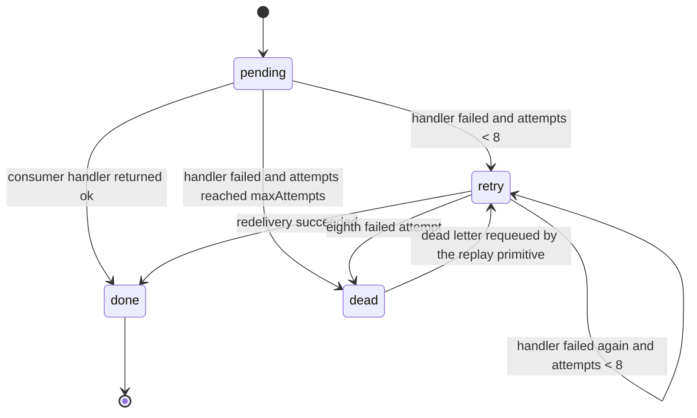
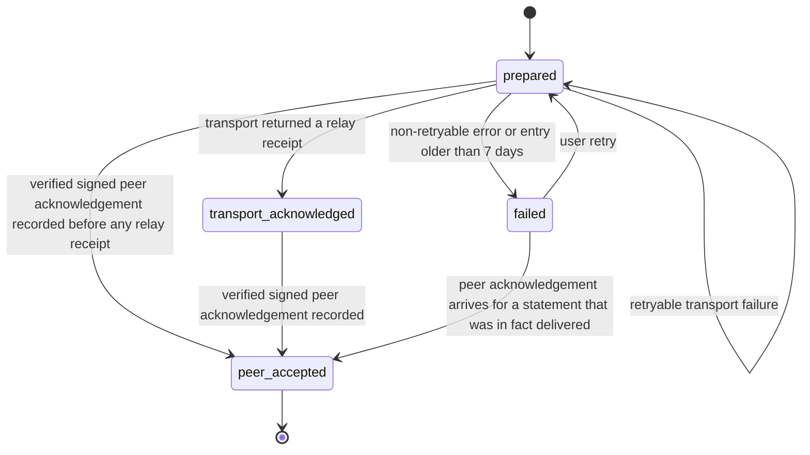
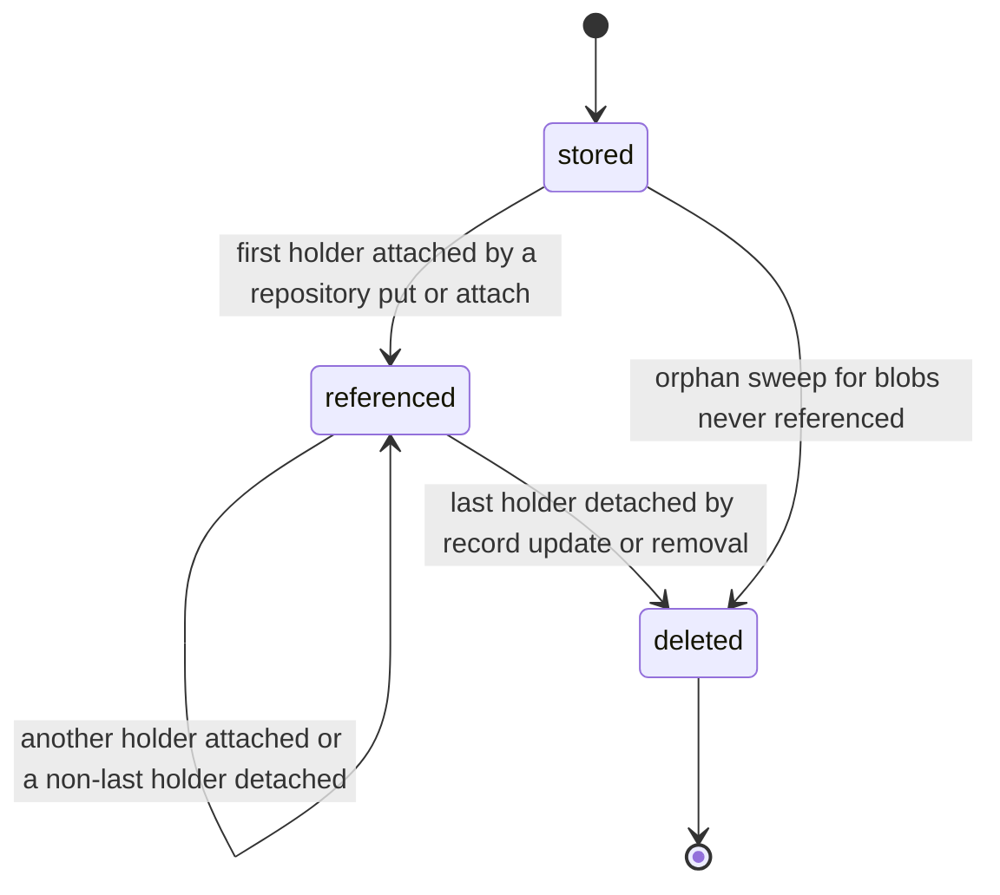

# PS-119-03 — Workflow state machine: Storage

**Status:** SPECIFIED (Stage 3). **Module:** [F15.S02.M03 Storage](SPEC.md) · **Scope:** MVP · **Code:** `packages/kernel/src/storage` · **Contracts:** [CTR-ID-001](../../../planning/contracts/CTR-ID-001.md), [CTR-SCH-001](../../../planning/contracts/CTR-SCH-001.md), [CTR-IDM-001](../../../planning/contracts/CTR-IDM-001.md), [CTR-EVT-001](../../../planning/contracts/CTR-EVT-001.md), [CTR-ERR-001](../../../planning/contracts/CTR-ERR-001.md), [CTR-PRV-001](../../../planning/contracts/CTR-PRV-001.md), [CTR-IOX-001](../../../planning/contracts/CTR-IOX-001.md), [CTR-FLG-001](../../../planning/contracts/CTR-FLG-001.md), [CTR-OBS-001](../../../planning/contracts/CTR-OBS-001.md), [CTR-TST-001](../../../planning/contracts/CTR-TST-001.md), [CTR-FED-001](../../../planning/contracts/CTR-FED-001.md)

> Generated from `module.spec.yaml` by `tools/specgen`. Edit the YAML, then run `pnpm spec:render`.

## Requirements

- **PS-119-03.R01** Outbox delivery per consumer follows the InboxEntry machine; a failure schedules a retry after random(0, min(30 s, 500 ms × 2^(attempt-1))) and the eighth failure moves the event to dead_letter.
- **PS-119-03.R02** Sync-outbox entries follow prepared, transport_acknowledged and peer_accepted with failed reachable from prepared and user retry back to prepared (IDM-7); no state implies more than was observed.
- **PS-119-03.R03** Leases follow acquire by compare-and-set, renew by the holder, release by the holder and automatic expiry at expiresAt, with a fencing counter that increases on every new acquisition (IDM-3, IDM-8).

## Specification

### InboxEntry lifecycle

Initial **pending**; terminal **done**.

| Transition | Trigger | Guard / effect |
|---|---|---|
| pending -> done | consumer handler returned ok | inbox row written in the handler transaction |
| pending -> retry | handler failed and attempts < 8 | nextAttemptAt = now + full-jitter backoff; later events of the aggregate wait |
| pending -> dead | handler failed and attempts reached maxAttempts | event copied to dead_letter with its error code |
| retry -> done | redelivery succeeded | inbox row marked done |
| retry -> retry | handler failed again and attempts < 8 | backoff ceiling doubles up to 30 s |
| retry -> dead | eighth failed attempt | event copied to dead_letter with its error code |
| dead -> retry | dead letter requeued by the replay primitive | attempts reset to 0, due immediately |

### SyncOutboxEntry lifecycle

Initial **prepared**; terminal **peer_accepted**.

| Transition | Trigger | Guard / effect |
|---|---|---|
| prepared -> transport_acknowledged | transport returned a relay receipt | receipt stored; relay time is evidence of that relay clock only |
| prepared -> peer_accepted | verified signed peer acknowledgement recorded before any relay receipt | ack stored |
| prepared -> prepared | retryable transport failure | attempts + 1; nextAttemptAt by full-jitter backoff |
| prepared -> failed | non-retryable error or entry older than 7 days | lastError set to the code or EXPIRED |
| transport_acknowledged -> peer_accepted | verified signed peer acknowledgement recorded | ack stored |
| failed -> prepared | user retry | attempts reset, due immediately |
| failed -> peer_accepted | peer acknowledgement arrives for a statement that was in fact delivered | ack stored |

### MediaBlob lifecycle

Initial **stored**; terminal **deleted**.

| Transition | Trigger | Guard / effect |
|---|---|---|
| stored -> referenced | first holder attached by a repository put or attach | holder row written |
| referenced -> referenced | another holder attached or a non-last holder detached | holder rows updated |
| referenced -> deleted | last holder detached by record update or removal | blob row deleted in the same transaction; shred reported when encrypted |
| stored -> deleted | orphan sweep for blobs never referenced | blob row deleted |

### Timeouts and scheduled transitions

- Inbox retry: nextAttemptAt = now + random(0, min(30 s, 500 ms × 2^(attempt-1))); dead letter after 8 attempts.
- Disabled consumer modules (FLG-3) are paused 60 s at a time without consuming attempts; events stay in the outbox.
- Sync outbox: prepared entries older than 7 days become failed with EXPIRED (IDM-5); retryable failures back off with the same formula.
- Leases expire at expiresAt (default TTL 15 min, maximum 24 h); expired leases are free without cleanup.
- Orphan blob sweep deletes blobs without holders older than the cutoff chosen by the caller (default one day after upload).

## Verification

| Test | Level | Covers | Scenario | Expected |
|---|---|---|---|---|
| TEST-PS-119-09.T03 | contract | PS-119-02.R03, PS-119-03.R03, PS-119-05.R03 | acquire, competing acquire, non-holder release, renew, expiry, late renew, re-acquire | PRECONDITION_FAILED, EXPIRED, fence 1 then 2 then 3 |
| TEST-PS-119-09.T04 | integration | PS-119-01.R02, PS-119-03.R01, PS-119-04.R03, PS-119-06.R03, PS-119-09.R02 | two aggregates with a failing first delivery, duplicate delivery, eight failures, requeue; pending query semantics per adapter | per-aggregate order kept; duplicate skipped; dead letter at attempt 8; requeued events delivered |
| TEST-PS-119-09.T05 | contract | PS-119-03.R02, PS-119-04.R04 | FIFO heads per destination, retry_later, transport ack, undeclared transition, peer ack twice, sender with fatal, retryable and 7-day failures | declared states only; CONFLICT_STATE; idempotent ack; failed with VALIDATION_FAILED and EXPIRED |
| TEST-PS-119-09.T16 | unit | PS-119-03.R01, PS-119-03.R02 | compare inboxMachine and syncMachine with this file's InboxEntry and SyncOutboxEntry machines | identical initial, terminal and transition rows |

## Dependencies

Module depends on: F15.S03.M01, CTR-ID-001, CTR-SCH-001, CTR-IDM-001, CTR-EVT-001, CTR-ERR-001, CTR-PRV-001, CTR-IOX-001, CTR-FLG-001, CTR-OBS-001, CTR-TST-001, CTR-FED-001. Predecessor: [domain_schema.md](domain_schema.md).
