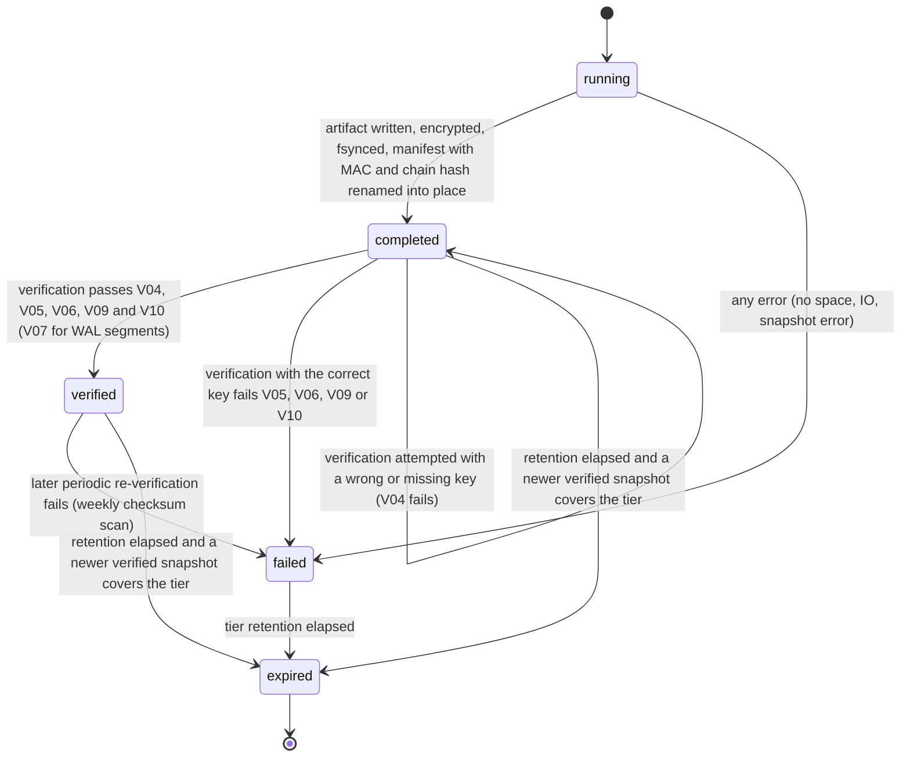

# PS-120-03 — Workflow state machine: Backups

**Status:** SPECIFIED (Stage 3). **Module:** [F15.S03.M02 Backups](SPEC.md) · **Scope:** MVP · **Code:** `apps/relay/src/ops/backups` · **Contracts:** [CTR-IOX-001](../../../planning/contracts/CTR-IOX-001.md), [CTR-PRV-001](../../../planning/contracts/CTR-PRV-001.md), [CTR-OBS-001](../../../planning/contracts/CTR-OBS-001.md), [CTR-ID-001](../../../planning/contracts/CTR-ID-001.md), [CTR-EVT-001](../../../planning/contracts/CTR-EVT-001.md), [CTR-ERR-001](../../../planning/contracts/CTR-ERR-001.md), [CTR-CAP-001](../../../planning/contracts/CTR-CAP-001.md), [CTR-FED-001](../../../planning/contracts/CTR-FED-001.md)

> Generated from `module.spec.yaml` by `tools/specgen`. Edit the YAML, then run `pnpm spec:render`.

## Requirements

- **PS-120-03.R01** A backup moves from running to completed only after the encrypted artifact and manifest are fsynced and renamed into place.
- **PS-120-03.R02** completed becomes verified only through a passing verification; a failed verification never deletes the artifact before its tier retention ends, and a verification attempted with a wrong or missing key leaves the record completed with errorCode PLATFORM_BACKUP_DECRYPT_FAILED and raises an alert.
- **PS-120-03.R03** Expiry is the only way an artifact is removed - a completed or verified artifact only when its retention elapsed and a newer verified snapshot covers the tier, a failed artifact when its tier retention elapsed - and the record is always kept.

## Specification

### BackupRecord lifecycle

Initial **running**; terminal **expired**.

| Transition | Trigger | Guard / effect |
|---|---|---|
| running -> completed | artifact written, encrypted, fsynced, manifest with MAC and chain hash renamed into place | emits no event until verification passes |
| running -> failed | any error (no space, IO, snapshot error) | partial files removed; emits platform.backup.failed |
| completed -> verified | verification passes V04, V05, V06, V09 and V10 (V07 for WAL segments) | verifiedAt set; emits platform.backup.completed |
| completed -> failed | verification with the correct key fails V05, V06, V09 or V10 | errorCode set; emits platform.backup.failed; an extra snapshot is scheduled |
| completed -> completed | verification attempted with a wrong or missing key (V04 fails) | errorCode PLATFORM_BACKUP_DECRYPT_FAILED, verifiedAt unset, artifact untouched, alert raised |
| verified -> failed | later periodic re-verification fails (weekly checksum scan) | emits platform.backup.failed |
| verified -> expired | retention elapsed and a newer verified snapshot covers the tier | artifact deleted, record kept |
| completed -> expired | retention elapsed and a newer verified snapshot covers the tier | artifact deleted, record kept |
| failed -> expired | tier retention elapsed | artifact deleted, record kept |

### Timeouts and scheduled transitions

- Full snapshot every 21600000 ms (6 h) at offsets derived from the relayId (so relays do not all run at the same minute); WAL archive every 300000 ms (5 min) or at once when the WAL reaches 67108864 bytes (64 MiB, checked every 10000 ms); ledger appended at every run.
- A gap-triggered full snapshot at most once per 1800000 ms (30 min).
- A run exceeding 1800000 ms (30 min) is aborted as failed with errorCode INTERNAL; the shutdown archive hook has a 5000 ms budget.
- Alert if no verified snapshot exists in the last 25200000 ms (7 h); weekly checksum and manifest-chain re-verification of all retained artifacts.

## Verification

| Test | Level | Covers | Scenario | Expected |
|---|---|---|---|---|
| TEST-PS-120-09.T03 | property | PS-120-03.R01, PS-120-03.R02, PS-120-03.R03 | random sequences of run, verify with right and wrong key, tamper, expire | only declared transitions occur; newest verified snapshot never expires; expired is the only terminal state |
| TEST-PS-120-09.T04 | integration | PS-120-03.R01, PS-120-06.R01 | kill the process during a snapshot and during a WAL archive run | no visible partial artifact, next run succeeds, record is failed or absent, WAL archive resumes from the last toFrame |
| TEST-PS-120-09.T24 | integration | PS-120-03.R02, PS-120-03.R03 | failed record reaches its tier expiry; completed record reaches retention with and without a newer verified snapshot | failed artifact deleted, record kept; completed expires only when a newer verified snapshot covers the tier |

## Dependencies

Module depends on: F15.S02.M01, F15.S02.M03, F15.S03.M01, F16.S01.M01, CTR-IOX-001, CTR-PRV-001, CTR-OBS-001, CTR-ID-001, CTR-EVT-001, CTR-ERR-001, CTR-CAP-001, CTR-FED-001. Predecessor: [domain_schema.md](domain_schema.md).
