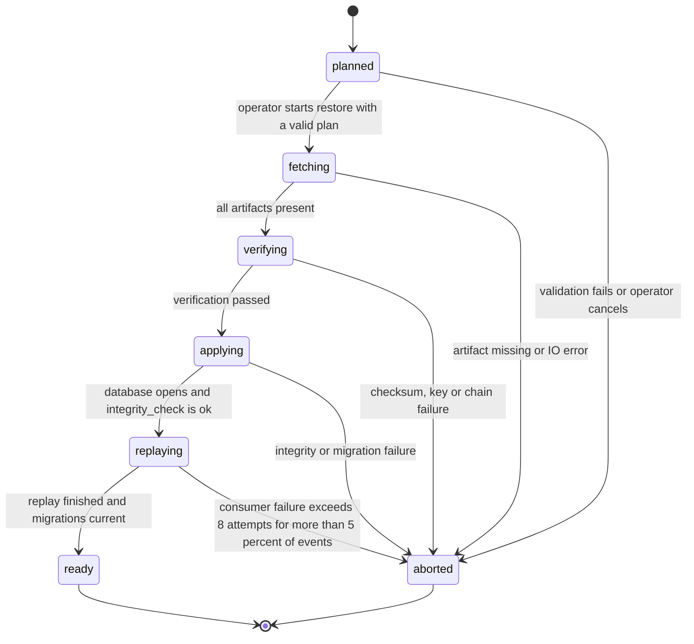
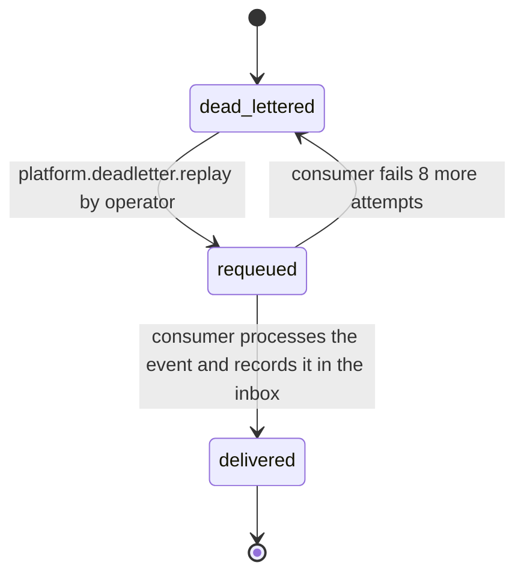

# PS-122-03 — Workflow state machine: Disaster recovery

**Status:** SPECIFIED (Stage 3). **Module:** [F15.S03.M03 Disaster recovery](SPEC.md) · **Scope:** MVP · **Code:** `apps/relay/src/ops/recovery` · **Contracts:** [CTR-IOX-001](../../../planning/contracts/CTR-IOX-001.md), [CTR-EVT-001](../../../planning/contracts/CTR-EVT-001.md), [CTR-IDM-001](../../../planning/contracts/CTR-IDM-001.md), [CTR-OBS-001](../../../planning/contracts/CTR-OBS-001.md), [CTR-CAP-001](../../../planning/contracts/CTR-CAP-001.md), [CTR-ERR-001](../../../planning/contracts/CTR-ERR-001.md), [CTR-PRV-001](../../../planning/contracts/CTR-PRV-001.md)

> Generated from `module.spec.yaml` by `tools/specgen`. Edit the YAML, then run `pnpm spec:render`.

## Requirements

- **PS-122-03.R01** A restore follows ordered phases and any failure leaves the target directory unusable but the live system untouched.
- **PS-122-03.R02** The restored relay opens its port only after all phases pass and the operator confirms.
- **PS-122-03.R03** A dead letter moves back to pending delivery only through the replay command and each replay is counted.

## Specification

### RestoreRun lifecycle

Initial **planned**; terminal **ready**, **aborted**.

| Transition | Trigger | Guard / effect |
|---|---|---|
| planned -> fetching | operator starts restore with a valid plan | artifacts copied to the target directory |
| fetching -> verifying | all artifacts present | checksums and GCM tags verified (V02-V04) |
| verifying -> applying | verification passed | snapshot decrypted, WAL segments applied up to the target time |
| applying -> replaying | database opens and integrity_check is ok | tombstones re-applied, archived events after the watermark re-delivered to consumers |
| replaying -> ready | replay finished and migrations current | restore-report.json written, relay may be started on the new host |
| planned -> aborted | validation fails or operator cancels | target directory left for inspection |
| fetching -> aborted | artifact missing or IO error | report records the phase |
| verifying -> aborted | checksum, key or chain failure | report records the failed check |
| applying -> aborted | integrity or migration failure | report records the failed check |
| replaying -> aborted | consumer failure exceeds 8 attempts for more than 5 percent of events | report lists dead letters |

### DeadLetterReplay lifecycle

Initial **dead_lettered**; terminal **delivered**.

| Transition | Trigger | Guard / effect |
|---|---|---|
| dead_lettered -> requeued | platform.deadletter.replay by operator | replayCount += 1, attempts reset to 0, rate 500 per minute |
| requeued -> delivered | consumer processes the event and records it in the inbox | removed from dead_letter |
| requeued -> dead_lettered | consumer fails 8 more attempts | error code updated, replayCount kept |

### Timeouts and scheduled transitions

- Restore RTO budget 14400000 ms (4 h) end to end, with phase budgets fetch 45 min, verify 30 min, apply 30 min, replay 30 min, cutover and checks 60 min, reserve 45 min.
- Dead letters kept 30 days then purged.
- Quarterly restore drill, alert after 100 days without one.

## Verification

| Test | Level | Covers | Scenario | Expected |
|---|---|---|---|---|
| TEST-PS-122-09.T01 | integration | PS-122-01.R01, PS-122-01.R03, PS-122-03.R02 | relay restore to an empty directory at latest | database opens, integrity ok, restore-report.json contains all documented fields |
| TEST-PS-122-09.T03 | property | PS-122-03.R01, PS-122-03.R03 | random failures injected per phase | only declared transitions occur; aborted runs never modify the live database; requeued becomes delivered or dead_lettered only |
| TEST-PS-122-09.T04 | integration | PS-122-03.R01, PS-122-06.R03 | delete a middle WAL segment | restore stops at the last contiguous segment, reports reachedTimestamp, applies no later segment |
| TEST-PS-122-09.T09 | chaos | PS-122-06.R03, PS-122-03.R03 | kill the restore process in each phase and the consumer during replay | restart from scratch succeeds; failed consumers leave dead letters, not lost events |

## Dependencies

Module depends on: F15.S03.M02, F15.S02.M01, F15.S02.M03, F15.S03.M01, CTR-IOX-001, CTR-EVT-001, CTR-IDM-001, CTR-OBS-001, CTR-CAP-001, CTR-ERR-001, CTR-PRV-001. Predecessor: [domain_schema.md](domain_schema.md).
