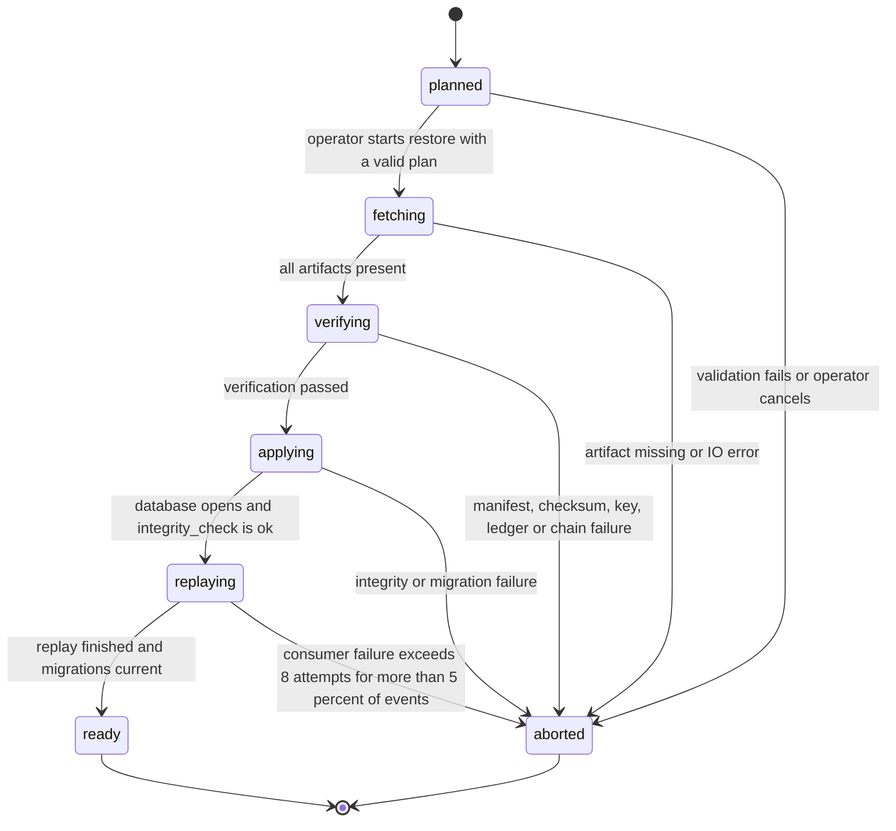
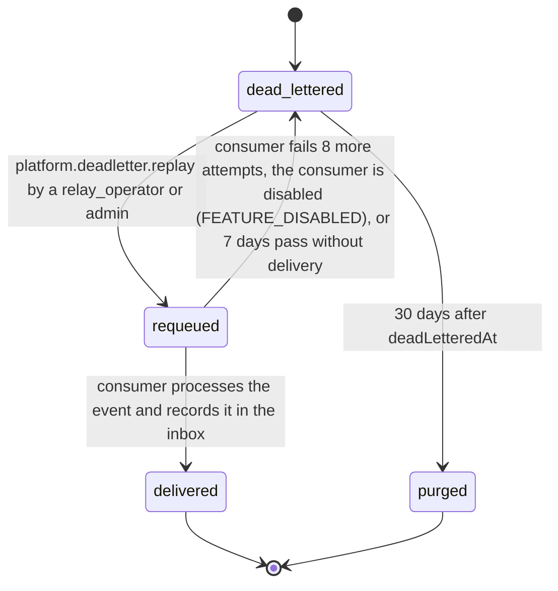

# PS-122-03 — Workflow state machine: Disaster recovery

**Status:** SPECIFIED (Stage 3). **Module:** [F15.S03.M03 Disaster recovery](SPEC.md) · **Scope:** MVP · **Code:** `apps/relay/src/ops/recovery` · **Contracts:** [CTR-IOX-001](../../../planning/contracts/CTR-IOX-001.md), [CTR-EVT-001](../../../planning/contracts/CTR-EVT-001.md), [CTR-IDM-001](../../../planning/contracts/CTR-IDM-001.md), [CTR-OBS-001](../../../planning/contracts/CTR-OBS-001.md), [CTR-CAP-001](../../../planning/contracts/CTR-CAP-001.md), [CTR-ERR-001](../../../planning/contracts/CTR-ERR-001.md), [CTR-PRV-001](../../../planning/contracts/CTR-PRV-001.md), [CTR-FED-001](../../../planning/contracts/CTR-FED-001.md)

> Generated from `module.spec.yaml` by `tools/specgen`. Edit the YAML, then run `pnpm spec:render`.

## Requirements

- **PS-122-03.R01** A restore follows ordered phases and any failure leaves the target directory unusable but the live system untouched.
- **PS-122-03.R02** The restored relay opens its port only after all phases pass and the operator confirms.
- **PS-122-03.R03** A dead letter moves back to pending delivery only through the replay command, each replay is counted in replay_count, and every non-terminal state has an exit - requeued events return to dead_lettered when the consumer is disabled or not delivered within 7 days, and dead letters are purged 30 days after deadLetteredAt.
- **PS-122-03.R04** Restore re-delivers only events with occurredAt ≤ reachedTimestamp whose aggregate revision exists in the restored records, never to consumers with external side effects, and reports later events as lost in rpoAchievedMs and lostEvents.
- **PS-122-03.R05** Before the port opens, the restore writes the relay-signed restore announcement, increments the receipt epoch and freezes relay-hosted auctions with activity in the lost window.

## Specification

### RestoreRun lifecycle

Initial **planned**; terminal **ready**, **aborted**.

| Transition | Trigger | Guard / effect |
|---|---|---|
| planned -> fetching | operator starts restore with a valid plan | artifacts copied to the target directory |
| fetching -> verifying | all artifacts present | manifests authenticated (V10), checksums and GCM tags verified (V02-V04), ledger checked (V09) |
| verifying -> applying | verification passed | snapshot decrypted, WAL frames after walPosition applied up to the target time |
| applying -> replaying | database opens and integrity_check is ok | tombstone ledger re-applied; archived events with occurredAt ≤ reachedTimestamp, an existing aggregate revision and no inbox row re-delivered to consumers without external side effects; later events counted lost |
| replaying -> ready | replay finished and migrations current | restore announcement signed with the relay key (or the new identity) and written for F15.S02.M01, receipt epoch incremented, auctions with activity in lostWindow frozen through AuctionHostPort, restore-report.json written; relay may be started on the new host |
| planned -> aborted | validation fails or operator cancels | target directory left for inspection |
| fetching -> aborted | artifact missing or IO error | report records the phase |
| verifying -> aborted | manifest, checksum, key, ledger or chain failure | report records the failed check |
| applying -> aborted | integrity or migration failure | report records the failed check |
| replaying -> aborted | consumer failure exceeds 8 attempts for more than 5 percent of events | report lists dead letters |

### DeadLetterReplay lifecycle

Initial **dead_lettered**; terminal **delivered**, **purged**.

| Transition | Trigger | Guard / effect |
|---|---|---|
| dead_lettered -> requeued | platform.deadletter.replay by a relay_operator or admin | replay_count += 1, last_replayed_at = now, attempts reset to 0, rate 500 per minute |
| requeued -> delivered | consumer processes the event and records it in the inbox | removed from dead_letter |
| requeued -> dead_lettered | consumer fails 8 more attempts, the consumer is disabled (FEATURE_DISABLED), or 7 days pass without delivery | error code updated, replay_count and last_replayed_at kept |
| dead_lettered -> purged | 30 days after deadLetteredAt | row deleted, counted in classrup_platform_deadletter_purged_total |

### Timeouts and scheduled transitions

- Restore RTO budget 14400000 ms (4 h) end to end, with phase budgets fetch 45 min, verify 30 min, apply 30 min, replay 30 min, cutover and checks 60 min, reserve 45 min.
- Dead letters purged 2592000000 ms (30 days) after deadLetteredAt; a requeued event not delivered within 604800000 ms (7 days) returns to dead_lettered.
- Quarterly restore drill, alert after 100 days without one.

## Verification

| Test | Level | Covers | Scenario | Expected |
|---|---|---|---|---|
| TEST-PS-122-09.T01 | integration | PS-122-01.R01, PS-122-01.R03, PS-122-03.R02 | relay restore to an empty directory at latest | database opens, integrity ok, restore-report.json contains all documented fields |
| TEST-PS-122-09.T03 | property | PS-122-03.R01, PS-122-03.R03 | random failures injected per phase and random dead-letter timelines | only declared transitions occur; aborted runs never modify the live database; every non-terminal dead-letter state reaches delivered, dead_lettered or purged |
| TEST-PS-122-09.T04 | integration | PS-122-03.R01, PS-122-06.R03 | delete a middle WAL segment | restore stops at the last contiguous segment, reports reachedTimestamp, applies no later segment |
| TEST-PS-122-09.T09 | chaos | PS-122-06.R03, PS-122-03.R03 | kill the restore process in each phase and the consumer during replay | restart from scratch succeeds; failed consumers leave dead letters, not lost events |
| TEST-PS-122-09.T20 | integration | PS-122-03.R04, PS-122-01.R03 | archive holds events before and after reachedTimestamp, one whose aggregate revision is missing in the restored records, and push events in range | only events ≤ reachedTimestamp with existing revisions re-delivered; the rest counted in lostEvents and rpoAchievedMs; push consumer listed in excludedConsumers and sends nothing |
| TEST-PS-122-09.T21 | integration | PS-122-03.R05, PS-122-04.R04, PS-122-06.R04 | restore with receipts issued after the restored point and an auction bid in the lost window | signed restore announcement served in the well-known document with lostWindow, lastReceiptSeq and epoch 1; the stub outbox returns covered entries to prepared and resends them once; the auction is frozen through AuctionHostPort |
| TEST-PS-122-09.T22 | integration | PS-122-03.R03 | dead letter left 30 days; a requeued event whose consumer is then disabled; a requeued event not delivered for 7 days | first purged and counted; second and third return to dead_lettered with replay_count kept |

## Dependencies

Module depends on: F15.S03.M02, F15.S02.M01, F15.S02.M03, F15.S03.M01, F16.S01.M01, CTR-IOX-001, CTR-EVT-001, CTR-IDM-001, CTR-OBS-001, CTR-CAP-001, CTR-ERR-001, CTR-PRV-001, CTR-FED-001. Predecessor: [domain_schema.md](domain_schema.md).
