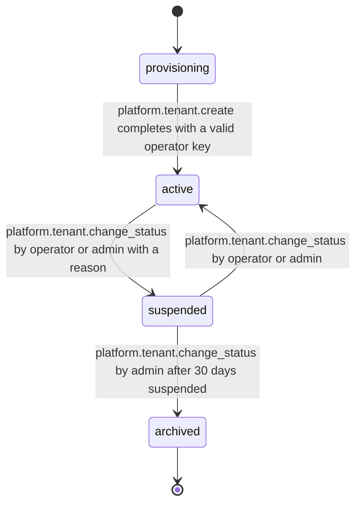

# PS-125-03 — Workflow state machine: Tenants

**Status:** SPECIFIED (Stage 3). **Module:** [F15.S04.M03 Tenants](SPEC.md) · **Scope:** MVP · **Code:** `packages/platform/src/configuration/tenants` · **Contracts:** [CTR-ID-001](../../../planning/contracts/CTR-ID-001.md), [CTR-IDM-001](../../../planning/contracts/CTR-IDM-001.md), [CTR-ERR-001](../../../planning/contracts/CTR-ERR-001.md), [CTR-EVT-001](../../../planning/contracts/CTR-EVT-001.md), [CTR-CAP-001](../../../planning/contracts/CTR-CAP-001.md), [CTR-MNY-001](../../../planning/contracts/CTR-MNY-001.md), [CTR-PRV-001](../../../planning/contracts/CTR-PRV-001.md), [CTR-IOX-001](../../../planning/contracts/CTR-IOX-001.md), [CTR-OBS-001](../../../planning/contracts/CTR-OBS-001.md)

> Generated from `module.spec.yaml` by `tools/specgen`. Edit the YAML, then run `pnpm spec:render`.

## Requirements

- **PS-125-03.R01** A tenant moves provisioning to active once an operator key is set and bootstrap completes, and any transition not listed is refused with CONFLICT_STATE.
- **PS-125-03.R02** Suspension is reversible; archiving is final and is allowed only from suspended to prevent accidents.
- **PS-125-03.R03** Status changes are written with their event in one transaction.

## Specification

### Tenant lifecycle

Initial **provisioning**; terminal **archived**.

| Transition | Trigger | Guard / effect |
|---|---|---|
| provisioning -> active | platform.tenant.create completes with a valid operator key | emits platform.tenant.created |
| active -> suspended | platform.tenant.change_status by operator or admin with a reason | relay refuses writes with PLATFORM_TENANT_SUSPENDED; emits platform.tenant.status_changed |
| suspended -> active | platform.tenant.change_status by operator or admin | emits platform.tenant.status_changed |
| suspended -> archived | platform.tenant.change_status by admin after 30 days suspended | read-only export remains for 90 days; emits platform.tenant.status_changed |

### Timeouts and scheduled transitions

- Archiving requires the tenant to have been suspended for at least 2592000000 ms (30 days); archived tenants are purged from the relay 7776000000 ms (90 days) after archiving.
- Configuration cache TTL 30000 ms, invalidated immediately on change.

## Verification

| Test | Level | Covers | Scenario | Expected |
|---|---|---|---|---|
| TEST-PS-125-09.T03 | property | PS-125-03.R01, PS-125-03.R02 | random sequences of status commands | only declared transitions occur; archived never changes; archive requires 30 days suspended |
| TEST-PS-125-09.T04 | integration | PS-125-03.R03, PS-125-04.R02, PS-125-06.R03 | status change with injected event-insert failure | transaction rolled back, no status change visible, no event |

## Dependencies

Module depends on: F15.S02.M03, F15.S04.M01, CTR-ID-001, CTR-IDM-001, CTR-ERR-001, CTR-EVT-001, CTR-CAP-001, CTR-MNY-001, CTR-PRV-001, CTR-IOX-001, CTR-OBS-001. Predecessor: [domain_schema.md](domain_schema.md).
