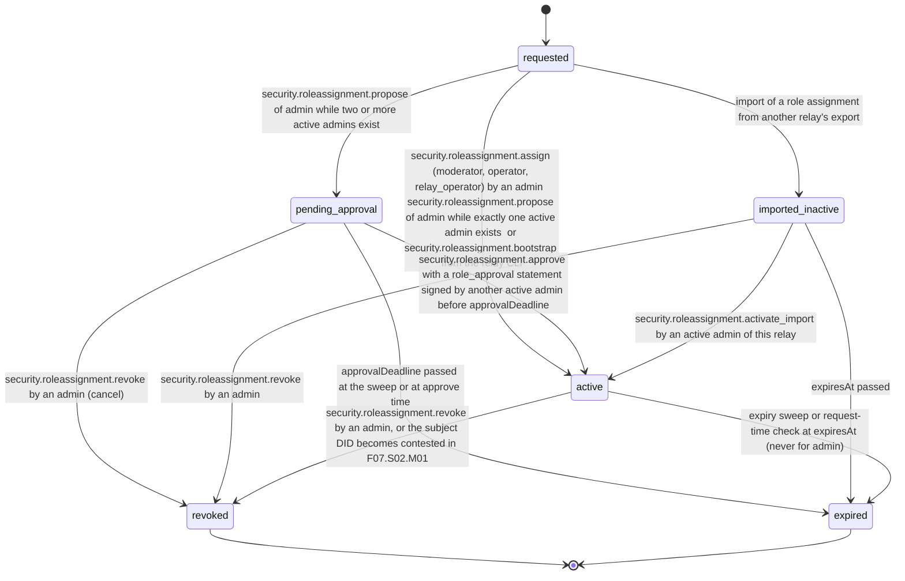

# PS-126-03 — Workflow state machine: Authorization policy

**Status:** SPECIFIED (Stage 3). **Module:** [F16.S01.M01 Authorization policy](SPEC.md) · **Scope:** MVP · **Code:** `packages/security/src/authz/authorization` · **Contracts:** [CTR-CAP-001](../../../planning/contracts/CTR-CAP-001.md), [CTR-ID-001](../../../planning/contracts/CTR-ID-001.md), [CTR-EVT-001](../../../planning/contracts/CTR-EVT-001.md), [CTR-ERR-001](../../../planning/contracts/CTR-ERR-001.md), [CTR-IDM-001](../../../planning/contracts/CTR-IDM-001.md), [CTR-PRV-001](../../../planning/contracts/CTR-PRV-001.md), [CTR-FED-001](../../../planning/contracts/CTR-FED-001.md), [CTR-OBS-001](../../../planning/contracts/CTR-OBS-001.md)

> Generated from `module.spec.yaml` by `tools/specgen`. Edit the YAML, then run `pnpm spec:render`.

## Requirements

- **PS-126-03.R01** Role assignments follow the declared lifecycle and any other transition is refused with CONFLICT_STATE; requested is the initial pseudostate of a validated command and is never stored.
- **PS-126-03.R02** Expiry, revocation and device-key revocation take effect on the next request, and no role grant or key status is cached for more than 60 seconds (CAP-6).
- **PS-126-03.R03** Audit entries have no lifecycle; entries for state-changing commands are appended inside the same transaction as the command, and buffered read-only denials are appended once when their 60 second window closes.
- **PS-126-03.R04** Admin assignments never expire, so expiry can never remove the last admin, and an admin proposal not approved within 24 hours expires without granting anything.
- **PS-126-03.R05** Bootstrap and break-glass are the only paths that create an admin without an existing admin's signature, and break-glass use emits security.role.assigned with breakGlass true so that F16.S03.M02 opens a SEV1 incident.

## Specification

### RoleAssignment lifecycle

Initial **requested**; terminal **revoked**, **expired**.

| Transition | Trigger | Guard / effect |
|---|---|---|
| requested -> active | security.roleassignment.assign (moderator, operator, relay_operator) by an admin; security.roleassignment.propose of admin while exactly one active admin exists; or security.roleassignment.bootstrap from the relay CLI | grantedAt set; role statement signed; emits security.role.assigned with via assign, propose, bootstrap or break_glass |
| requested -> pending_approval | security.roleassignment.propose of admin while two or more active admins exist | approvalDeadline = proposedAt + 24 h; grants nothing; no event |
| requested -> imported_inactive | import of a role assignment from another relay's export | grants nothing; no event |
| pending_approval -> active | security.roleassignment.approve with a role_approval statement signed by another active admin before approvalDeadline | approvalStatementCid stored; role statement signed; emits security.role.assigned with via approve |
| pending_approval -> expired | approvalDeadline passed at the sweep or at approve time | revokeReason approval_expired; no event |
| pending_approval -> revoked | security.roleassignment.revoke by an admin (cancel) | revokeReason cancelled; no event |
| imported_inactive -> active | security.roleassignment.activate_import by an active admin of this relay | new role statement signed by this relay; emits security.role.assigned with via import |
| imported_inactive -> revoked | security.roleassignment.revoke by an admin | no event |
| imported_inactive -> expired | expiresAt passed | no event |
| active -> revoked | security.roleassignment.revoke by an admin, or the subject DID becomes contested in F07.S02.M01 | revokedAt set; revocation role statement signed; emits security.role.revoked with reason and lastAdmin |
| active -> expired | expiry sweep or request-time check at expiresAt (never for admin) | emits security.role.revoked with reason expired |

### Timeouts and scheduled transitions

- Expiry sweep every 60 s; per-request check also compares expiresAt so a missed sweep never extends a role.
- Admin proposals expire 24 h (86 400 000 ms) after proposedAt.
- Audit anchor classrup.security.audit_anchor/v1 signed by the relay key every 1 000 entries or every 5 minutes with new entries, whichever comes first, and served for vaults and peers to fetch.
- Read-only denial coalescing window 60 s; the buffer is flushed when the window closes, on graceful shutdown and when it holds 1 000 distinct keys.
- Role grant and key status caches expire after at most 60 s.

## Verification

| Test | Level | Covers | Scenario | Expected |
|---|---|---|---|---|
| TEST-PS-126-09.T04 | integration | PS-126-03.R02 | expiry sweep missed; role revoked mid-request; Md1 revoked in M's stored portable document | request-time check denies; handler re-check denies; Md1 denied with signer_key_revoked within 60 s while Md2 keeps the role |
| TEST-PS-126-09.T12 | abuse | PS-126-03.R03, PS-126-07.R03 | 1 000 identical read-only denials in 60 seconds; 1 000 denials of a state-changing command; crash in the middle of a window | one entry with count 1 000 appended at window close with entryHash computed then; 1 000 separate entries; the crash loses at most the open window |
| TEST-PS-126-09.T16 | integration | PS-126-03.R05, PS-126-04.R04, PS-126-05.R04 | fresh relay rejects assign; CLI bootstrap creates A1; second bootstrap without break-glass; break-glass with a 30-character reason; bootstrap attempted over HTTP; RoleBootstrapPort from a tenant bootstrap stub | A1 active via bootstrap with OS user audited; SECURITY_BOOTSTRAP_REFUSED; new admin via break_glass and security.role.assigned with breakGlass true; no HTTP route; operator and admin created in one transaction |
| TEST-PS-126-09.T17 | integration | PS-126-02.R01, PS-126-03.R04 | A1 proposes admin S with A2 approving within 24 h; a proposal left 25 h; assign naming A2 as approvedBy without a signed approval; approval signed by the proposer | S active with approvalStatementCid; expired with approval_expired; SECURITY_APPROVAL_REQUIRED; SECURITY_APPROVAL_REQUIRED |
| TEST-PS-126-09.T19 | integration | PS-126-03.R04, PS-126-03.R01 | expiry sweep runs when A1 is the only admin; admin proposal carrying expiresInMs; revoke of an already expired assignment; approve of an active one | A1 never expires; VALIDATION_FAILED; CONFLICT_STATE; CONFLICT_STATE |

## Dependencies

Module depends on: F16.S01.M02, F10.S02.M02, CTR-CAP-001, CTR-ID-001, CTR-EVT-001, CTR-ERR-001, CTR-IDM-001, CTR-PRV-001, CTR-FED-001, CTR-OBS-001. Predecessor: [domain_schema.md](domain_schema.md).
