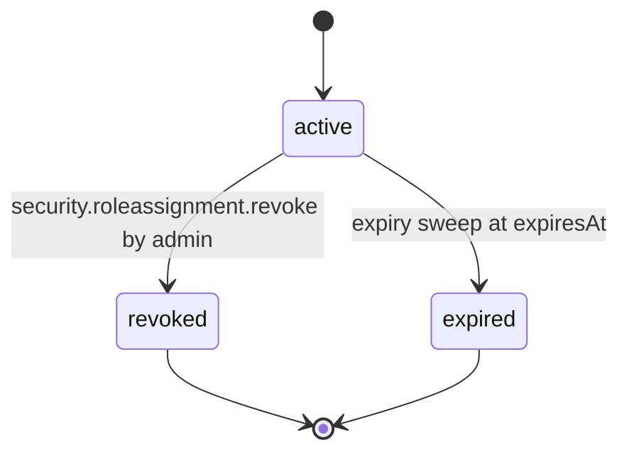

# PS-126-03 — Workflow state machine: Authorization policy

**Status:** SPECIFIED (Stage 3). **Module:** [F16.S01.M01 Authorization policy](SPEC.md) · **Scope:** MVP · **Code:** `packages/security/src/authz/authorization` · **Contracts:** [CTR-CAP-001](../../../planning/contracts/CTR-CAP-001.md), [CTR-ID-001](../../../planning/contracts/CTR-ID-001.md), [CTR-EVT-001](../../../planning/contracts/CTR-EVT-001.md), [CTR-ERR-001](../../../planning/contracts/CTR-ERR-001.md), [CTR-IDM-001](../../../planning/contracts/CTR-IDM-001.md), [CTR-PRV-001](../../../planning/contracts/CTR-PRV-001.md), [CTR-FED-001](../../../planning/contracts/CTR-FED-001.md), [CTR-OBS-001](../../../planning/contracts/CTR-OBS-001.md)

> Generated from `module.spec.yaml` by `tools/specgen`. Edit the YAML, then run `pnpm spec:render`.

## Requirements

- **PS-126-03.R01** Role assignments follow the declared lifecycle and any other transition is refused with CONFLICT_STATE.
- **PS-126-03.R02** Expiry and revocation take effect on the next request and no role grant is cached for more than 60 seconds (CAP-6).
- **PS-126-03.R03** Audit entries have no lifecycle; they are appended inside the same transaction as the decision's command when it changes state.

## Specification

### RoleAssignment lifecycle

Initial **active**; terminal **revoked**, **expired**.

| Transition | Trigger | Guard / effect |
|---|---|---|
| active -> revoked | security.roleassignment.revoke by admin | revokedAt set; emits security.role.revoked; statement of revocation signed |
| active -> expired | expiry sweep at expiresAt | emits security.role.revoked with reason expired |

### Timeouts and scheduled transitions

- Expiry sweep every 60 s; per-request check also compares expiresAt so a missed sweep never extends a role.
- Daily at 00:05 UTC the relay signs an audit digest {seq, entryHash} with its relay key and stores it as a chain anchor.

## Verification

| Test | Level | Covers | Scenario | Expected |
|---|---|---|---|---|
| TEST-PS-126-09.T04 | integration | PS-126-03.R01, PS-126-03.R02, PS-126-03.R03 | expiry sweep missed; role revoked mid-request | request-time check denies; handler re-check denies; audit entries written |

## Dependencies

Module depends on: CTR-CAP-001, CTR-ID-001, CTR-EVT-001, CTR-ERR-001, CTR-IDM-001, CTR-PRV-001, CTR-FED-001, CTR-OBS-001. Predecessor: [domain_schema.md](domain_schema.md).
