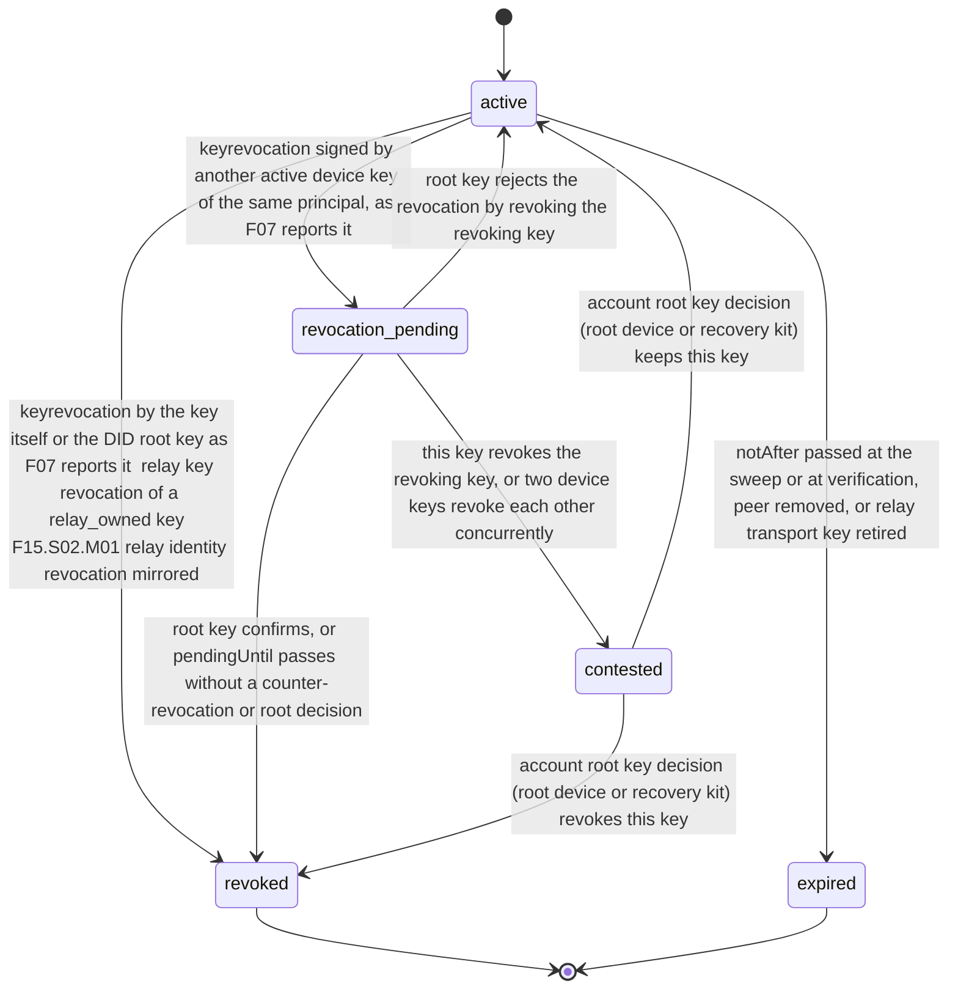

# PS-129-03 — Workflow state machine: Key registry and revocation

**Status:** SPECIFIED (Stage 3). **Module:** [F16.S02.M02 Key registry and revocation](SPEC.md) · **Scope:** MVP · **Code:** `packages/security/src/cryptography/management` · **Contracts:** [CTR-ID-001](../../../planning/contracts/CTR-ID-001.md), [CTR-EVT-001](../../../planning/contracts/CTR-EVT-001.md), [CTR-ERR-001](../../../planning/contracts/CTR-ERR-001.md), [CTR-IDM-001](../../../planning/contracts/CTR-IDM-001.md), [CTR-PRV-001](../../../planning/contracts/CTR-PRV-001.md), [CTR-FED-001](../../../planning/contracts/CTR-FED-001.md), [CTR-CAP-001](../../../planning/contracts/CTR-CAP-001.md), [CTR-OBS-001](../../../planning/contracts/CTR-OBS-001.md)

> Generated from `module.spec.yaml` by `tools/specgen`. Edit the YAML, then run `pnpm spec:render`.

## Requirements

- **PS-129-03.R01** Key records follow the declared lifecycle, revoked and expired are final, and any other transition is refused with CONFLICT_STATE.
- **PS-129-03.R02** A revocation by another device key waits 7 days as revocation_pending, ending in revoked at the timeout or on root confirmation and in contested on a counter-revocation, and a contested key leaves only by a decision of the account root key (the recovery-key role, from the root device or the recovery kit).
- **PS-129-03.R03** Expiry is evaluated at verification time as well as by the sweep, so a missed sweep never extends a key.
- **PS-129-03.R04** Transitions of cached user keys follow F07 events and identity documents only and never run ahead of or against them; native records follow this module's own commands and mirrored relay and peer events.

## Specification

### KeyRecord lifecycle

Initial **active**; terminal **revoked**, **expired**.

| Transition | Trigger | Guard / effect |
|---|---|---|
| active -> revoked | keyrevocation by the key itself or the DID root key as F07 reports it; relay key revocation of a relay_owned key; F15.S02.M01 relay identity revocation mirrored | revokedAt = receipt time; effectiveFrom clamped per V04; finalCids stored for reason account_deleted; key hash added to the revoked-key set; emits security.key.revoked |
| active -> revocation_pending | keyrevocation signed by another active device key of the same principal, as F07 reports it | pendingUntil = recorded time + 7 days; statements still verify with a pending warning |
| active -> expired | notAfter passed at the sweep or at verification, peer removed, or relay transport key retired | local status only; signatures first seen before notAfter stay verifiable |
| revocation_pending -> revoked | root key confirms, or pendingUntil passes without a counter-revocation or root decision | emits security.key.revoked |
| revocation_pending -> active | root key rejects the revocation by revoking the revoking key | pending entry closed |
| revocation_pending -> contested | this key revokes the revoking key, or two device keys revoke each other concurrently | both keys frozen for key management; routine statements verify with a contested warning |
| contested -> revoked | account root key decision (root device or recovery kit) revokes this key | emits security.key.revoked |
| contested -> active | account root key decision (root device or recovery kit) keeps this key | the other key's revocation stands |

### Timeouts and scheduled transitions

- Expiry sweep every 5 minutes on a relay and on app start plus hourly while open in a vault.
- revocation_pending lasts 7 days (604 800 000 ms); a recovery-driven revocation waits 72 h from this store's first sight of the recovery notice (F07.S02.M01).
- Revocation list heads are published at least every 6 hours with nextUpdateBy at most 24 hours ahead; vaults poll the own relay and the counterparty's listed relays at most hourly while open; freshness is computed from issuedAt, older than 24 hours shows 'not recently checked' and older than 7 days shows unknown.

## Verification

| Test | Level | Covers | Scenario | Expected |
|---|---|---|---|---|
| TEST-PS-129-09.T03 | property | PS-129-01.R03, PS-129-03.R01, PS-129-09.R02 | random sequences of revocations, pending periods, counter-revocations, root decisions, expiries and purges | revoked and expired never change; a revoked key never returns, also after its KeyRecord is purged |
| TEST-PS-129-09.T04 | integration | PS-129-03.R03, PS-129-06.R03 | expiry sweep missed for a VAPID key; revocation of peer key Z arrives before federation.peer.added | verification refuses the expired key; Z's hash is in the revoked-key set and the key is recorded revoked when it appears |
| TEST-PS-129-09.T05 | integration | PS-129-03.R02, PS-129-03.R04 | F07 reports K3 revoking K1 (pending), K1 counter-revoking K3 (contested) and a root decision; a test injects a revocation without any F07 event | the cache mirrors revocation_pending for 7 days, contested and the root outcome; the injected change is refused |
| TEST-PS-129-09.T23 | unit | PS-129-02.R01, PS-129-03.R02 | revocation signed by the root key decrypted from a recovery kit; by another active device key, then confirmed by the root key; by the revoked key itself; two device keys revoking each other | immediate; pending until the root confirmation, then revoked; immediate; both contested until a root-key decision |

## Dependencies

Module depends on: F16.S01.M01, F16.S02.M03, F10.S02.M02, CTR-ID-001, CTR-EVT-001, CTR-ERR-001, CTR-IDM-001, CTR-PRV-001, CTR-FED-001, CTR-CAP-001, CTR-OBS-001. Predecessor: [domain_schema.md](domain_schema.md).
