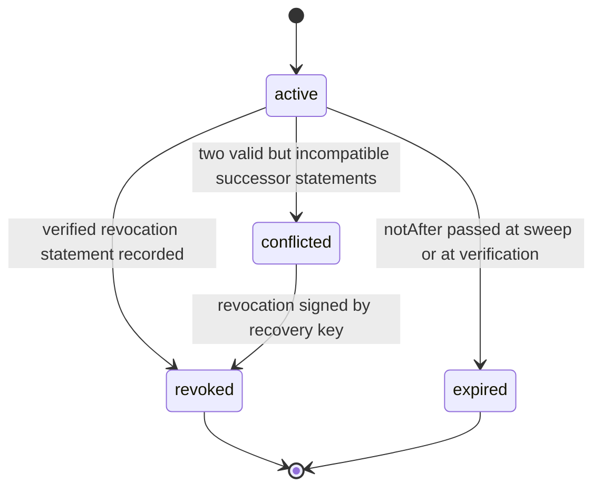

# PS-129-03 — Workflow state machine: Key registry and revocation

**Status:** SPECIFIED (Stage 3). **Module:** [F16.S02.M02 Key registry and revocation](SPEC.md) · **Scope:** MVP · **Code:** `packages/security/src/cryptography/management` · **Contracts:** [CTR-ID-001](../../../planning/contracts/CTR-ID-001.md), [CTR-EVT-001](../../../planning/contracts/CTR-EVT-001.md), [CTR-ERR-001](../../../planning/contracts/CTR-ERR-001.md), [CTR-IDM-001](../../../planning/contracts/CTR-IDM-001.md), [CTR-PRV-001](../../../planning/contracts/CTR-PRV-001.md), [CTR-FED-001](../../../planning/contracts/CTR-FED-001.md), [CTR-CAP-001](../../../planning/contracts/CTR-CAP-001.md), [CTR-OBS-001](../../../planning/contracts/CTR-OBS-001.md)

> Generated from `module.spec.yaml` by `tools/specgen`. Edit the YAML, then run `pnpm spec:render`.

## Requirements

- **PS-129-03.R01** Key records follow the declared lifecycle, revoked and expired are final, and any other transition is refused with CONFLICT_STATE.
- **PS-129-03.R02** A conflicting pair of successor claims freezes the key as conflicted until the user resolves it by a revocation signed by the recovery key.
- **PS-129-03.R03** Expiry is evaluated at verification time as well as by the sweep, so a missed sweep never extends a key.

## Specification

### KeyRecord lifecycle

Initial **active**; terminal **revoked**, **expired**.

| Transition | Trigger | Guard / effect |
|---|---|---|
| active -> revoked | verified revocation statement recorded | revokedAt set from store clock; emits security.key.revoked |
| active -> expired | notAfter passed at sweep or at verification | no event beyond local status |
| active -> conflicted | two valid but incompatible successor statements | key frozen; verifiers return conflicted |
| conflicted -> revoked | revocation signed by recovery key | emits security.key.revoked |

### Timeouts and scheduled transitions

- Expiry sweep every 5 minutes on a relay and on app start plus hourly while open in a vault.
- Revocation list poll every 5 minutes for relays and peers, and at most hourly in a vault while open; freshness older than 24 hours shows 'not recently checked' and older than 7 days shows unknown.

## Verification

| Test | Level | Covers | Scenario | Expected |
|---|---|---|---|---|
| TEST-PS-129-09.T03 | property | PS-129-01.R03, PS-129-03.R01 | random sequences of register, revoke, expire, conflict resolution | revoked and expired never change; revoked never returns to active |
| TEST-PS-129-09.T04 | integration | PS-129-03.R03, PS-129-06.R03 | expiry sweep missed; revocation arrives before key | verification denies expired key; pending revocation applied when key appears |
| TEST-PS-129-09.T05 | integration | PS-129-03.R02 | two valid successor statements for K1 | status conflicted; revocation by recovery key resolves |

## Dependencies

Module depends on: F16.S01.M01, CTR-ID-001, CTR-EVT-001, CTR-ERR-001, CTR-IDM-001, CTR-PRV-001, CTR-FED-001, CTR-CAP-001, CTR-OBS-001. Predecessor: [domain_schema.md](domain_schema.md).
